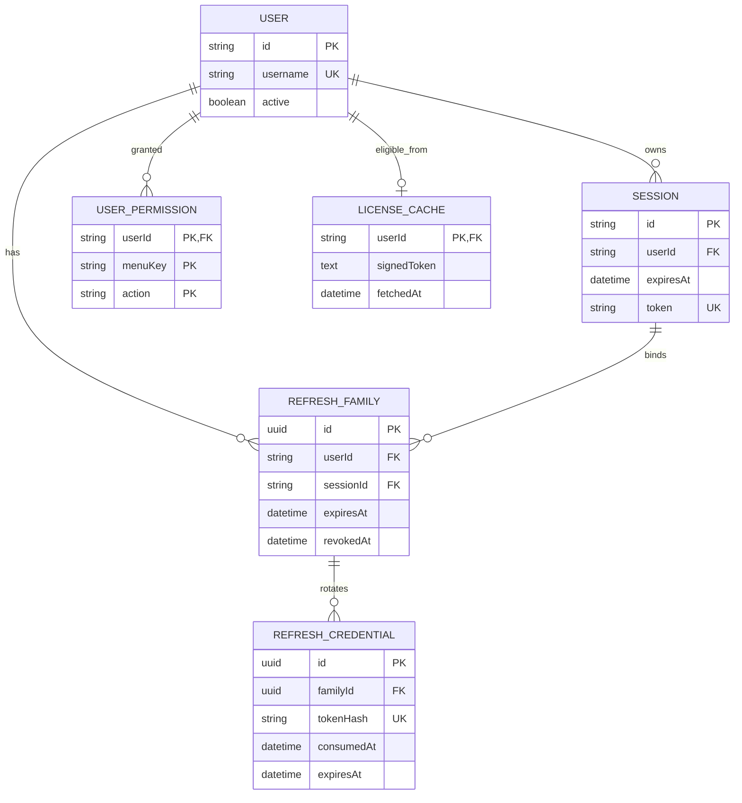
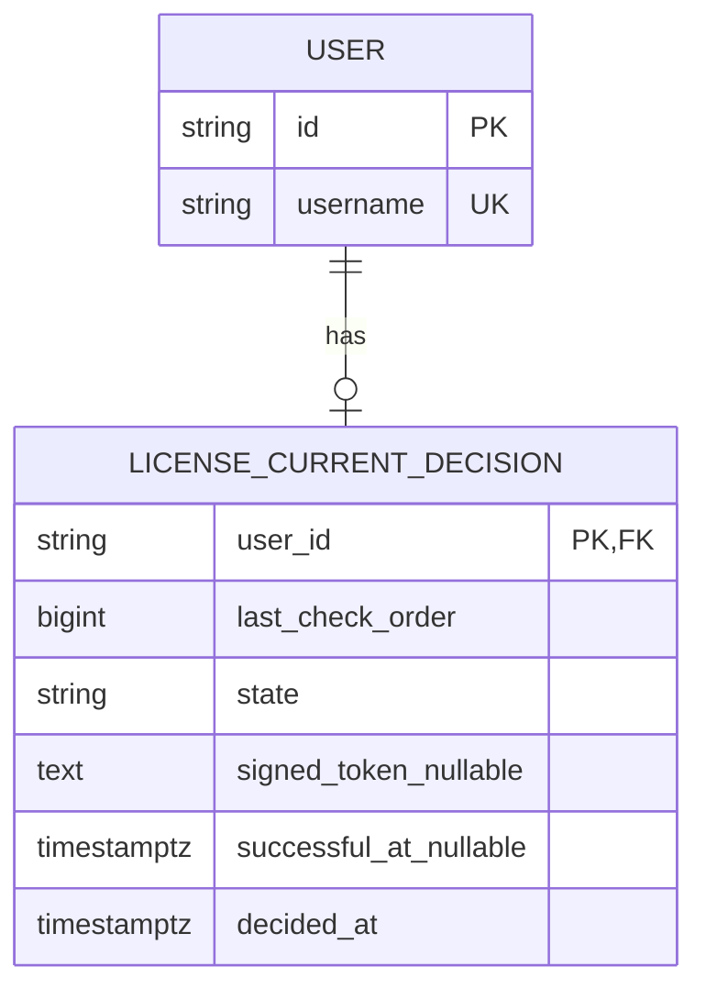

# Database diagram: auth / GMS platform migration

- SA revision: 1, approved-design; see central TODO gates; owner/schema: `api-auth` / `auth`
- Actual source: `backend-api-auth/prisma/schema.prisma`; new entities/views below are **proposed**

Current User, Session, UserPermission and LicenseCache are real Prisma models; refresh tables and `auth.current_authorization` read-only view are proposed. View projects `user_id`, `session_id`, current active/expiry, bounded action grants/location keys and eligibility from a verified cache-derived state. It must **not** expose opaque session token, signed license token, refresh hashes or other personal data. The auth app role writes its own tables; master/inventory app roles receive SELECT on this specific view, never base tables. View predicate indexes use existing Session token/id/user and UserPermission composite PK; add indexes only after query plan review. No cross-schema foreign key.

Expand with versioned auth migration, backfill no refresh tokens (existing sessions use old path until new sign-in/explicit safe exchange), compare eligibility/grants with existing session-context, then cut over. Retain additive tables/view for rollback; contract old path after observed compatibility. Refresh raw token exists only in the cookie response, hash at rest. License cache's token remains signed license-server material, not a user access token. Exact view DDL/security mode and refresh uniqueness/cleanup SQL require backend/SA implementation review before migration.

## License decision ordering — SA revision 3 approved and staged

This additive migration addresses [INV-20261020-001](../../../../task/investigation/INV-20261020-001-gms-license-v2-cache-order.md). Existing `LICENSE_CACHE` remains for v1 rollback; no v1 positive row is copied into the new table. The new sequence/table applied successfully in an isolated PostgreSQL 18.6 test container; no live database migration was run.

`auth.LicenseCurrentCheckOrder` is a PostgreSQL bigint sequence allocated before each online call. `last_check_order` is compared atomically on write across app replicas. `state` is `ACTIVE` or `DENIED`; a check constraint requires token and `successful_at` exactly for `ACTIVE`. The user FK cascades on delete. Primary key bounds storage to one row/user. Only auth writes this table; domain services never see the token. Expand first, leave inert on rollback, and contract only after a separately approved observation period. No new package or container.
