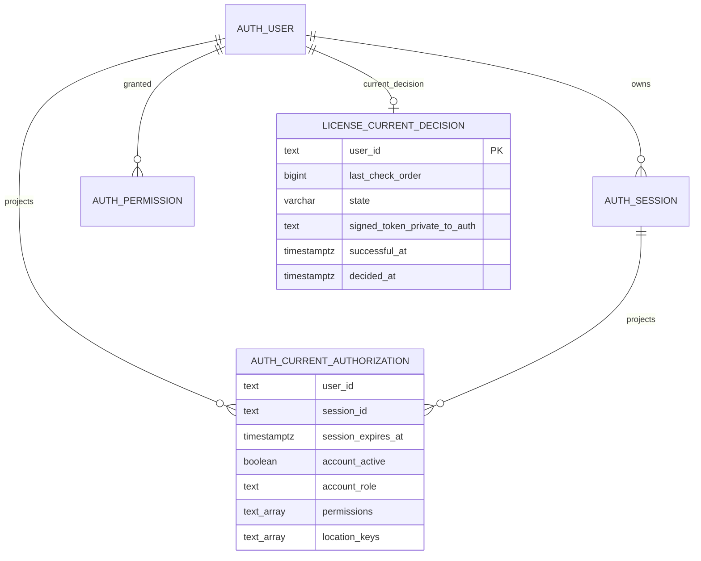

# Database boundary: auth current authorization/license

- Source / SA revision: `INV-20261021-006-r1` / 1; approved for implementation (2026-10-21)
- Owner/schema: auth service / `auth`; actual schema and migration: `backend-api-auth/prisma/schema.prisma`, `backend-api-auth/prisma/migrations/20261021090000_gms_refresh_and_current_authorization/migration.sql`.

No table or view change is proposed. Reuse existing `auth.current_authorization`, `auth.User`, `auth.Session` and `auth.LicenseCurrentDecision`; see [approved auth ER](../database-diagram.md) and [master ER](../../../master/gms-platform/database-diagram.md).

The master runtime login receives `CONNECT` on the database, `USAGE` on `auth`, and `SELECT` on exactly `auth.current_authorization`; it receives no auth base-table, sequence, function, insert/update/delete, create, or ownership rights. Existing partner domain access is retained with explicit `USAGE ON SCHEMA partner` and `SELECT, INSERT, UPDATE, DELETE` on the four existing models used by this slice: `partner.customer`, `partner.customer_address`, `partner.vendor`, `partner.vendor_address`. It receives no `stone` access, migration-table access, schema `CREATE`, ownership, or sequence privileges (IDs are UUID-generated by the application/database defaults already in the schema). Use a dedicated non-owner login role with no inherited membership or superuser/bypass-RLS attributes.

Provision this login through a backend-owned, additive/reversible migration or deployment provisioning script after identifying the actual schema owner and current existing grants. Grant exact listed object privileges; set exact default privileges for future objects only if created by the same owning/migration role and only for the listed tables. Do not grant broad `ALL TABLES`, `ALL SEQUENCES`, or `auth` schema defaults. Preserve current owner/migration-role privileges and existing rows. Rollback revokes the dedicated role's grants and disables its credential; it does not drop schemas/data. Acceptance must run `has_table_privilege`, `has_schema_privilege`, and negative checks against base tables, other auth tables, `stone`, `_prisma_migrations`, functions and sequences using the actual master login.
