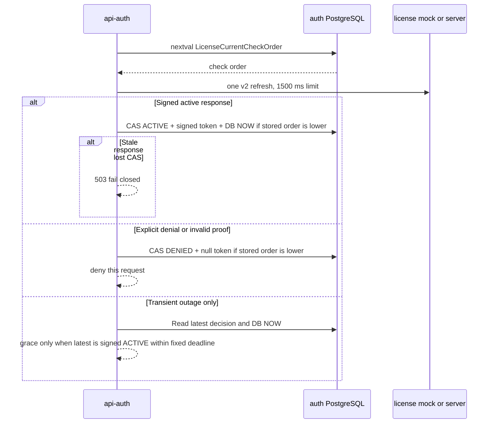

# Sequence diagram: auth / GMS platform migration

- SA revision: 1, approved-design; see central TODO gates; source UI revision: none
- Main flow: [GMS request](../../../../diagram/gms-platform-request-flow.md); TODO: GP-AUTH-01..06

```mermaid
sequenceDiagram
    actor U as Browser user
    participant N as Nginx same origin
    participant A as api-auth Better Auth
    participant D as auth PostgreSQL
    participant L as license-server
    participant M as protected domain API
    U->>N: POST /api/auth/sign-in/username + CSRF evidence
    N->>A: Trusted forwarded request
    A->>D: Check password, lockout, session, grants
    A->>D: Read signed license cache
    A->>L: Check current signed license status for sign-in
    alt Transient outage with eligible signed result inside configured grace
      A->>D: Check fixed last-success time and signed expiry
    else No eligible fallback or grace is zero
      A-->>U: 503; no access token
    end
    alt Disabled, unlicensed or invalid request
      A-->>N: 401/403 or activation state; no access JWT
      N-->>U: Login/activation outcome
    else Eligible
      A->>D: Transaction: session and hashed refresh family
      A-->>N: Better Auth cookie + access JWT + refresh cookie
      N-->>U: Secure HttpOnly cookies
    end
    U->>N: POST /api/auth/refresh + CSRF evidence
    N->>A: Refresh cookie
    A->>D: Atomic consume old hash, check live account/session/license, write successor
    alt Reuse, expired, unavailable or denied
      A->>D: Revoke family where supported
      A-->>U: 401/403/503; clear applicable cookies
    else Rotated
      A-->>U: New access and refresh cookies
    end
    M->>M: Verify access JWT and live local auth view
    M->>A: Private license-current with service credential
    A->>L: Bounded online status check; validate signed result
    alt Revoked
      A-->>M: 403; deny this request
    else Transient outage and eligible result inside configured grace
      A-->>M: Eligible fallback with bounded fallbackUntil
    else No eligible fallback or invalid signature
      A-->>M: 503; deny this request
    else Eligible
      A-->>M: Current eligible decision
    end
```

The protected-request license check is an approved design exception to GMS §2 and revises ADR-0013's offline grace to a configurable 0–2 days, default 2, under the separately approved three-day-token license contract revision 2. A verified revoked/expired result never uses fallback; transient failures never extend the last-success timestamp. External license-server implementation and capacity verification are still required before GP-AUTH-05 route cutover. Better Auth/session and custom refresh transaction integration needs a version-locked prototype before implementation.

## Concurrent decision ordering — SA revision 3 approved and staged



The database connection is released before the remote call; a slow earlier response cannot overwrite a later decision. The private endpoint must authenticate the service caller and bind user ID to the immutable subject from the auth database. The external server remains a separate repository; local development uses the existing mock v2 response.
