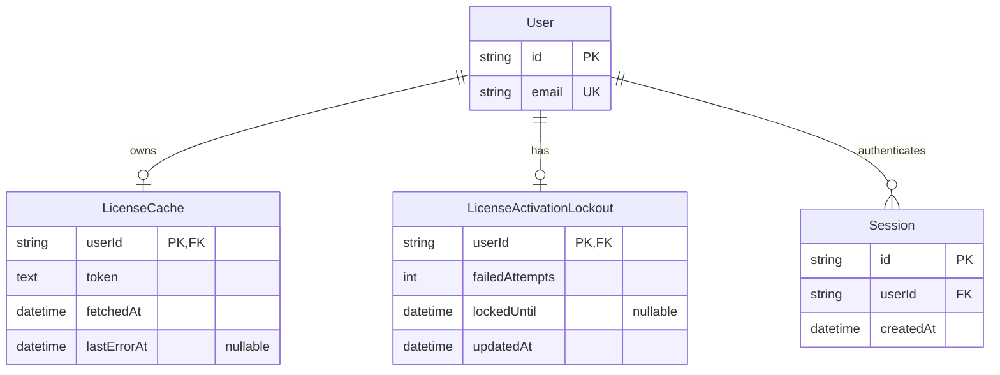

# Database diagram: auth license cache

- Source UI revision / SA revision: none / `auth-license` revision 2
- Owning service / schema: `backend-api-auth` / PostgreSQL `auth`
- Proposed Prisma path: `backend-api-auth/prisma/schema.prisma`
- Status: approved design; additive migration implemented at `backend-api-auth/prisma/migrations/20261011000000_auth_license_cache_lockout/migration.sql`

## Constraints and lifecycle

- `userId` is the primary key and FK to `auth.User.id`, `onDelete: Cascade`; exactly zero or
  one cached license token per local user. No raw activation key, email copy, upstream
  response, or personal license list is stored.
- `token` is a signed compact JWT (`TEXT`); token contents remain untrusted until verified.
  `fetchedAt` is UTC and is the origin for the approved outage grace interval. `lastErrorAt`
  is nullable telemetry only; it does not change license state by itself.
- Existing User email is unique. The signed `sub` must match normalized current email; a
  mismatch fails closed. A licensed account email is immutable. A different email requires a
  new account and separately issued license; no transfer state or email history is stored.
- `LicenseActivationLockout.userId` PK/FK provides one atomic bucket/user. Failed attempts
  update under transaction/row lock; at 3 set `lockedUntil=now+1 minute`; successful
  activation resets. No key or raw email stored in the lockout row.
- Single-session policy uses existing `auth.Session`: serialize successful sign-ins by user
  in PostgreSQL, keep newest `createdAt` row, invalidate all others. Resolve timestamp ties
  with stable session ID ordering.
- PK supports bounded lookup by user ID; no additional index required. Cache size is at most
  one row per user. Do not query the external license system for each protected procedure.

## Migration, compatibility and rollback

Additive tables and constraints only; no backfill. Apply migration before deploying auth
code. Old versions ignore the added tables. No transfer records or cross-schema query is
introduced; gateway has no direct DB access.
