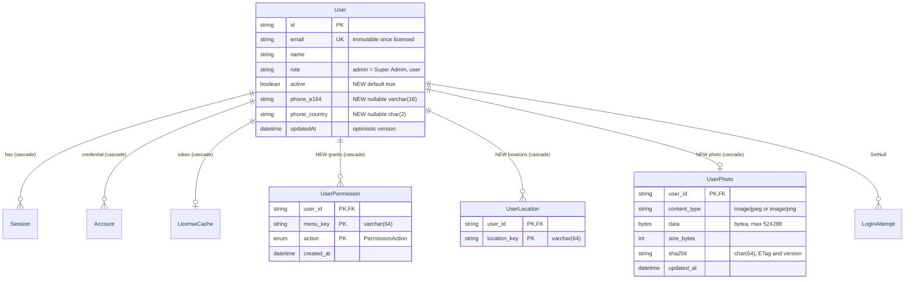

# Database diagram: auth / user-permission

- Source UI revision / SA revision: 1 / 1 (pending-review; **proposal**, no migration written)
- Owning service / schema: `backend-api-auth` / PostgreSQL `auth`
- Actual Prisma schema / migration paths: `backend-api-auth/prisma/schema.prisma`; new migration `backend-api-auth/prisma/migrations/2026101x000000_user_permission/` (name chosen by backend; integration-owned, parent serializes)

Existing entities (unchanged): `Session`, `Account`, `LicenseCache`, `LicenseActivationLockout`,
`LoginAttempt`, `LoginLockout`, `Verification`, `RateLimit`. Proposed changes are marked **NEW**.



## Prisma proposal

```prisma
enum PermissionAction {
  VIEW
  ADD
  EDIT
  DELETE
  CANCEL
  PRICE
  @@schema("auth")
}

model User {
  // existing fields unchanged …
  active        Boolean          @default(true)
  phoneE164     String?          @map("phone_e164") @db.VarChar(16)
  phoneCountry  String?          @map("phone_country") @db.Char(2)
  permissions   UserPermission[]
  locations     UserLocation[]
  photo         UserPhoto?
  @@index([role, createdAt])
  @@schema("auth")
}

model UserPermission {
  userId    String           @map("user_id")
  menuKey   String           @map("menu_key") @db.VarChar(64)
  action    PermissionAction
  createdAt DateTime         @default(now()) @map("created_at")
  user      User             @relation(fields: [userId], references: [id], onDelete: Cascade)
  @@id([userId, menuKey, action])
  @@schema("auth")
}

model UserLocation {
  userId      String @map("user_id")
  locationKey String @map("location_key") @db.VarChar(64)
  user        User   @relation(fields: [userId], references: [id], onDelete: Cascade)
  @@id([userId, locationKey])
  @@schema("auth")
}

model UserPhoto {
  userId      String   @id @map("user_id")
  contentType String   @map("content_type") @db.VarChar(16)
  data        Bytes
  sizeBytes   Int      @map("size_bytes")
  sha256      String   @db.Char(64)
  updatedAt   DateTime @updatedAt @map("updated_at")
  user        User     @relation(fields: [userId], references: [id], onDelete: Cascade)
  @@schema("auth")
}
```

The migration adds raw SQL checks that Prisma cannot express:
`CHECK (size_bytes BETWEEN 1 AND 524288 AND octet_length(data) = size_bytes)`,
`CHECK (content_type IN ('image/jpeg','image/png'))`,
`CHECK (phone_e164 IS NULL OR phone_e164 ~ '^\+[1-9][0-9]{6,14}$')`,
`CHECK (phone_country IS NULL OR phone_country ~ '^[A-Z]{2}$')`.
The `menu_key` and `location_key` checks are `~ '^[a-z0-9-]{1,64}$'`. Catalog membership is
validated in code, not by FK, because the catalog is a code constant.

## Constraints, indexes, bounds

- Composite PKs give a single index for "grants of user X" (PK prefix `user_id`), which is the
  hot path on every tRPC request. No extra index is needed.
- `@@index([role, createdAt])` supports the seat count (`role='user'`) and list ordering.
  The table is tiny, so this is optional; it is kept for predictable plans.
- At most 384 grant rows and 20 location rows per user, enforced in code. At most one photo
  per user, ≤ 512 KiB.
- Timestamps are `timestamp(3)` UTC as existing. No money/decimal fields.
- No cross-schema FK. A future Location master service will own its own schema. Moving
  `location_key` to real IDs will be a backfill in a later revision.

## Migration, backfill, compatibility, rollback

1. **Additive only:** a new enum, three new tables, three new nullable/defaulted columns, one
   index and the CHECK constraints. `ADD COLUMN active boolean NOT NULL DEFAULT true` is a
   metadata-only change on PostgreSQL 18, with no table rewrite.
2. **Backfill:** none. Existing users become `active=true` with no phone. No grants are
   created; Super Admins (`role='admin'`) have implicit ALL. Existing `role='user'` accounts
   (dev seed demo user) see no menus until granted. The dev seed (`src/scripts/seed.ts`)
   grants the demo user VIEW on all catalog leaves (development only).
3. **Order:** migrate → auth → gateway → frontend. Old auth/gateway ignore the new columns
   and tables.
4. **Rollback:** redeploy previous images and keep the schema. Data in the new tables is
   ignored, and deactivated users regain sign-in on old images (release note). To remove,
   add a forward migration dropping the tables and columns; Prisma has no down migrations.
5. Better Auth: add `active` to `user.additionalFields` (`type:"boolean"`, `defaultValue:true`,
   `input:false`) so the adapter selects it. Run `prisma generate`; never hand-edit generated
   output.
