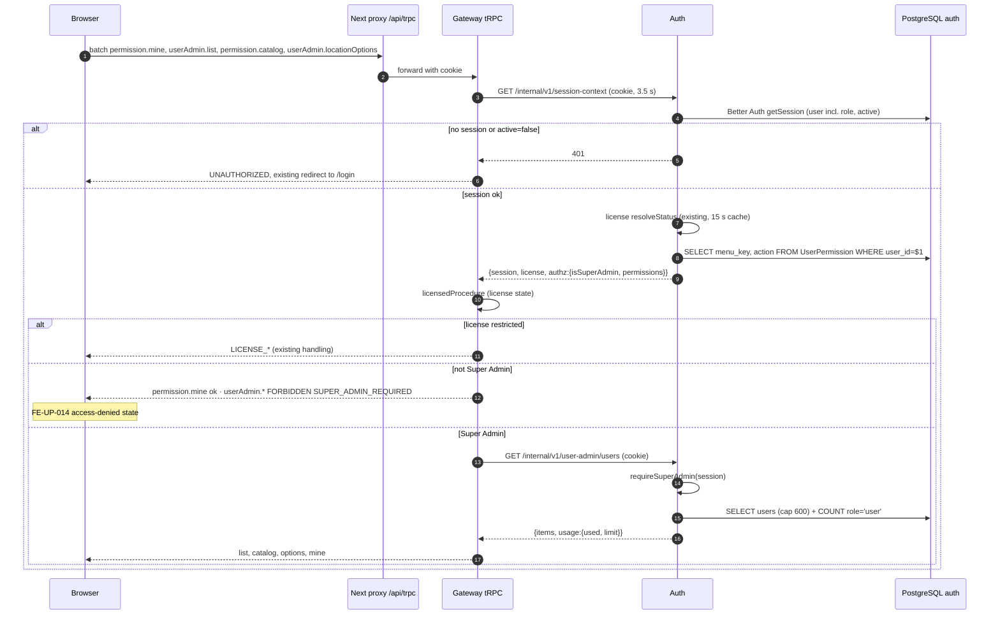
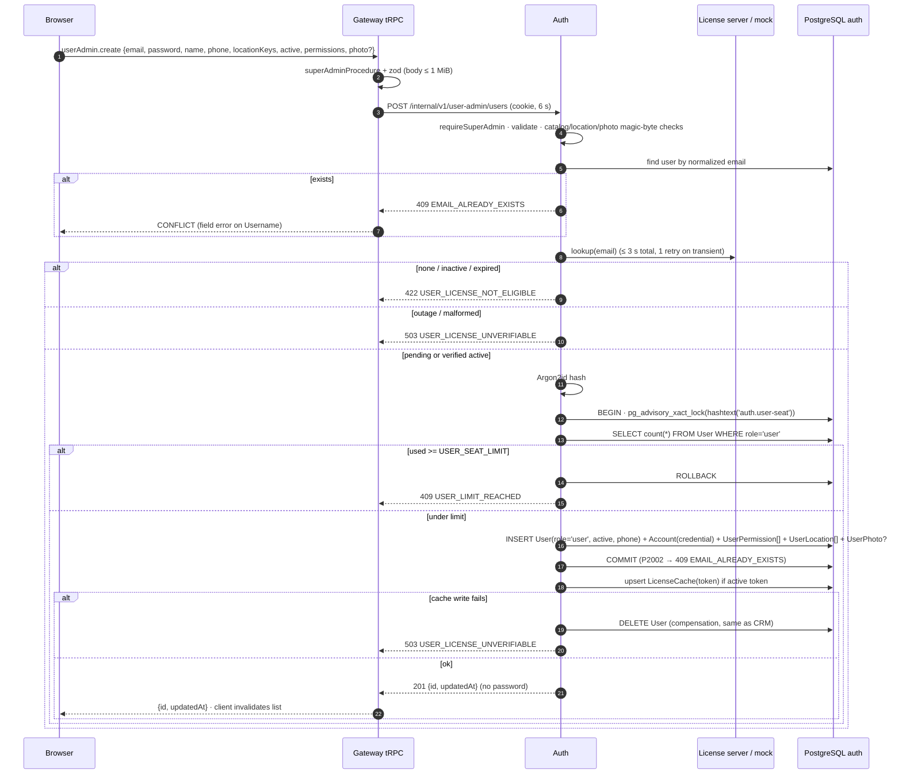
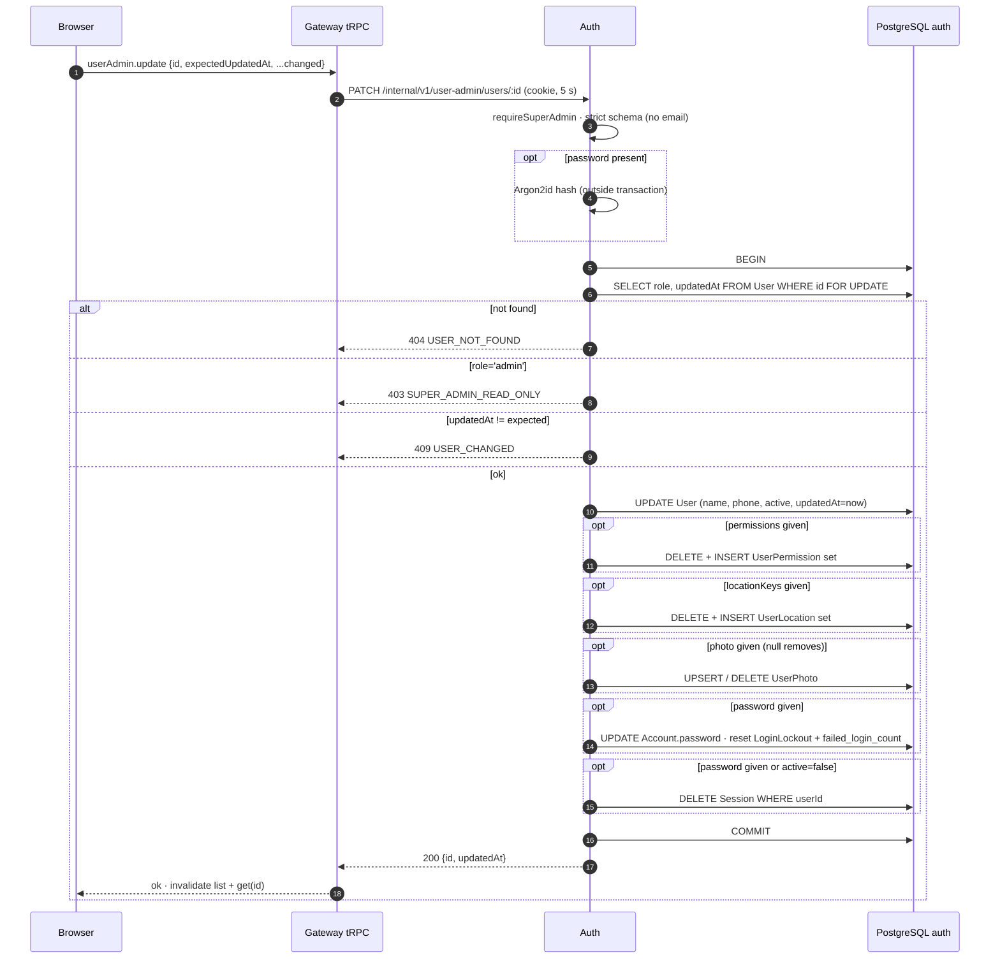
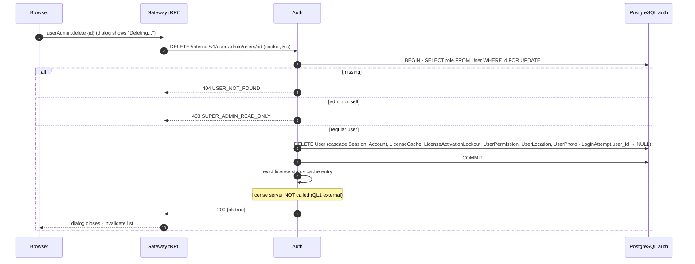
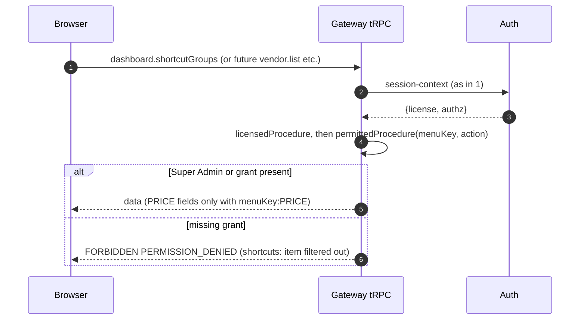
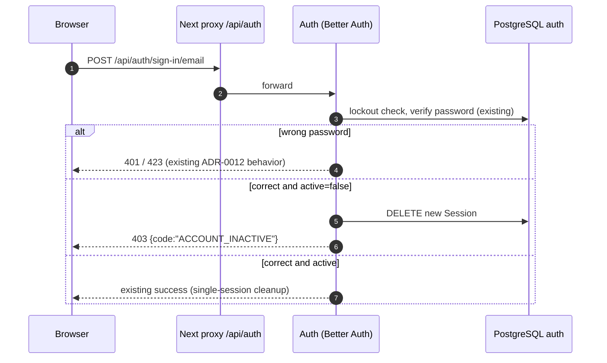
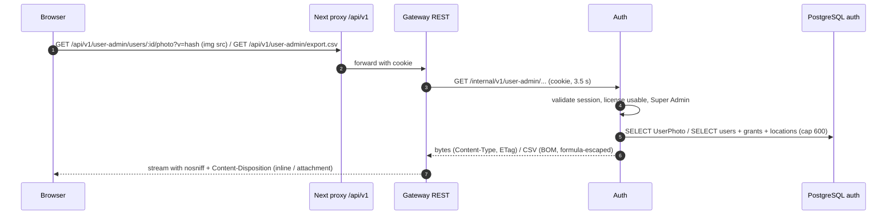

# Sequence diagram: auth + gateway / user-permission

- Source UI revision / SA revision: 1 / 1 (pending-review)
- Main user flow: [user-permission-flow.md](../../../../diagram/user-permission-flow.md)
- Related API operations / TODO IDs: [API contract](api-contract.md); BE-UP-001…014; FE-UP-007, 009, 012, 013, 014
- Participants: Browser (Next.js page) → Next proxy (`/api/trpc`, `/api/v1`) → Gateway (NestJS + tRPC) → Auth (NestJS, Better Auth) → PostgreSQL schema `auth`; License server (remote) or MockLicenseClient (dev)

## 1. Page load, context and guard

## 2. Create user

## 3. Update (permissions, profile, password reset, deactivate)

## 4. Delete

## 5. Enforcement on a menu procedure (current and future features)

## 6. Inactive user signs in

## 7. Photo download and CSV export

The REST routes do not pass through tRPC middleware, so gateway first resolves the same
session context and applies the same license + Super Admin checks before forwarding.
