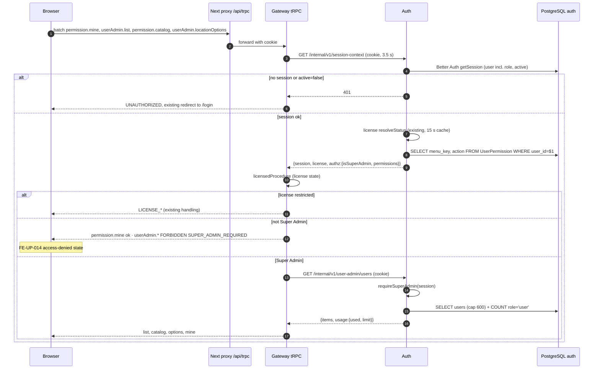
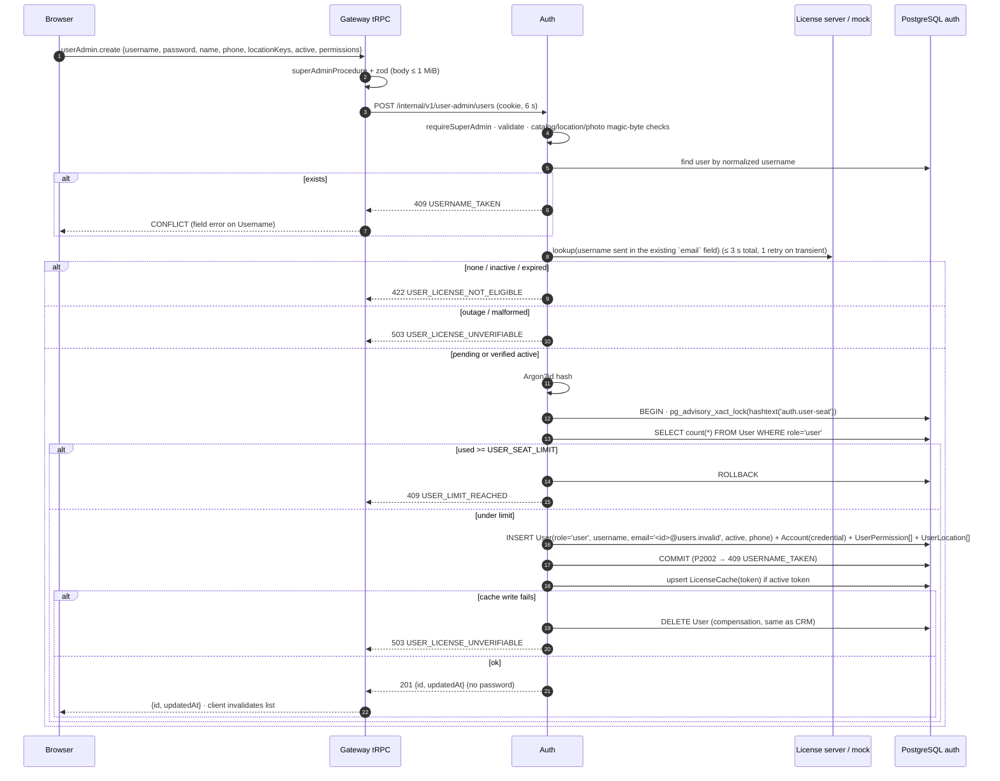
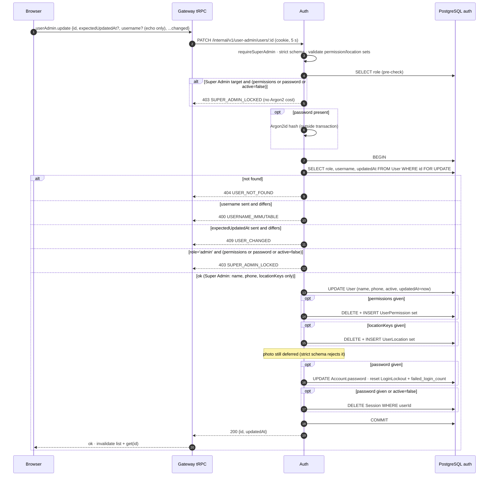
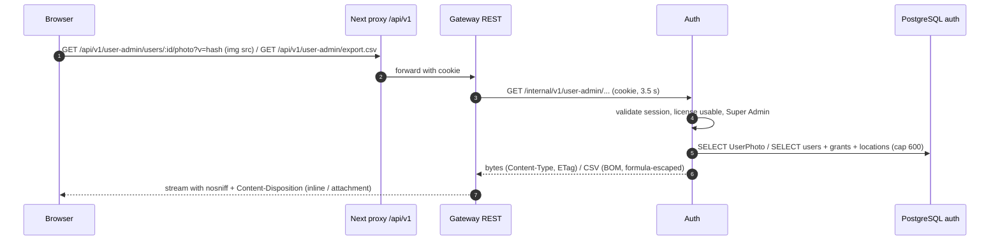

# Sequence diagram: auth + gateway / user-permission

- Source UI revision / SA revision: 2 / 2 (**implemented**; [ADR-0020](../../../../adr/0020-username-login-and-permission-matrix-v2.md) revision 1 Accepted 2026-10-15, owner "frontend backend อนุมัติ ADR-0020"). Revision 1 content below is kept where unchanged; revision 2 notes override it.
- Main user flow: [user-permission-flow.md](../../../../diagram/user-permission-flow.md)
- Related API operations / TODO IDs: [API contract](api-contract.md); BE-UP-001…014; FE-UP-007, 009, 012, 013, 014
- Participants: Browser (Next.js page) → Next proxy (`/api/trpc`, `/api/v1`) → Gateway (NestJS + tRPC) → Auth (NestJS, Better Auth) → PostgreSQL schema `auth`; License server (remote) or MockLicenseClient (dev)

## 1. Page load, context and guard



## 2. Create user



## 3. Update (permissions, profile, password reset, deactivate)



## 4. Delete


## 5. Enforcement on a menu procedure (current and future features)

```mermaid
sequenceDiagram
    autonumber
    participant B as Browser
    participant G as Gateway tRPC
    participant A as Auth
    B->>G: dashboard.shortcutGroups (or customer.*, vendor.*)
    G->>A: session-context (as in 1)
    A-->>G: {license, authz}
    G->>G: licensedProcedure, then permittedProcedure(menuKey, action)
    alt Super Admin or grant present
        G-->>B: data (PRICE fields only with menuKey:PRICE)
    else missing grant
        G-->>B: FORBIDDEN PERMISSION_DENIED (shortcuts: no dashboard:VIEW → []; item without slug:VIEW filtered out)
    end
```

## 6. Sign-in with username (ADR-0020) and inactive users

```mermaid
sequenceDiagram
    autonumber
    participant B as Browser
    participant P as Next proxy /api/auth
    participant A as Auth (Better Auth)
    participant DB as PostgreSQL auth
    B->>P: POST /api/auth/sign-in/username {username, password, rememberMe?}
    P->>A: forward (rate limit 5/min/IP on this path; /sign-in/email → 404)
    A->>A: normalize username (trim + lowercase)
    A->>DB: lockout check by HMAC(username) (ADR-0012)
    alt locked
        A-->>B: 423 {code:"ACCOUNT_LOCKED", retryAfterSeconds}
    end
    A->>DB: find user by username, verify Argon2id password
    alt wrong password, unknown or impossible username (Better Auth 401/422)
        A->>DB: increment LoginLockout bucket
        A-->>B: 401 {code:"INVALID_USERNAME_OR_PASSWORD", attemptsRemaining} or 423 on the 3rd failure
    else correct and active=false
        A->>DB: DELETE new Session (cookie expired)
        A-->>B: 403 {code:"ACCOUNT_INACTIVE"}
    else correct and active
        A-->>B: existing success (single-session cleanup)
    end
```

## 7. Photo download and CSV export



The REST routes do not pass through tRPC middleware, so gateway first resolves the same
session context and applies the same license + Super Admin checks before forwarding.
