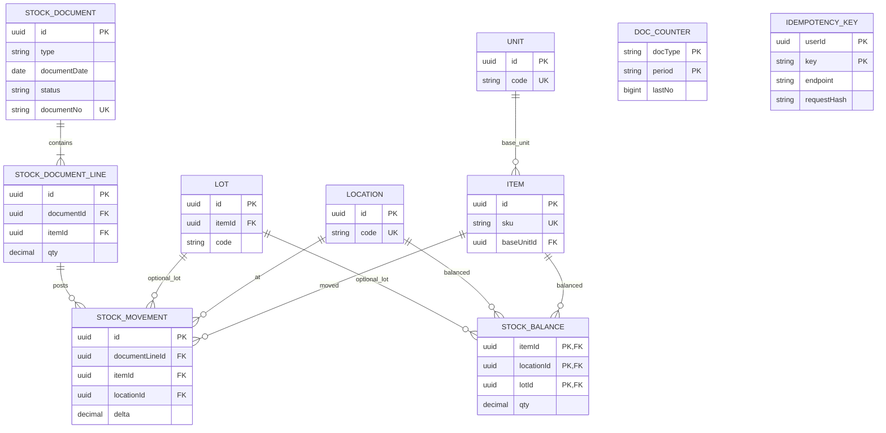

# Database diagram: inventory / GMS platform migration

- SA revision 1, approved-design; see central TODO gates; proposed owner/schema: `api-inventory` / `inventory`
- Actual source: **none** in this checkout; PostgreSQL 16+ portable migration proposed. [Spec §4 and Appendix E](../../../../gms-platform-spec.md)

`stock_movements` append-only. `stock_balances` uses `UNIQUE NULLS NOT DISTINCT(item_id,location_id,lot_id)` (nullable lot), `CHECK(qty>=0)`; use `numeric(18,4)` quantities and money-specific numeric scales. `doc_counters(type,period)` and `idempotency_keys(user,key)` composite PK; response/status stored, purge after 24 h. Add indexes on every list/filter key, document status/date, movement item/location/date and idempotency createdAt. `stored_files` and `jobs` metadata are **later proposed** additions when selected file/job feature is approved; do not create them for empty workflows. UUIDv7 generated by app, `gen_random_uuid()` fallback. Timestamps `timestamptz`; business period Asia/Bangkok. No cross-schema FKs; external master/user IDs validated through contracts.

Migration: create inventory schema/roles with one-off additive migration, validate unique/check/index and DB16/18 compatibility, then enable first selected API route. No backfill from current code because inventory tables do not exist. Rollback disables route/returns to previous image but preserves posted records; destructive rollback needs explicit data recovery decision. Stock corrections append offsetting movements, never edit history.
