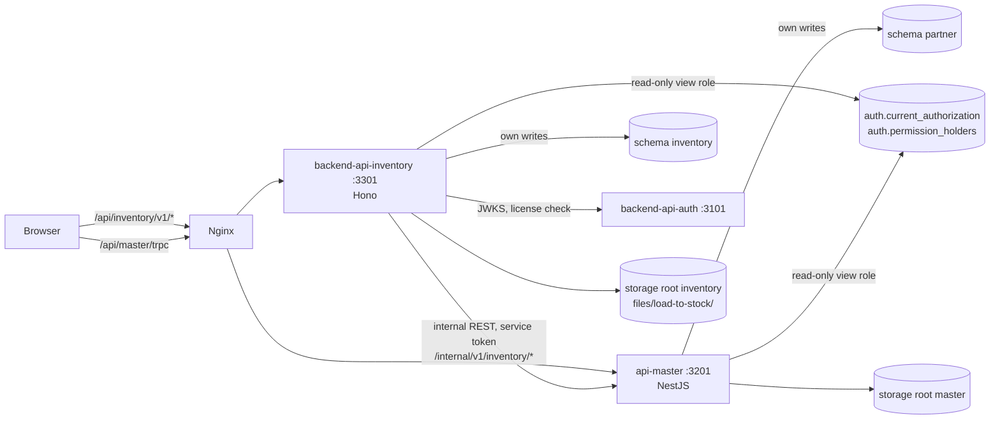

# Service architecture: inventory / load-to-stock

- Feature ID / SA revision: `load-to-stock` / **1** — status **pending-review** (not approved)
- Source UI revision / TODO: UI rev 1 (draft) + owner answers 2026-11-16 / [load-to-stock.md](../../../../task/todo/load-to-stock.md) (BE-LS-*)
- ADR / main flow / review bundle: [ADR-0052](../../../../adr/0052-load-to-stock-in-backend-api-inventory.md), [load-to-stock-flow](../../../../diagram/load-to-stock-flow.md), [decisions](decisions.md), [api-contract](api-contract.md), [authorization](authorization.md), [database-diagram](database-diagram.md), [sequence-diagram](sequence-diagram.md), [error-handling](error-handling.md), [dependencies](dependencies.md), [testing](testing.md), [infra/devops requirement](../../../../coordination/handoffs/load-to-stock-infra-devops.md)

## Domain and service boundaries

| Owner | Owns (writes) | Reads from others |
|---|---|---|
| `backend-api-inventory` (new) | schema `inventory`: Load to Stock documents, own stock, movements, inventory approval settings, inventory notifications, inventory stored files | master internal API (Purchase lines, numbering, stone options, PU photos, allocation); auth view (read-only role); auth JWKS + license |
| `api-master` (changed) | schema `partner`: Purchase incl. new `loaded_*`, allocation ledger, Stock ID counter + `load_stock_id`, Document Setup incl. `external_used_at`; **Location Master** (other branch) | nothing from inventory (no call from master to inventory) |
| `backend-api-auth` (changed) | auth schema; grants a second reader role; accepts the inventory license token | — |

**Module map inside `backend-api-inventory`** (owner-selected scope). Each module owns its tables in schema `inventory` and exposes a TypeScript service interface; no module writes another module's tables.

| Module | Status | Tables | Cross-module / cross-service |
|---|---|---|---|
| `load-to-stock` | this revision | `load_to_stock*`, `stock`, `stock_photo`, `stock_movement` (owner of stock creation) | master allocation, numbering, reference + `master-data/resolve` (stone codes, locations) |
| `approval` (platform) | this revision | `approval_setting`, approve-center queries per registered type | each document module registers its approve/revise/reject handler |
| `notification` (platform) | this revision | `notification_event`, `notification_recipient` | auth `permission_holders` |
| `merge-split`, `stock-transfer`, `stock-adjustment`, `barcode` | later | own document tables; write `stock`/`stock_movement` only through the `stock` service interface of `load-to-stock`'s stock component, which sets `first_used_at` | — |
| `sale`, `account-outstanding` | later | own tables | Sale consumes stock via the stock interface; master data via master internal API |
| `reports` (Stock Movement, Closing Stock, Sale Report) | later | none (read-only, bounded, keyset ≤ 200, report role) | reads inventory tables only; master names via snapshots |

The `stock` component (tables `stock`, `stock_photo`, `stock_movement`, `stock_hold`) is a separate folder `src/modules/stock/` from day one so later modules depend on its interface, not on Load to Stock. It owns the buckets (on_hand, reserved, memo_out, sold, consumed) and the in-use rule `on_hand_pcs <> pcs OR on_hand_weight_ct <> weight_ct` (ADR-0052 D9/D15).

**From Stock for master documents (owner Q-LS-30, ADR-0052 D15, phased).** Phase 1 ships the stock buckets/holds schema only. Phase 2a: browser reads own stock from `GET /api/inventory/v1/stock/available` beside the Memo Stock list (Quotation, copy only). Phase 2b: master Reserve / Memo Out / Memo Out Return call inventory `PUT /internal/v1/master/stock-holds/{documentType}/{documentId}` (set semantics + revision + hash, mirror of the allocation saga) with their own `partner.inventory_sync_op` and sweep; inventory locks the stock rows `FOR UPDATE` in id order, guards the buckets, writes `stock_hold` + movements. Load edit/delete and a hold lock the same stock rows inside inventory, so they serialize locally. Boundary cost: one saga per stock-moving document type in each direction (Q-LS-36).

## Behaviour and operation

### Read paths

- `GET /load-to-stock/purchase-lines/search` (picker) → one master internal call (`POST …/purchase-lines/loadable/search`, keyset ≤ 50) → the frontend gets PU number/date, rate, stone attributes, price unit, net unit price, remaining pcs/weight, company-currency amount of the remaining, photo count. Master runs one page query (`LIMIT limit+1`) on the partial "loadable" index joined to `purchase` (approved, not deleted, vendor, doc date range) and one bounded count. Excludes `excludeLineIds` (≤ 200, the lines already on the document).
- `GET /load-to-stock/:id` → ≤ 3 inventory queries (header; sources + rows + row_sources + photo ids in two batched `IN` queries) + **one** master call `POST …/purchase-lines/batch` for all source line ids (current remaining excluding this load's own allocation, for the Item table and editing limits). `inUse` = `EXISTS stock WHERE load_id = $1 AND first_used_at IS NOT NULL`.
- Lists and Daybook: one keyset query (≤ 51 rows) + no per-row lookups (`vendor_name_snapshot` on the header).

### Write paths (approval read `FOR SHARE` in each)

| Action | Approval ON | Approval OFF |
|---|---|---|
| Create | tx: validate, resolve numbering (master call **before** tx), insert DRAFT + sources + rows + photos; nothing applied | saga: tx0 insert as provisional `APPROVED` with `sync_state=SYNCING` + op → master PUT (rev 1) → tx1 create stocks, `auto_approved=true`, `IDLE`. Business refusal → tx1' hard-deletes the provisional rows (never visible: lists filter `provisional`) |
| Update | DRAFT / REVISION_REQUESTED only; tx replace sources/rows | auto-approved and not used: saga with the new set (rev n+1); rows keep ids → stocks keep Stock IDs; removed rows reverse; new rows get new IDs |
| Submit | DRAFT/REVISION → PENDING_APPROVAL; validates against current remaining (no lock) | refused `LOAD_TO_STOCK_STATUS_INVALID` (nothing to submit) |
| Approve / Revise / Reject | Approve: guarded PENDING → `sync_state=SYNCING` + op → master PUT → tx1 APPROVED + stocks + notification. Revise (once) / Reject: one guarded update + notification | — |
| Delete | DRAFT / REVISION: soft delete, no effects | not used: saga with empty set → tx1 reverse stocks (movement `LOAD_REVERSAL`, stock `REVERSED`), soft delete |
| Restore | not offered (owner Q-LS-33) | not offered |

Validation at Save (server, authoritative): header required fields; 1…200 rows; one vendor; each source a loadable line of that vendor (master batch read, no lock); mode shape rules (SA-LS-09); per source Σ row pcs ≤ remaining pcs and Σ weight ≤ remaining weight (row error path `rows.N.pcs` with `{purchaseLineId, remainingPcs, remainingWeightCt}`); location names and stone code ids are active (one master `master-data/resolve` call; names matched case-insensitively and stored in master's spelling; on update a row may keep its stored name); stock price and sale price present ≥ 0; photos ≤ 5, ready, `source_type` = `load-to-stock.row-photo`. Merge rows: pcs/weight must equal Σ source remaining (server computes and ignores client pcs/weight for MERGE).

### Saga state machine (D4)

`master_sync_op.state`: `PREPARED` → (master OK) `CONFIRMED` → (tx1 commit) `DONE`; or `PREPARED` → (business 409/422) `REFUSED` → (tx1' rollback of intent) `DONE`. Retryable failure (timeout, 5xx, connection) leaves `PREPARED` with `attempts+1`, `next_attempt_at = now + min(2^attempts, 60) s`. Re-drive sends the identical stored payload (hash) and revision. After 10 attempts → `STUCK` (log `inventory.sync_stuck`, document shows "Syncing — contact admin", operator command `pnpm --filter backend-api-inventory sync:redrive <loadId>`). The previous applied revision and stock state are restored only on a definitive business refusal; on uncertainty nothing is guessed.

Recovery triggers: (1) any GET/mutation on a load whose op is `PREPARED`/`CONFIRMED` and older than 15 s re-drives it inline (bounded to that load); (2) start-up sweep; (3) in-process timer every 60 s, ≤ 20 ops, single-flight (no overlap), skipped when the DB pool has < 2 idle connections.

### Logging and audit

`load_to_stock.created|updated|submitted|approved|revision_requested|rejected|deleted|applied|released`, `inventory.sync_retry|sync_stuck`, `{requestId, actorId, id, docNo, version, revision, rowCount, sourceCount}`; never prices, costs, vendor names, notes or tokens. Header columns record created/updated/submitted/reviewed/approved/deleted by + at (and name snapshots from the auth view, ADR-0046 D5). `stock_movement` is the stock audit trail (append-only; app role has INSERT/SELECT only).

### Timeouts, retries, transactions

- Inventory write tx: 4 s timeout, maxWait 2 s (as master `WRITE_TX`). Reads retry once on transient errors; writes are never retried blindly — only the saga re-drive with the stored revision.
- Master internal client: undici keep-alive, ≤ 4 sockets, 5 s total timeout, 1 s connect; no retry for PUT inside the request (re-drive handles it); GET/POST-read retry once.
- Master allocation tx: `WRITE_TX` 4 s; locks: allocation header → purchase headers `FOR SHARE` (id order) → purchase lines `FOR UPDATE` (id order) → Stock ID advisory lock → counter row. Purchase approve/update take purchase header `FOR UPDATE` first, so the two serialize without deadlock (same first lock class).

## Master changes (backend-api-master, additive)

1. Migration `2026111xxxxxxx_load_to_stock_allocation` ([database-diagram](database-diagram.md) part B).
2. `src/inventory-internal/` Nest controller under `/internal/v1/inventory/*`, guarded by a new `InventoryServiceTokenGuard` (file secret `INVENTORY_MASTER_SERVICE_TOKEN_FILE`, constant-time compare); the global `PARTNER_SERVICE_TOKEN` guard does not accept it for other routes and vice versa.
3. `issueStockIds` → takes `pg_advisory_xact_lock(<fixed key>)` and computes `now` after the lock (callers pass a clock function). Memo Receive keeps its behaviour.
4. Purchase update/delete guard `PURCHASE_IN_USE` when any line has loaded > 0 (in the existing engine `prepare`/delete paths, under the header lock).
5. Document Setup "used" check includes `external_used_at IS NOT NULL`.
6. Approval setting: remove `load-to-stock`, `merge-split`, `stock-transfer-location` from `APPROVAL_TYPES`; migration deletes the rows and narrows the CHECK.
7. `purchase.get`/`list` unchanged; the Purchase page may later show "Loaded" (not in scope).

## Capacity and rollout (4 GB / 2 vCPU host, ADR-0024)

| Item | Value |
|---|---|
| Container | 0.20 vCPU, 256 MiB, heap 160 MiB, pids 128, read-only rootfs, tmpfs /tmp 16 MiB |
| DB pools | inventory app max 5 (idle 30 s, connect 2 s); authz reader max 1; master pool unchanged (5) |
| Compose total after | 1.75 vCPU / 2880 MiB (headroom ≈ 0.25 vCPU / 1216 MiB) |
| Apply (200 rows) | inventory: 2 short tx + 1 HTTP call; master: 1 tx with ≤ 200 line locks, ≤ 3 set-based statements, 1 counter upsert; target p95 < 800 ms end to end (measure IT-LS-B12) |
| Picker | keyset 50 on a partial index; one count; no cache |
| Photos | ≤ 3 concurrent uploads/copies, ≤ 6 downloads per process; streamed, ≤ 5 MB each; copy dedupe |
| SSE | ≤ 3 streams/user, ≤ 200/process, ping 25 s, no DB connection held |
| Sweep | 1 timer, ≤ 20 ops/min |
| Expected data | hundreds of loads/month, ≤ 200 rows each; stock rows grow linearly (tens of thousands/year) — keyset indexes only |

Rollout order: infra research → auth (reader role, token) → master migration + internal API → inventory migration + service → infra Compose/nginx/secrets (parent serialized) → devops pipeline → frontend. Rollback: disable nginx `/api/inventory/` and stop the container; master additions are inert defaults. Release applied loads through the API before dropping inventory data. Measurements required before claiming production fit: idle RSS of the built image, RSS and p95 during a 200-row apply, and total host `free -m` with all containers.
