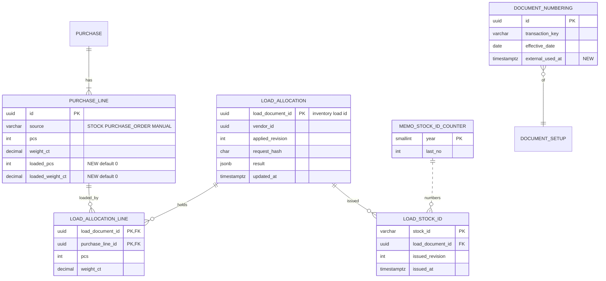
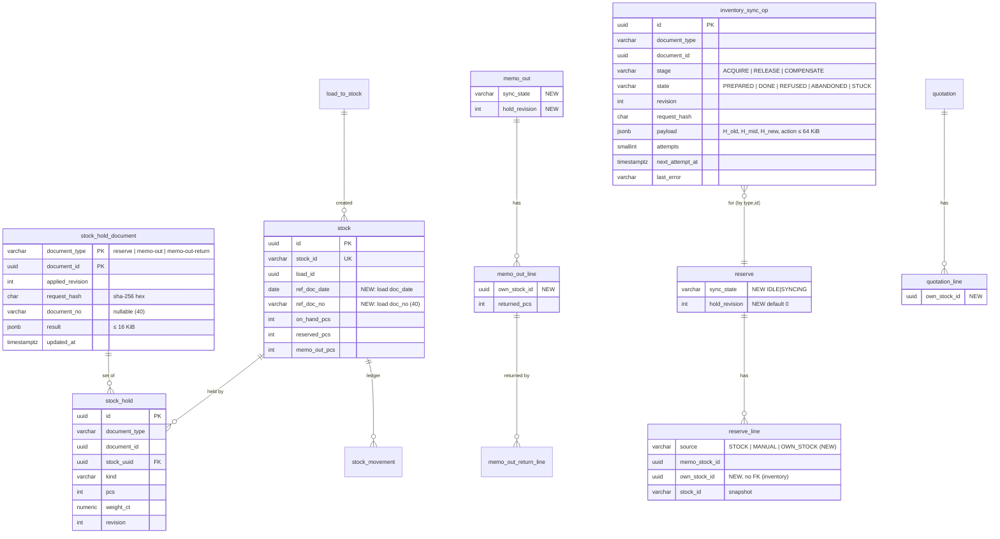

# Database diagram: inventory / load-to-stock (SA revision 1, pending-review)

- Owners: **A** — `backend-api-inventory`, schema `inventory` (new). **B** — `api-master`, schema `partner` (additive changes).
- No cross-schema foreign keys. IDs from the other service (`purchase_line_id`, `vendor_id`, `stone_code_id`, `numbering_id`, user ids) are plain columns validated through the internal API. UUIDv7 generated in the app (`uuidV7` from `@gms/storage`).
- PostgreSQL 18.6 (PG16-compatible SQL). Timestamps `timestamptz`; business dates `date` (Asia/Bangkok).

## A. Schema `inventory`

```mermaid
erDiagram
  LOAD_TO_STOCK ||--|{ LOAD_TO_STOCK_SOURCE : picks
  LOAD_TO_STOCK ||--|{ LOAD_TO_STOCK_ROW : has
  LOAD_TO_STOCK_ROW ||--|{ LOAD_TO_STOCK_ROW_SOURCE : takes
  LOAD_TO_STOCK_SOURCE ||--|{ LOAD_TO_STOCK_ROW_SOURCE : feeds
  LOAD_TO_STOCK_ROW ||--o{ LOAD_TO_STOCK_ROW_PHOTO : shows
  STORED_FILE ||--o{ LOAD_TO_STOCK_ROW_PHOTO : file
  LOAD_TO_STOCK_ROW ||--o| STOCK : creates
  STOCK ||--o{ STOCK_PHOTO : shows
  STORED_FILE ||--o{ STOCK_PHOTO : file
  STOCK ||--|{ STOCK_MOVEMENT : ledger
  STOCK ||--o{ STOCK_HOLD : held_by
  LOAD_TO_STOCK ||--o{ MASTER_SYNC_OP : syncs
  NOTIFICATION_EVENT ||--|{ NOTIFICATION_RECIPIENT : to

  LOAD_TO_STOCK {
    uuid id PK
    uuid numbering_id "master id, nullable"
    int running_no
    varchar doc_no UK
    varchar status "DRAFT PENDING_APPROVAL REVISION_REQUESTED APPROVED REJECTED"
    boolean provisional "true only during OFF create sync"
    varchar sync_state "IDLE SYNCING"
    int applied_revision "last confirmed by master"
    date doc_date
    uuid vendor_id
    varchar vendor_code_snapshot
    varchar vendor_name_snapshot
    char currency_code
    varchar ref
    varchar document_note
    varchar mode "NONE SPLIT MERGE"
    smallint row_count
    int total_pcs
    decimal total_weight_ct
    decimal total_cost_base
    boolean auto_approved
    smallint revision_count
    timestamptz submitted_at
    varchar review_action
    varchar review_note
    timestamptz approved_at
    timestamptz deleted_at
    int version
  }
  LOAD_TO_STOCK_SOURCE {
    uuid id PK
    uuid load_id FK
    smallint position
    uuid purchase_line_id "UK with load_id"
    uuid purchase_id
    varchar purchase_doc_no
    date purchase_doc_date
    char purchase_currency
    decimal exchange_rate
    varchar price_unit
    decimal net_unit_price
    decimal unit_cost_base
    int line_pcs
    decimal line_weight_ct
    varchar stone_attrs "snapshot columns"
  }
  LOAD_TO_STOCK_ROW {
    uuid id PK
    uuid load_id FK
    smallint position
    varchar location "Location Master name snapshot"
    varchar parcel
    uuid stone_code_id
    varchar stone_attrs "stone..cer_no columns"
    varchar price_unit
    int pcs
    decimal weight_ct
    decimal unit_cost_base
    decimal cost_amount_base
    decimal stock_price
    decimal sale_price
    varchar item_note
    varchar stock_id "issued, null = Auto"
  }
  LOAD_TO_STOCK_ROW_SOURCE {
    uuid row_id PK,FK
    uuid source_id PK,FK
    int pcs
    decimal weight_ct
    decimal cost_amount_base
  }
  LOAD_TO_STOCK_ROW_PHOTO {
    uuid row_id PK,FK
    smallint position PK
    uuid file_id FK
  }
  STOCK {
    uuid id PK
    varchar stock_id UK
    uuid load_row_id UK,FK
    uuid load_id
    varchar status "ACTIVE REVERSED"
    varchar location "Location Master name snapshot"
    varchar parcel
    varchar stone_attrs
    varchar price_unit
    int pcs
    decimal weight_ct
    int on_hand_pcs
    decimal on_hand_weight_ct
    int reserved_pcs
    int memo_out_pcs
    int sold_pcs
    int consumed_pcs
    decimal bucket_weights "same four for weight"
    decimal unit_cost_base
    decimal cost_amount_base
    decimal stock_price
    decimal sale_price
    char currency_code
    uuid vendor_id
    timestamptz first_used_at
    int version
  }
  STOCK_PHOTO {
    uuid stock_uuid PK,FK
    smallint position PK
    uuid file_id FK
  }
  STOCK_HOLD {
    uuid id PK
    varchar document_type "reserve memo-out memo-out-return sale"
    uuid document_id
    uuid line_id
    uuid stock_uuid FK
    varchar kind "RESERVED MEMO_OUT MEMO_OUT_RETURN SOLD"
    int pcs
    decimal weight_ct
    int revision
  }
  STOCK_MOVEMENT {
    uuid id PK
    uuid stock_uuid FK
    varchar kind "LOAD_IN LOAD_ADJUST LOAD_REVERSAL"
    varchar document_type
    uuid document_id
    int revision
    int pcs_delta
    decimal weight_delta
    decimal cost_delta_base
    timestamptz created_at
    varchar created_by
  }
  STORED_FILE {
    uuid id PK
    varchar bucket
    varchar object_key UK
    varchar source_type
    varchar status
    char sha256
    uuid origin_file_id UK "master file copied from"
  }
  APPROVAL_SETTING {
    varchar type PK
    boolean require_approval
    int version
  }
  MASTER_SYNC_OP {
    uuid id PK
    uuid load_id FK
    int revision "UK with load_id"
    varchar state "PREPARED CONFIRMED REFUSED DONE STUCK"
    char request_hash
    jsonb payload
    jsonb result
    smallint attempts
    timestamptz next_attempt_at
  }
  NOTIFICATION_EVENT {
    uuid id PK
    varchar type
    varchar document_type
    uuid document_id
    varchar doc_no
    jsonb summary
    timestamptz created_at
  }
  NOTIFICATION_RECIPIENT {
    uuid event_id PK,FK
    varchar user_id PK
    timestamptz created_at
    timestamptz read_at
  }
```

### Column details, constraints and indexes (schema `inventory`)

| Table | Constraints | Indexes |
|---|---|---|
| `load_to_stock` | `doc_no` varchar(40) UNIQUE; UNIQUE (`numbering_id`, `running_no`) + partial UNIQUE (`running_no`) WHERE `numbering_id IS NULL`; CHECK status set; CHECK mode set; CHECK `revision_count BETWEEN 0 AND 1`; CHECK `(deleted_at IS NULL) = (deleted_by IS NULL)`; CHECK review columns all-or-none (ADR-0046); CHECK `NOT provisional OR status = 'APPROVED'`; `ref` ≤ 100, `document_note` ≤ 250; `total_weight_ct` numeric(15,3), `total_cost_base` numeric(18,2) | list `(doc_date DESC, created_at DESC, id DESC)` WHERE `deleted_at IS NULL AND NOT provisional`; deleted list partial; pending `(submitted_at, id)` WHERE status = 'PENDING_APPROVAL' AND deleted_at IS NULL; revision partial; `(vendor_id, doc_date DESC)`; `(sync_state)` WHERE sync_state = 'SYNCING' |
| `load_to_stock_source` | FK `load_id` ON DELETE CASCADE; UNIQUE (`load_id`, `purchase_line_id`); UNIQUE (`load_id`, `position`); `exchange_rate` numeric(18,6) > 0; `net_unit_price`, `unit_cost_base` numeric(18,4) ≥ 0 | `(purchase_line_id)` (find drafts naming a line) |
| `load_to_stock_row` | FK `load_id` CASCADE; `location` varchar(40) NOT NULL, the Location Master name snapshot (no id/FK, ADR-0053 D2); UNIQUE (`load_id`, `position`); CHECK `pcs ≥ 1`, `weight_ct ≥ 0` (0 only when the source weight is 0, checked by the service, Q-LS-26); `weight_ct` numeric(12,3); money numeric(18,2) ≥ 0; `unit_cost_base` numeric(18,4); `parcel` ≤ 50; `item_note` ≤ 500; CHECK price_unit set | `(location)` |
| `load_to_stock_row_source` | FKs CASCADE; CHECK `pcs ≥ 0`, `weight_ct ≥ 0` | `(source_id)` |
| `load_to_stock_row_photo` | position 1–5; FK file RESTRICT | `(file_id)` |
| `stock` | `stock_id` varchar(10) UNIQUE (never reused, kept after reversal); `location` varchar(40) name snapshot as the row; `load_row_id` UNIQUE FK RESTRICT; CHECK status; buckets `reserved_*`, `memo_out_*`, `sold_*`, `consumed_*` (int / numeric(12,3), default 0, all ≥ 0); CHECK `pcs = on_hand_pcs + reserved_pcs + memo_out_pcs + sold_pcs + consumed_pcs` and the same for weight (ADR-0052 D15, phase 1); CHECK `status = 'ACTIVE' OR (on_hand_pcs = 0 AND on_hand_weight_ct = 0)`; `first_used_at` audit only | `(load_id)`; available list `(location, stock_id)` WHERE status = 'ACTIVE' AND on_hand_pcs > 0 (phase 2 picker); in-use probe `(load_id)` WHERE `on_hand_pcs <> pcs OR on_hand_weight_ct <> weight_ct` |
| `stock_hold` | UNIQUE (`document_type`, `document_id`, `line_id`); FK stock RESTRICT; CHECK kind set, pcs ≥ 0, weight ≥ 0; created in phase 1, written from phase 2 | `(stock_uuid)`; `(document_type, document_id)` |
| `stock_photo` | as row photo | `(file_id)` |
| `stock_movement` | append-only: app role has INSERT, SELECT only; CHECK kind set | `(stock_uuid, created_at)`; `(document_type, document_id)`; `(created_at)` for reports |
| `stored_file` | shape of master `stored_files` (bucket, object_key, filename, content_type, size_bytes, sha256, status, source_type, source_id, created_by, created_at, ready_at) + `origin_service` varchar(16) NULL, `origin_file_id` uuid NULL, partial UNIQUE (`origin_service`, `origin_file_id`) WHERE not null; UNIQUE (`bucket`, `object_key`). **No** `expires_at`/`purge_after` (ADR-0030) | `(source_type, source_id)`, `(created_by, created_at DESC)` |
| `approval_setting` | PK `type` CHECK IN ('load-to-stock','merge-split','stock-transfer-location'); seed all three `require_approval = true` (ADR-0050 seed "others on") | — |
| `master_sync_op` | UNIQUE (`load_id`, `revision`); CHECK state set; `payload` ≤ 64 KiB (≤ 200 lines) | `(next_attempt_at)` WHERE state IN ('PREPARED','CONFIRMED') |
| `notification_event` / `notification_recipient` | as master (ADR-0049 D2) | as master + partial unread `(user_id)` WHERE `read_at IS NULL` |

Retention: documents, stock, movements, files — permanent. Notifications — 90 days, bounded daily deletion ≤ 5,000 rows (ADR-0049 D11). `master_sync_op` rows in `DONE` — kept 30 days then deleted by the same bounded job (operational data, not user content).

## B. Schema `partner` (api-master, additive)



| Change | Detail |
|---|---|
| `purchase_line.loaded_pcs` int NOT NULL DEFAULT 0, `loaded_weight_ct` numeric(12,3) NOT NULL DEFAULT 0 | CHECK `purchase_line_loaded_check`: `0 ≤ loaded_pcs ≤ pcs AND 0 ≤ loaded_weight_ct ≤ weight_ct AND (source <> 'STOCK' OR (loaded_pcs = 0 AND loaded_weight_ct = 0))`. A line with pcs 0 is never loadable (Q-LS-26). Always equals Σ `load_allocation_line` for that line (maintained in the same statement set; verified by test). |
| Partial index `purchase_line_loadable_idx` | `(purchase_id, position)` WHERE `source <> 'STOCK' AND pcs > loaded_pcs` |
| `load_allocation` | PK `load_document_id`; `applied_revision` int ≥ 0; `request_hash` char(64); `result` jsonb (≤ 16 KiB: stockIds + remaining) |
| `load_allocation_line` | PK (`load_document_id`, `purchase_line_id`); FK `load_document_id` CASCADE, FK `purchase_line_id` RESTRICT (a loaded line cannot be hard-deleted); CHECK pcs ≥ 0, weight ≥ 0, not both 0; index `(purchase_line_id)` |
| `load_stock_id` | PK `stock_id` varchar(10); FK `load_document_id` RESTRICT (kept forever, IDs never reused); index `(load_document_id)` |
| `document_numbering.external_used_at` timestamptz NULL | Document Setup treats the row as used when not null |
| Phase 2 (D15, later revision) | `partner.inventory_sync_op` + `sync_state` on Reserve / Memo Out / Memo Out Return headers; line source `OWN_STOCK` with `stock_uuid`, `stock_id` snapshot |
| `approval_setting` | DELETE rows `load-to-stock`, `merge-split`, `stock-transfer-location`; CHECK narrowed to the eight master types (Q-LS-25 default) |

Note: deletion of an allocation is "set to empty": lines removed, header kept with the new `applied_revision` (so a stale older revision can never re-apply).

## Migration, backfill and rollback

- **Inventory:** first migration creates schema objects (roles provisioned by infra/backend migrator job, not by the app role), seeds `approval_setting` (3 rows, ON). No location table: locations are master data (Location Master, other branch), Q-LS-28/34. No backfill: no own stock exists. Migrations run once as a one-off `gms_inventory_migrator` job before the service starts (`prisma migrate deploy`, schema `inventory`, `_prisma_migrations` inside schema `inventory`).
- **Master:** one additive migration. Backfill: none (`loaded_*` = 0 is correct: nothing was ever loaded). The approval rows deleted were inactive (no document type used them).
- **Order:** master migration → inventory migration → services.
- **Rollback:** inventory route off; master columns stay (inert). Full down (only if no applied load exists, checked by `SELECT count(*) FROM partner.load_allocation_line` = 0): drop master additions, re-insert the three approval rows (seed values) and restore the CHECK. Applied loads must first be deleted through the API so PU remaining returns; schema rollback never silently drops stock history.

---

## C. Phase 2 (SA revision 2, Proposed)

ADR-0052 D16–D20. Two additive migrations: inventory `2026111x_stock_holds_phase2` and master `2026111x_own_stock_lines`. Each owner writes only its own schema.



### Inventory changes (schema `inventory`)

| Change | Detail |
|---|---|
| `stock.ref_doc_date date NOT NULL`, `stock.ref_doc_no varchar(40) NOT NULL` | Added nullable, backfilled `UPDATE stock s SET … FROM load_to_stock l WHERE l.id = s.load_id`, then NOT NULL. Set by `createStocks`; `applyStockEdit` updates them when the load's date or number changes (one set-based UPDATE) |
| Index `stock_picker_idx` | `(ref_doc_date DESC, stock_id DESC) WHERE status = 'ACTIVE' AND (on_hand_pcs > 0 OR on_hand_weight_ct > 0)`. `stock_available_idx` is dropped (no reader after D16) |
| `stock_hold` re-key | Drop `stock_hold_line_key` and column `line_id` (the table is empty: phase 1 never writes it; the migration asserts `count(*) = 0`). Add unique `stock_hold_doc_stock_key (document_type, document_id, stock_uuid)` and `document_no varchar(40) NULL`. The kind CHECK is unchanged; add CHECK that kind matches document_type (`reserve`→RESERVED, `memo-out`→MEMO_OUT, `memo-out-return`→MEMO_OUT_RETURN, `sale`→SOLD); CHECK `pcs > 0 OR weight_ct > 0` (zero rows are deleted, not stored) |
| `stock_hold_document` (new) | PK (`document_type`, `document_id`); `applied_revision int ≥ 1`; `request_hash char(64)`; `document_no varchar(40) NULL`; `result jsonb`; `updated_at`; CHECK document_type as `stock_hold` |
| `stock_movement_kind_check` | Adds `HOLD_RESERVE`, `RELEASE_RESERVE`, `MEMO_OUT`, `MEMO_OUT_REVERSAL`, `MEMO_OUT_RETURN`, `MEMO_OUT_RETURN_REVERSAL` (deltas = on-hand change; cost 0) |
| Grants | `gms_inventory_app`: DML on `stock_hold_document`; `stock_movement` stays INSERT/SELECT only |

### Master changes (schema `partner`)

| Change | Detail |
|---|---|
| `quotation_line`, `reserve_line`, `memo_out_line`: `own_stock_id uuid NULL` | No FK (cross-service id). Source CHECK adds `OWN_STOCK`; CHECK `(source = 'OWN_STOCK') = (own_stock_id IS NOT NULL)` and `NOT (memo_stock_id IS NOT NULL AND own_stock_id IS NOT NULL)`; unique `(<doc>_id, own_stock_id)`; index `(own_stock_id)` |
| `memo_out_line_open_idx` | Recreated with `(memo_stock_id IS NOT NULL OR own_stock_id IS NOT NULL) AND (returned_pcs < pcs OR returned_weight_ct < weight_ct)` |
| `reserve`, `memo_out`, `memo_out_return`: `sync_state varchar(10) NOT NULL DEFAULT 'IDLE'` (CHECK IDLE/SYNCING), `hold_revision int NOT NULL DEFAULT 0` | Partial index `(<table>_syncing_idx) WHERE sync_state = 'SYNCING'` |
| `inventory_sync_op` (new) | Columns as in the diagram + `created_by`, `created_at`, `updated_at`. Unique `(document_type, document_id, revision)`; partial unique `(document_type, document_id) WHERE state IN ('PREPARED','STUCK')` (one active op per document); due index `(next_attempt_at) WHERE state = 'PREPARED'`; DONE / REFUSED / ABANDONED rows deleted after 30 days by the existing bounded cleanup pattern |

### Migration, backfill, rollback (phase 2)

- Order: inventory migration → master migration → services (master tolerates a missing inventory route: picker degrades, own-stock saves get 503).
- Backfill: only `stock.ref_doc_*` from `load_to_stock` (one statement; tens of thousands of rows at most). No own-stock lines exist in master.
- Rollback: turn off `fromStock.list` own-stock part by config (`INVENTORY_INTERNAL_URL` unset → `ownStock: "UNAVAILABLE"`, own-stock saves refused). A schema down is allowed only when `partner.*_line.own_stock_id` is all NULL and `inventory.stock_hold` is empty; otherwise release documents through the API first.
