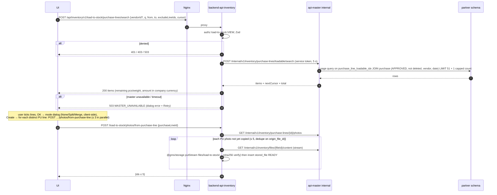
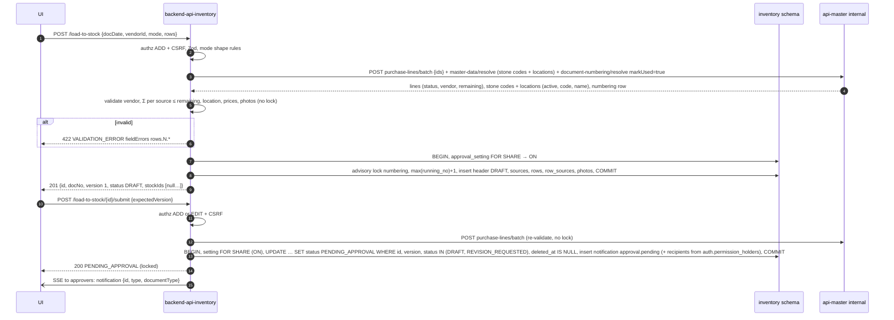
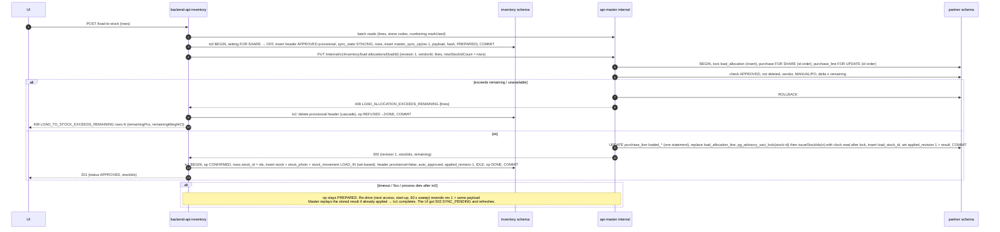
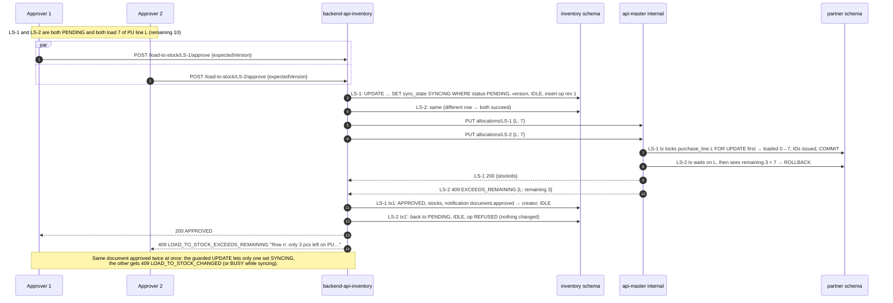
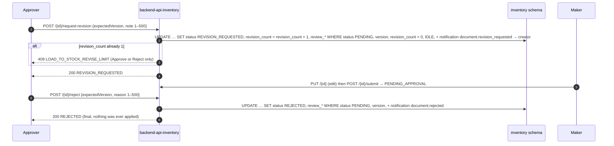
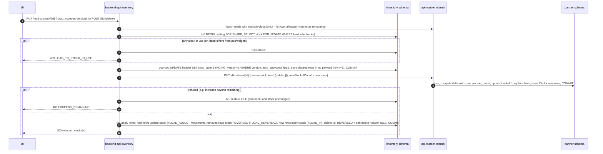
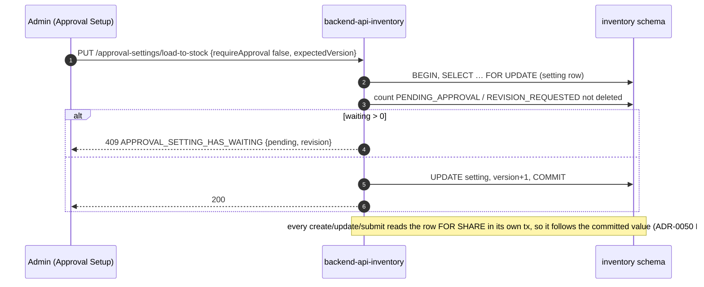

# Sequence diagrams: inventory / load-to-stock (SA revision 1, pending-review)

Main user flow: [diagram/load-to-stock-flow.md](../../../../diagram/load-to-stock-flow.md) (not copied here). Participants: browser (UI), Nginx, `backend-api-inventory` (INV) with schema `inventory` (IDB), `api-master` (MS) with schema `partner` (PDB). No gateway. "authz" = JWT + auth view + license + CSRF (mutations) + grant, see [authorization](authorization.md).

## 1. Picker (P-01) and the mode dialog

## 2. Save with approval ON (Draft) and Send to approve

## 3. Save with approval OFF (applied at once) — saga

## 4. Approve in Approve Center (ON) and concurrent approve race

## 5. Revise (once) and Reject

## 6. Edit / Delete of an auto-approved load (OFF) — reversal until used

The PU side (master): once a line has loaded > 0, `purchase.update` / `purchase.delete` of that Purchase return `PURCHASE_IN_USE` (ADR-0052 D9). A Draft/Pending load naming a line does not block the PU; its later Approve fails with `LOAD_TO_STOCK_LINE_UNAVAILABLE` if the PU changed.

## 7. Approval setting turn-OFF guard (inventory-owned, Q-LS-25)

