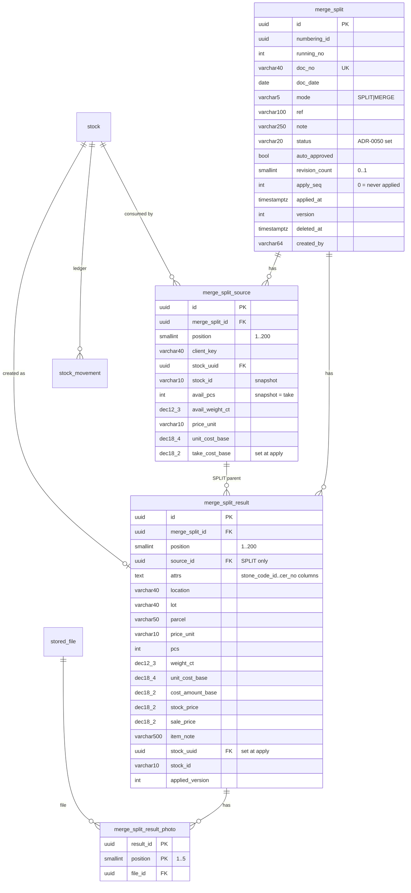
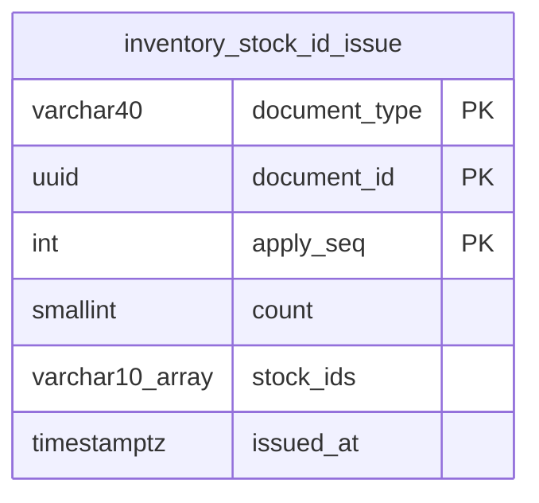

# Database: inventory / merge-split (SA revision 1, pending-review)

Schema `inventory` (owner `backend-api-inventory`) plus one table in master schema `partner`. No cross-service FK.

`merge_split` copies every header column and CHECK of `stock_adjustment` (numbering, review, submitted, deleted) except `location`, and adds `mode` and `apply_seq`.

## Constraints and indexes

- `merge_split`: `mode IN ('SPLIT','MERGE')`; `apply_seq >= 0`; doc no / running no unique indexes and `merge_split_list_idx (doc_date DESC, id DESC) WHERE deleted_at IS NULL`, `merge_split_pending_idx (status) WHERE status = 'PENDING_APPROVAL'` (as stock_adjustment).
- `merge_split_source`: unique `(merge_split_id, stock_uuid)`, `(merge_split_id, position)`, `(merge_split_id, client_key)`; `avail_pcs >= 1`, `avail_weight_ct >= 0`; FK stock `ON DELETE RESTRICT`; **index `merge_split_source_stock_idx (stock_uuid)`** for the Pending exclusion.
- `merge_split_result`: unique `(merge_split_id, position)`; unique `stock_uuid` where not null; `pcs >= 1`, `weight_ct >= 0`, prices/cost ≥ 0; `(stock_uuid IS NULL) = (applied_version IS NULL)`; FK source `ON DELETE CASCADE`, FK stock `ON DELETE RESTRICT`. Mode rules (SPLIT has `source_id`, MERGE has none) are enforced in the service (cross-table).
- `merge_split_result_photo`: FK result `ON DELETE CASCADE`, FK `stored_file` RESTRICT, index `(file_id)`.
- `stock_movement_kind_check`: superset of the latest list + `'SPLIT_OUT','SPLIT_IN','SPLIT_REVERSAL','MERGE_OUT','MERGE_IN','MERGE_REVERSAL'`.
- `stock`: **no column change**. Results reuse `pcs`, `on_hand_*`, `consumed_*` and the generated `lot_key`/`card_key`/`item_key`; `load_row_id` stays NULL on results.
- Grants to `gms_inventory_app` as the stock_adjustment migration.

## Master (`partner`)

CHECK `document_type IN ('merge-split')`, `count BETWEEN 1 AND 200`, `cardinality(stock_ids) = count`. Written in the same master transaction as `issueStockIds`.

## Migrations and rollback

| Service | Migration | Content | Rollback |
|---|---|---|---|
| inventory | `prisma/migrations/20261127100000_merge_split/` | 4 tables, indexes, kind check, grants; Prisma models | `prisma/rollback/20261127100000_merge_split.down.sql`: refuse if any `SPLIT_*`/`MERGE_*` movement exists, else drop the 4 tables and restore the previous kind check |
| master | `prisma/migrations/20261127100000_inventory_stock_id_issue/` | 1 table | drop the table (issued IDs stay consumed in the counter) |

Additive only; no backfill. The approval type row and check already include `merge-split`.
