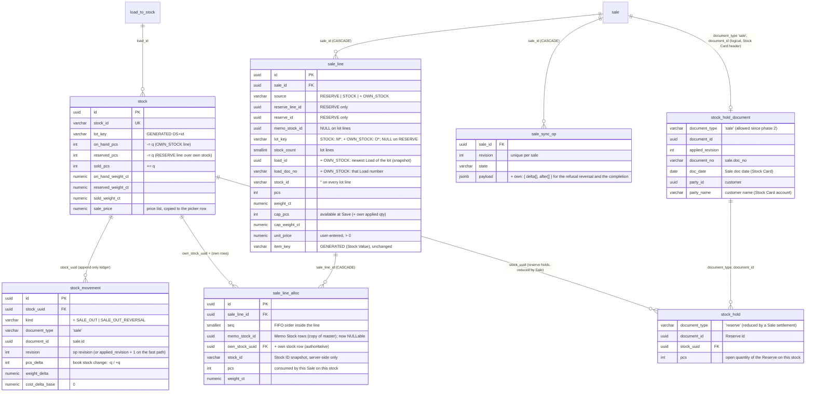

# Database diagram: inventory / sale-own-stock

- Source UI revision / SA revision: Sale UI 1 + addendum A / **1** (pending-review)
- Owning service / schema: `backend-api-inventory` / `inventory`. No other schema is touched (master changes are one partial index, listed at the end).
- Actual Prisma schema / migration paths: `backend-api-inventory/prisma/schema.prisma` (models `stock`, `stock_movement`, `stock_hold`, `stock_hold_document`, `sale`, `sale_line`, `sale_line_alloc`, `sale_sync_op`); migrations `20261117100000_inventory_init`, `20261118100000_stock_holds_phase2`, `20261119090000_sale`, `20261120090000_lot_based_stock`, `20261121090000_own_lot_key_per_stock`, `20261123090000_stock_card`, `20261123110000_stock_value`. Proposed: `backend-api-inventory/prisma/migrations/20261123120000_sale_own_stock/migration.sql` and `prisma/rollback/20261123120000_sale_own_stock.down.sql`. **The timestamp is later than Stock Value's `20261123110000`; nothing applied is edited.** `schema.prisma` is a shared file: BE-SO-001 starts after BE-SV-001 is merged (parent-serialized).

The change is additive: three columns on `sale_line`, one new column and relaxed nullability on `sale_line_alloc`, two ledger kinds, two indexes. **No new table, no backfill** (nothing references own-stock Sales yet). Entities marked `+` are proposed columns; unchanged columns are omitted.



## Definitions

```sql
-- 20261123120000_sale_own_stock (inventory only; applied migrations are not edited)

-- 1. sale_line: the new source and its reference columns.
ALTER TABLE "inventory"."sale_line" ADD COLUMN "load_id" UUID, ADD COLUMN "load_doc_no" VARCHAR(40);
ALTER TABLE "inventory"."sale_line" DROP CONSTRAINT "sale_line_source_check";
ALTER TABLE "inventory"."sale_line" ADD CONSTRAINT "sale_line_source_check" CHECK (
  ("source" = 'RESERVE' AND "reserve_line_id" IS NOT NULL AND "reserve_id" IS NOT NULL)
  OR ("source" IN ('STOCK', 'OWN_STOCK') AND "reserve_line_id" IS NULL AND "reserve_id" IS NULL));
ALTER TABLE "inventory"."sale_line" DROP CONSTRAINT "sale_line_stock_ref_check";
ALTER TABLE "inventory"."sale_line" ADD CONSTRAINT "sale_line_stock_ref_check" CHECK (
  ("memo_stock_id" IS NOT NULL AND "lot_key" IS NULL AND "stock_count" IS NULL AND "source" <> 'OWN_STOCK')
  OR ("memo_stock_id" IS NULL AND "source" = 'STOCK'     AND "lot_key" LIKE 'M%' AND "stock_count" >= 1)
  OR ("memo_stock_id" IS NULL AND "source" = 'OWN_STOCK' AND "lot_key" LIKE 'O%' AND "stock_count" >= 1 AND "load_id" IS NOT NULL)
  OR ("memo_stock_id" IS NULL AND "lot_key" IS NULL AND "source" = 'RESERVE'));
CREATE UNIQUE INDEX "sale_line_own_lot_key" ON "inventory"."sale_line" ("sale_id", "lot_key") WHERE "source" = 'OWN_STOCK';

-- 2. sale_line_alloc: own-stock rows (authoritative), Memo Stock rows stay a copy of master's answer.
ALTER TABLE "inventory"."sale_line_alloc" ADD COLUMN "own_stock_uuid" UUID;
ALTER TABLE "inventory"."sale_line_alloc" ALTER COLUMN "memo_stock_id" DROP NOT NULL;
ALTER TABLE "inventory"."sale_line_alloc" ADD CONSTRAINT "sale_line_alloc_stock_fkey"
  FOREIGN KEY ("own_stock_uuid") REFERENCES "inventory"."stock" ("id") ON DELETE RESTRICT ON UPDATE CASCADE;
ALTER TABLE "inventory"."sale_line_alloc" ADD CONSTRAINT "sale_line_alloc_one_stock_check"
  CHECK (("memo_stock_id" IS NOT NULL) <> ("own_stock_uuid" IS NOT NULL));
CREATE UNIQUE INDEX "sale_line_alloc_own_stock_key" ON "inventory"."sale_line_alloc" ("sale_line_id", "own_stock_uuid") WHERE "own_stock_uuid" IS NOT NULL;
CREATE INDEX "sale_line_alloc_own_stock_idx" ON "inventory"."sale_line_alloc" ("own_stock_uuid") WHERE "own_stock_uuid" IS NOT NULL;
-- (the existing unique ("sale_line_id","memo_stock_id") is unaffected: NULLs do not collide)

-- 3. Ledger kinds (the ledger stays append-only; app role INSERT / SELECT only).
ALTER TABLE "inventory"."stock_movement" DROP CONSTRAINT "stock_movement_kind_check";
ALTER TABLE "inventory"."stock_movement" ADD CONSTRAINT "stock_movement_kind_check" CHECK ("kind" IN (
  'LOAD_IN', 'LOAD_ADJUST', 'LOAD_REVERSAL',
  'HOLD_RESERVE', 'RELEASE_RESERVE', 'MEMO_OUT', 'MEMO_OUT_REVERSAL', 'MEMO_OUT_RETURN', 'MEMO_OUT_RETURN_REVERSAL',
  'SALE_OUT', 'SALE_OUT_REVERSAL'));
-- Grants: unchanged (the app role has DML on sale_line / sale_line_alloc and UPDATE on stock; stock_movement stays INSERT-only).
```

## Constraints, indexes and nullability

- **Bucket CHECKs** (`stock_buckets_check`, `stock_pcs_balance_check`, `stock_weight_balance_check`) are unchanged and are the final guard for `on_hand → sold` and `reserved → sold`.
- **`sale_line_qty_check`** (`pcs ≤ cap_pcs`, `weight_ct ≤ cap_weight_ct`) holds for own lines: the cap is the available quantity at Save plus the Sale's own applied quantity.
- **One lot once per document:** `sale_line_own_lot_key`. An own lot and a Memo Stock lot never collide (prefixes `O` / `M`, different sources).
- **`sale_line_alloc`**: exactly one of `memo_stock_id` / `own_stock_uuid`; `(sale_line_id, own_stock_uuid)` unique; `seq` unique per line (existing); `pcs ≥ 0`, `weight_ct ≥ 0`, not both zero (existing CHECK). Own rows are written by inventory when a Sale completes; the Memo Stock copy writer is limited to `memo_stock_id IS NOT NULL` rows so the two never overwrite each other.
- **`stock_movement`**: no schema change besides the CHECK; indexes `stock_movement_stock_idx (stock_uuid, created_at)` and `stock_movement_document_idx (document_type, document_id)` serve the Stock Card and the reversal.
- **`stock_hold_document` row of a Sale**: `document_type = 'sale'`, `applied_revision ≥ 1`, `request_hash` = the op hash (any 64-hex value; the CHECK only requires the shape), `document_no`, `doc_date`, `party_id`, `party_name`. No `stock_hold` rows are written for a Sale. The row is replaced on every completion (set semantics) and kept after a delete (a deleted Sale has no net movement rows, so the header is not read).
- **`loadHolders`** (Load "in use by") gains a second source: Sales with an allocation row on a stock of the Load (`sale_line_alloc` -> `sale_line` -> `sale`, `deleted_at IS NULL`, ≤ 5), one extra statement only on the Load detail.
- **Foreign keys:** `sale_line_alloc.own_stock_uuid -> stock` is `RESTRICT` (a stock row is never deleted, `status = 'REVERSED'` instead; a Load reversal is refused while the stock is in use). `stock_movement` keeps its FK. No cross-schema FK.

## Migration, backfill and rollback

- **Order:** migrate (additive, offline-safe, no rewrite of `stock`) -> deploy inventory with the new routes (the `OWN_STOCK` source is only accepted by the new code) -> master -> frontend.
- **Backfill:** none (no own-stock Sale exists). The earlier lot-based migration already backfilled Memo Stock allocation rows; they keep `own_stock_uuid IS NULL`.
- **Rollback** (`prisma/rollback/20261123120000_sale_own_stock.down.sql`, run manually as `gms_inventory_migrator`, routes disabled first): it **refuses** (`RAISE EXCEPTION 'own-stock sales exist: forward-fix only'`) if any `sale_line.source = 'OWN_STOCK'`, `sale_line_alloc.own_stock_uuid IS NOT NULL`, or `stock_movement.kind IN ('SALE_OUT','SALE_OUT_REVERSAL')` exists; otherwise it restores the previous constraints, drops the indexes, the new columns and the FK. After the first applied own-stock Sale the ledger rows cannot be deleted (append-only), so recovery is **forward-fix only** (as ADR-0054 for the first applied Sale and ADR-0055 for lot lines). Afterwards delete the migration's row from `inventory._prisma_migrations`.
- **Master (separate, additive, BE-SO-007):** one partial index on `partner.reserve_line` for open own-stock lines (`WHERE own_stock_id IS NOT NULL AND (sold_pcs < pcs OR sold_weight_ct < weight_ct)`; a second partial index beside `reserve_line_open_idx`). No column, no backfill (`own_stock_id`, `lot_key`, `reserve_line_alloc.own_stock_id/settled_*` exist). Rollback: drop the index.
- **Auth, infra, devops:** none.

## Not in this revision

Merged own lots (several stocks per lot key; the allocation supports it, nothing writes it), cost of goods in the ledger (SQ-SO-06), a Sale return / credit note, selling own stock held by a Memo Out (it is `memo_out`, returned first).
