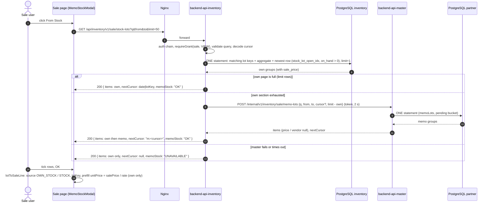
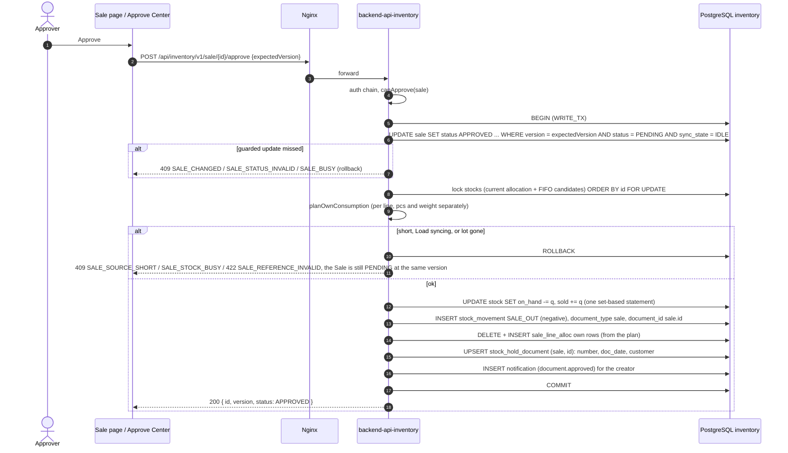

# Sequence diagram: inventory / sale-own-stock

- Source UI revision / SA revision: Sale UI 1 + addendum A / **1** (pending-review). Main user flow: [diagram/sale-own-stock-flow.md](../../../../diagram/sale-own-stock-flow.md) (not copied here). Base saga and approval flows: [inventory/sale sequence-diagram](../sale/sequence-diagram.md) (unchanged; only the deltas are drawn).
- Participants: UI (browser), Nginx (routes `/api/inventory/` to `backend-api-inventory`; no gateway), I = `backend-api-inventory`, M = `backend-api-master`, DB = PostgreSQL schema `inventory`, MDB = schema `partner`. Master's internal API is not routed by Nginx.

## A. From Stock picker (own first, then Memo Stock)



## B. Approve (or auto-approved Save) of a Sale with only own-stock lines: local fast path



No master call and no `sale_sync_op` row exist on this path, so it works while master is stopped. A Save with approval OFF takes the same path (the Sale row is inserted `APPROVED, auto_approved` in the same transaction).

## C. Mixed Sale (own + Memo Stock / Reserve lines): tx0, master, tx1, and the refusal

```mermaid
sequenceDiagram
  autonumber
  actor U as Approver
  participant I as backend-api-inventory
  participant DB as PostgreSQL inventory
  participant M as backend-api-master
  participant MDB as PostgreSQL partner

  U->>I: approve (via Nginx)
  I->>DB: BEGIN tx0
  I->>DB: guarded UPDATE sale SET sync_state = SYNCING, version + 1
  I->>DB: lock stocks FOR UPDATE (id order), plan, UPDATE stock on_hand -> sold, INSERT stock_movement SALE_OUT
  I->>DB: INSERT sale_sync_op (PREPARED, revision r, hash, payload { consumption: master lines only, own: { delta, after } })
  I->>DB: COMMIT tx0
  I->>M: PUT /internal/v1/inventory/sale-consumptions/{saleId} {revision r, master lines} (5 s)
  M->>MDB: one transaction (existing lock order, set semantics, idempotent on revision + hash)
  alt master refuses (EXCEEDS_AVAILABLE, LINE_UNAVAILABLE, IN_USE, RESERVE_BUSY)
    M-->>I: 409 / 422
    I->>DB: BEGIN refuse tx
    I->>DB: reverseOwnDelta from payload.own.delta (stock on_hand += q, sold -= q; ledger SALE_OUT_REVERSAL)
    I->>DB: op REFUSED; Sale back to PENDING (or provisional CREATE deleted), sync_state IDLE
    I->>DB: COMMIT
    I-->>U: 409 SALE_SOURCE_SHORT / 422 SALE_REFERENCE_INVALID / 409 SALE_IN_USE / 409 SALE_RESERVE_BUSY
  else master confirms
    M-->>I: 200 { revision r, allocations }
    I->>DB: BEGIN tx1: op CONFIRMED
    I->>DB: (phase B) settleReserve: reserved -> sold, stock_hold(reserve) reduced, ledger SALE_OUT
    I->>DB: status APPROVED, copy memo allocation, completeOwn (own allocation rows + stock_hold_document header), notification
    I->>DB: op DONE
    I->>DB: COMMIT tx1
    I-->>U: 200 APPROVED
  else master down or timeout
    I-->>U: 503 SYNC_PENDING (op stays PREPARED; own stock already sold)
    Note over I,M: the 60 s sweep, access re-drive or sync:redrive repeats the PUT with the same revision and hash, then tx1, or the refusal path
  end
```

## D. Own-stock Reserve line sold from the Reserve (phase B)

```mermaid
sequenceDiagram
  autonumber
  participant FE as Sale page
  participant I as backend-api-inventory
  participant DB as PostgreSQL inventory
  participant M as backend-api-master
  participant MDB as PostgreSQL partner

  FE->>I: GET /sale/reserve-lines?customerId&currency (own-stock Reserve lines are listed)
  I->>M: POST sale/reserve-lines/search
  M->>MDB: open lines (memo_stock_id OR own_stock_id OR lot_key), customer, currency, APPROVED
  M-->>I: items (source MEMO_STOCK | OWN_STOCK)
  FE->>I: approve the Sale
  I->>DB: tx0 (guarded update, op PREPARED; no own on-hand lines needed)
  I->>M: PUT sale-consumptions (RESERVE line, reserveLineId)
  M->>MDB: lock Reserve header FOR SHARE, line FOR UPDATE; busy check; reserve_line.sold += q; reserve_line_alloc.settled oldest seq first
  M-->>I: allocations [{lineId, rows: [{source OWN_STOCK, stockUuid, stockId, pcs, weightCt}]}]
  I->>DB: tx1: lock stock rows + stock_hold(reserve, R, stock) FOR UPDATE (id order)
  I->>DB: reserved -= q, sold += q; stock_hold.pcs -= q (zero row deleted); INSERT stock_movement SALE_OUT
  I->>DB: sale APPROVED, own allocation rows, stock_hold_document header, op DONE
```

## E. Edit down / delete of an auto-approved Sale (release), and Stock Card read

```mermaid
sequenceDiagram
  autonumber
  actor U as User
  participant I as backend-api-inventory
  participant DB as PostgreSQL inventory
  participant FE as Stock Card page

  U->>I: PUT /sale/{id} (fewer pcs) or POST /sale/{id}/delete (via Nginx)
  I->>DB: BEGIN: guarded UPDATE, lock stocks, plan release newest allocation first
  I->>DB: UPDATE stock on_hand += d, sold -= d (Reserve origin: reserved += d, stock_hold re-inserted / increased)
  I->>DB: INSERT stock_movement SALE_OUT_REVERSAL (+d); rewrite allocation rows; refresh stock_hold_document (date / customer)
  I->>DB: COMMIT
  FE->>I: GET /stock-card/cards/{key}/transactions
  I->>DB: entries per (card, document): net of SALE_OUT + SALE_OUT_REVERSAL; join stock_hold_document for number, date, account
  DB-->>I: one OUT row "Sale" (net), zero net = no row
  I-->>FE: row: docType sale, docNo, docDate, account = customer, OUT q, running BALANCE
  FE->>FE: DOC NO link -> /sale/sale/{id}
```

## Alternate and error paths covered

Short lot (A/B/C), Load edit in flight (`SALE_STOCK_BUSY`), lot gone (`SALE_REFERENCE_INVALID`), two concurrent Sales (second `SALE_SOURCE_SHORT`), master refusal after own tx0 (C, reversal), master down (503, re-drive), crash between tx0 and master or master and tx1 (C), master down while picking (A), Reserve busy, `STOCK_LOT_TOO_LARGE`, delete / edit release (E). Their codes and user text are in [error-handling](error-handling.md).
