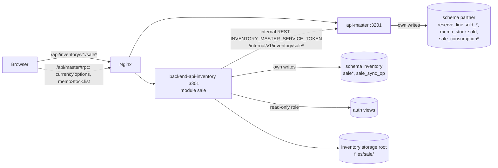

# Service architecture: inventory / sale

- Feature ID / SA revision: `sale` / **1** — status **approved** 2026-11-18
- Source UI revision / TODO: UI rev 1 (approved 2026-11-18) / [task/todo/sale.md](../../../../task/todo/sale.md) (BE-SL-*)
- ADR / flow / bundle: [ADR-0054](../../../../adr/0054-sale-document.md), [sale-flow](../../../../diagram/sale-flow.md), [decisions](decisions.md), [api-contract](api-contract.md), [authorization](authorization.md), [database-diagram](database-diagram.md), [sequence-diagram](sequence-diagram.md), [error-handling](error-handling.md), [dependencies](dependencies.md), [testing](testing.md)

## Domain and service boundaries

| Owner | Writes | Reads from others |
|---|---|---|
| `backend-api-inventory` / module `sale` | `inventory.sale`, `sale_line`, `sale_charge`, `sale_line_photo`, `sale_sync_op`; `stored_file` rows with `source_type = 'sale-line'`; notification rows `documentType = sale`; `approval_setting` row `sale` (platform) | master internal API only (reference, open Reserve lines, prepare, numbering, consumption); auth views |
| `api-master` | `partner.reserve_line.sold_*`, `partner.memo_stock` buckets, `partner.sale_consumption*`, `document_numbering.external_used_at` | nothing from inventory |
| `backend-api-auth` | unchanged (leaf `sale` exists) | — |

Module boundaries inside inventory: `sale` writes only its own tables. It uses the platform kernel (auth, CSRF, errors, db, master client, approval settings, Approve Center registry, notification store/hub, storage) and the shared `SyncDriver`. It does not touch `load_to_stock*` or `stock*` in phase 1; phase 2 uses the `stock` component interface (`src/modules/stock/`), never its tables directly. Reports and Account Outstanding (later) read `sale*` through a read-only interface of this module.

No transaction ever spans the two services. Each apply is: inventory tx0 → one master transaction (inside master) → inventory tx1; no HTTP call while a transaction is open (ADR-0052 D4).

## Behaviour

### Read paths

| Path | Queries / calls |
|---|---|
| `GET /sale/options` | 1 master call `GET /internal/v1/inventory/sale/reference` (customers + addresses as `customerLineOptions`, active currencies, company currency, charge types, stone options, `numbering.configured`); no local query |
| `GET /sale/next-number` | 1 master numbering call (`markUsed:false`) + 1 local `max(running_no)` |
| `GET /sale` (Daybook) | 1 keyset query (≤ 51 rows) on `sale_list_idx` / `sale_deleted_list_idx`; customer name from snapshot |
| `GET /sale/{id}` | ≤ 3 local queries (header; lines + photo ids; charges) + **1** master `POST /sale/prepare` (read-only mode) for current caps and reference validity when the document is editable (DRAFT / REVISION_REQUESTED / auto-approved not used); none for read-only documents |
| `GET /sale/reserve-lines` (P-01) | 1 master call `POST /internal/v1/inventory/sale/reserve-lines/search`: one page query (`LIMIT limit+1`) on `reserve_open_customer_idx` joined to open lines on `reserve_line_open_idx`, no count |
| From Stock (P-02) | browser → master `memoStock.list` (existing, granted to `sale:VIEW`) |
| Approve Center | inventory `approval/summary` (+1 count query for `sale`), `approval/pending?type=sale` (1 keyset query on `sale_pending_idx`) |

### Write paths (setting row read `FOR SHARE` in each create/update/submit)

| Action | Approval ON | Approval OFF |
|---|---|---|
| Create | master `prepare` (before tx) + numbering (before tx) → tx: insert DRAFT + lines + charges + photo links | provisional create: tx0 insert `APPROVED`, `provisional = true`, `sync_state = SYNCING` + op (rev 1) → master `PUT sale-consumptions` → tx1 `provisional = false`, `auto_approved = true`, `IDLE`, notification none. Refusal → tx1′ deletes the provisional rows; caller gets the row errors |
| Update | DRAFT / REVISION_REQUESTED only; `prepare` then tx replace lines/charges/photo links | auto-approved and not used: tx0 save the new lines as pending op (rev n+1, SYNCING) → master PUT (delta: increases re-checked, decreases released with the in-use guard) → tx1 replace lines. Refusal → tx1′ keep the previous lines |
| Submit | DRAFT/REVISION → PENDING_APPROVAL after a `prepare` check (no lock); notify approvers | `SALE_STATUS_INVALID` |
| Approve | PENDING_APPROVAL: tx0 SYNCING + op APPROVE → master PUT → tx1 `APPROVED`, `approved_*`, notify creator. Short → tx1′ back to PENDING_APPROVAL, `409 SALE_SOURCE_SHORT` | — |
| Revise / Reject | local only (ADR-0050), notify creator | — |
| Delete | DRAFT / REVISION_REQUESTED / REJECTED: soft delete locally | auto-approved, not used: tx0 SYNCING + op DELETE (empty set) → master PUT releases → tx1 soft delete. `SALE_CONSUMPTION_IN_USE` → `409 SALE_IN_USE` |
| Restore | deleted → DRAFT (nothing applied); new number not issued (keeps its number) | same; the next Save under OFF applies |

While `sync_state = SYNCING` every write and photo link on that Sale returns `409 SALE_BUSY`; `GET` returns `syncing: true`. Unknown outcome (timeout/5xx) → `503 SYNC_PENDING`; re-drive on next access, at start and by the shared sweep (≤ 20 ops / 60 s, backoff 2^n ≤ 60 s, STUCK after 10 attempts, `sync:redrive` command).

### Saga generalisation (BE-SL-004)

`SyncDriver` gets an `OpStore` (table name and owner column fixed per document type — `master_sync_op.load_id`, `sale_sync_op.sale_id`; identifiers from a fixed map, never input) and a `MasterPort` (`put(id, revision, payload)`, `get(id)`, refusal classifier). Load to Stock passes its current store/port; all existing Load to Stock tests must pass unchanged. The sweep iterates both stores within the same ≤ 20-op budget (oldest due first).

### Master consumption transaction (BE-SL-002)

Lock order (extends approval-setup "Lock order"): `sale_consumption` header (`INSERT … ON CONFLICT DO NOTHING` then `SELECT … FOR UPDATE`) → `reserve` headers `FOR SHARE` (id order) → `reserve_line` `FOR UPDATE` (id order) → `memo_stock` `FOR NO KEY UPDATE` (id order). Reserve's own edit/delete takes its header `FOR NO KEY UPDATE` first, so it serialises with a consumption and then sees the line sold (→ `RESERVE_IN_USE`). Reserve/Memo Out/Memo Return approvals lock `memo_stock` in the same id order, so they queue instead of deadlocking.

Delta per line (desired − previously applied): increases are checked against current open (Reserve line) and pending/reserved (Memo Stock); decreases require `sold − purchased ≥ decrease` on the item. Bucket moves: RESERVE `reserve_line.sold += d`, `memo_stock.reserved −= d, sold += d`; STOCK `memo_stock.pending −= d, sold += d` (negative d reverses). CHECKs `memo_stock_balance`, `memo_stock_purchased_check`, `reserve_line_sold_check` hold. ≤ 6 statements, each bounded by ≤ 200 ids.

## Notifications

Owned by inventory (existing feed + SSE `GET /api/inventory/v1/notifications/stream`). Events `SUBMITTED` (recipients: holders of `sale` APPROVE + VIEW from `auth.permission_holders`, excluding the actor), `APPROVED` / `REVISION_REQUESTED` / `REJECTED` (recipient: creator). Written in the status-change transaction (tx1 for Approve). Payload on the stream: event type + notification id only; the UI refetches `GET /notifications` and `GET /sale/{id}`. Reconnect: `retry: 5000`, `Last-Event-ID` ignored, the client refetches the unread count (ADR-0049). Bounds: existing ≤ 200 streams per process. No central service, broker or Redis. Frontend: bell already merges the inventory feed; add `documentType: "sale"` link `/sale/sale/{id}`. Nginx: existing SSE location. DevOps: none.

## Uploads (`@gms/storage`)

| Item | Rule |
|---|---|
| Driver / root | `@gms/storage` local-fs driver, inventory storage root (`GMS_STORAGE_ROOT`, bind already provisioned) |
| Scope | object keys under **`files/sale/`** only (`files/sale/{yyyy}/{mm}/{uuid}`), never user-supplied names |
| Metadata owner | Sale module: `inventory.stored_file` rows with `source_type = 'sale-line'`, `source_id` = uploader-scoped id until linked |
| Upload | `sale` ADD or EDIT + CSRF; JPEG/PNG by signature, ≤ 5 MiB; ≤ 3 concurrent transfers per process (shared limiter, slot before body read) |
| Read | `sale` VIEW and the file is linked from a `sale_line_photo` row, or is the caller's own unlinked upload |
| Retention | permanent; UI removal, replacement, line removal, document edit/delete/restore only change `sale_line_photo` links (ADR-0030); no purge, no expiry |
| S3 | not implemented (proposed driver only) |
| Tests | upload/read authorization, signature/size refusals, scope prefix, unlink keeps bytes + metadata, foreign-scope file id refused on link |

## Infra and DevOps requirement (route through the parent)

No new container, image, network, secret, volume or DB role. Compared with [service-index](../../../../infra/service-index.md) row `backend-api-inventory` (bundle `services/backend-api-inventory/1`): one config change.

| ID | Owner | Requirement |
|---|---|---|
| INF-SL-001 | infra (parent-serialized `docker/nginx/gms-dev.conf` and the production nginx config) | Add `location ^~ /api/inventory/v1/sale/photos { backslash guard; client_max_body_size 6m; proxy_pass http://$gms_inventory_upstream; }` before `location ^~ /api/inventory/`, mirroring the Load to Stock photo location. Run `nginx -t` and a route probe (6 MiB upload reaches inventory; 256 KiB cap still applies to `/api/inventory/v1/sale`). Record in the existing inventory infra bundle as a revision note; review-by unchanged unless versions change. Writable path: existing inventory storage root (`files/sale/` created by the app). Capacity unchanged. |
| DO-SL-001 | devops | No build context, image or variable change. Confirm the existing `backend-api-inventory` and master CI targets run the new tests (no workflow edit expected). |

## Capacity (4 GB RAM / 2 vCPU host)

| Item | Bound |
|---|---|
| Containers | unchanged: total 1.75 vCPU / 2880 MiB, headroom ≈ 0.25 vCPU / 1216 MiB |
| inventory | 0.20 vCPU / 256 MiB / heap 160 MiB; Prisma pool 5 + authz 1 (shared with Load to Stock) |
| master | unchanged limits and pool; consumption tx locks ≤ 200 + ≤ 200 rows |
| Requests | Save ≤ 2 master calls; apply 1; `get` ≤ 1; picker page 1; 5 s timeout, ≤ 4 sockets shared |
| Data | ≤ 200 lines, ≤ 5 photos/line, 50-row pages; JSON body ≤ 256 KiB |
| Background | shared sweep ≤ 20 ops / 60 s; no worker, cache or Redis |
| Measurement still needed | inventory RSS and p95 latency under a 200-line apply (with BE-LS-012) |
