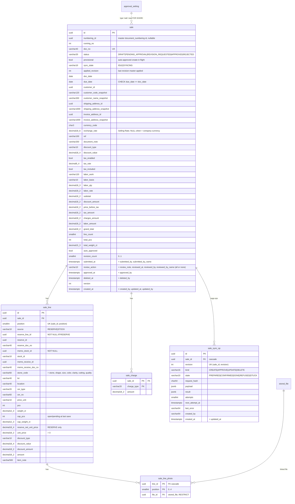
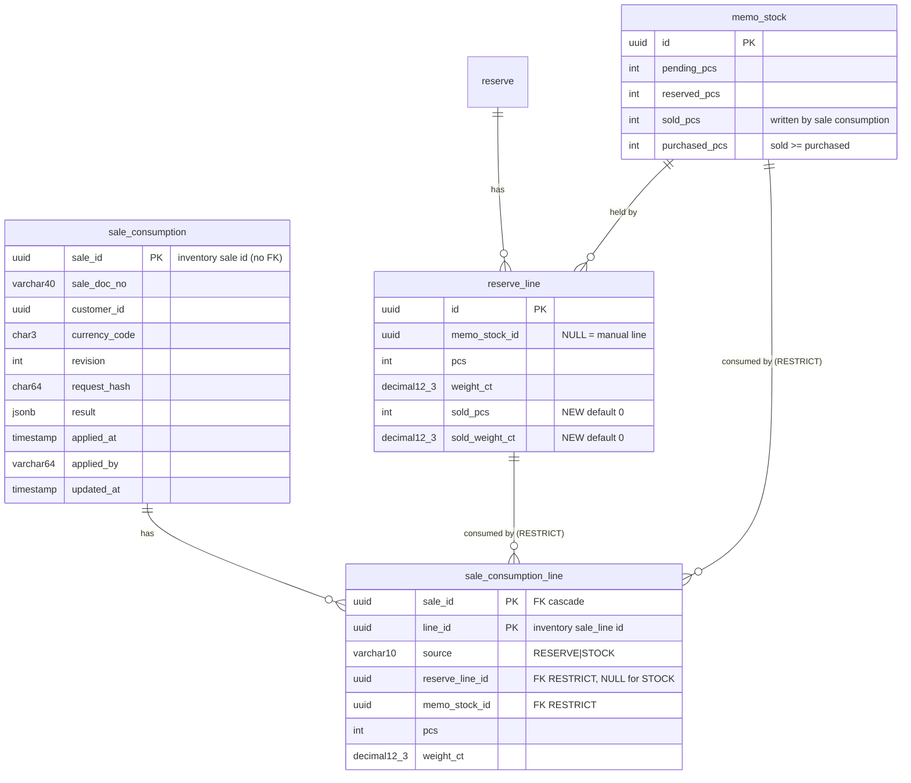

# Database design: inventory / sale (SA revision 1, approved 2026-11-18)

Two owners, two additive migrations, no cross-schema foreign key and no shared transaction. Inventory stores master ids (`customer_id`, `reserve_line_id`, `memo_stock_id`) as plain uuids with snapshots; master stores inventory ids (`sale_id`, `line_id`) as plain uuids in its consumption ledger.

## Part A — schema `inventory` (owner `backend-api-inventory`, migration `2026111xxxxxxx_sale`)

Constraints (SQL CHECKs in the migration):

- `sale_status_check`, `sale_sync_state_check`, `sale_revision_count_check (0..1)`, `sale_review_check` (all five review columns null or all set), `sale_submitted_check` (null while DRAFT and on auto-approved rows), `sale_due_date_check`, `sale_exchange_rate_check (exchange_rate IS NULL OR exchange_rate > 0)`, money ≥ 0, `version ≥ 1`.
- `sale_line_source_check`: `(source = 'RESERVE' AND reserve_line_id IS NOT NULL AND reserve_id IS NOT NULL) OR (source = 'STOCK' AND reserve_line_id IS NULL AND reserve_id IS NULL)`.
- `sale_line_qty_check`: `pcs >= 0 AND weight_ct >= 0 AND (pcs > 0 OR weight_ct > 0) AND pcs <= cap_pcs AND weight_ct <= cap_weight_ct`; `unit_price > 0`; `price_unit IN ('PER_CT','PER_PCS')`.
- Unique: `sale_line_reserve_line_key (sale_id, reserve_line_id) WHERE reserve_line_id IS NOT NULL`; `sale_line_stock_key (sale_id, memo_stock_id) WHERE source = 'STOCK'`.
- `sale_sync_op_state_check`, `sale_sync_op_kind_check`.
- `approval_setting_type_check` widened with `'sale'`; `INSERT ('sale', true)`.
- `notification_event` / `stored_file.source_type`: widen any value CHECK to include `sale` / `sale-line` (if present).

Indexes (Daybook, Approve Center, saga — same set as `load_to_stock`):

| Index | Columns / predicate | Used by |
|---|---|---|
| `sale_numbering_running_no_key` UK | `(numbering_id, running_no)`; plain `(running_no) WHERE numbering_id IS NULL` | numbering |
| `sale_list_idx` | `(doc_date DESC, created_at DESC, id DESC) WHERE deleted_at IS NULL AND NOT provisional` | Daybook |
| `sale_deleted_list_idx` | same `WHERE deleted_at IS NOT NULL` | Deleted filter |
| `sale_pending_idx` | `(submitted_at, id) WHERE status = 'PENDING_APPROVAL' AND deleted_at IS NULL` | Approve Center |
| `sale_revision_idx` | `(id) WHERE status = 'REVISION_REQUESTED' AND deleted_at IS NULL` | turn-OFF guard |
| `sale_syncing_idx` | `(sync_state) WHERE sync_state = 'SYNCING'` | start-up re-drive |
| `sale_customer_idx` | `(customer_id, doc_date DESC)` | later Account Outstanding / Sale Report |
| `sale_line_memo_stock_idx`, `sale_line_reserve_line_idx` | `(memo_stock_id)`, `(reserve_line_id)` | later reports / support |
| `sale_line_photo_file_idx` | `(file_id)` | photo read authorization |
| `sale_sync_op_due_idx` | `(next_attempt_at) WHERE state IN ('PREPARED','CONFIRMED')` | sweep |
| `sale_sync_op_done_idx` | `(updated_at) WHERE state = 'DONE'` | housekeeping |

Grants: tables owned by the migrator role; `gms_inventory_app` gets DML (existing default privileges in `provision-inventory-roles.sql`). No grant to other roles.

## Part B — schema `partner` (owner `api-master`, migration `2026111xxxxxxx_sale_consumption`)

- `reserve_line_sold_check`: `sold_pcs BETWEEN 0 AND pcs AND sold_weight_ct BETWEEN 0 AND weight_ct AND (memo_stock_id IS NOT NULL OR (sold_pcs = 0 AND sold_weight_ct = 0))`.
- `reserve_line_open_idx`: `(reserve_id, position) WHERE memo_stock_id IS NOT NULL AND (sold_pcs < pcs OR sold_weight_ct < weight_ct)`.
- `reserve_open_customer_idx` on `reserve`: `(customer_id, currency_code, doc_date, id) WHERE status = 'APPROVED' AND deleted_at IS NULL`.
- `sale_consumption_line`: CHECK source shape as inventory; `pcs ≥ 0`, `weight_ct ≥ 0`; indexes `(reserve_line_id)`, `(memo_stock_id)`; unique `(sale_id, reserve_line_id) WHERE reserve_line_id IS NOT NULL`.
- Existing `memo_stock_balance` and `memo_stock_purchased_check` are unchanged and enforce the bucket moves.
- `api-master` runtime role gets DML on the two new tables (existing default privileges).

## Migration, backfill, rollback

- Both migrations are additive; defaults 0 need no backfill (no Sale exists). Run master first (internal API depends on it), then inventory.
- Rollback before the first applied Sale: drop the new tables/columns/indexes and the `approval_setting` row (down scripts provided). After applied sales exist: release auto-approved sales through Delete first; approval-ON sales are final (Q-SL-16), so rollback becomes forward-fix only — recorded in ADR-0054.
- Retention: `stored_file` rows and bytes under `files/sale/` are never deleted by any migration or rollback (ADR-0030).
