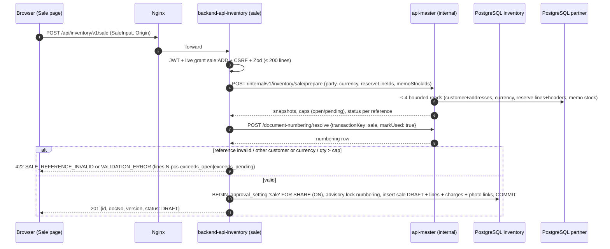
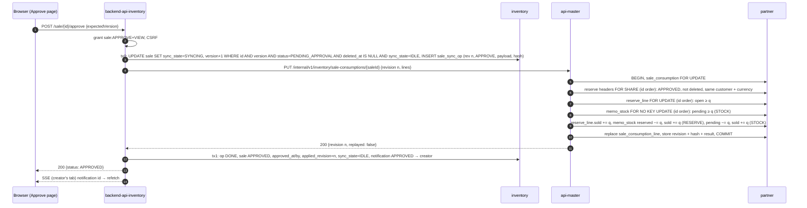
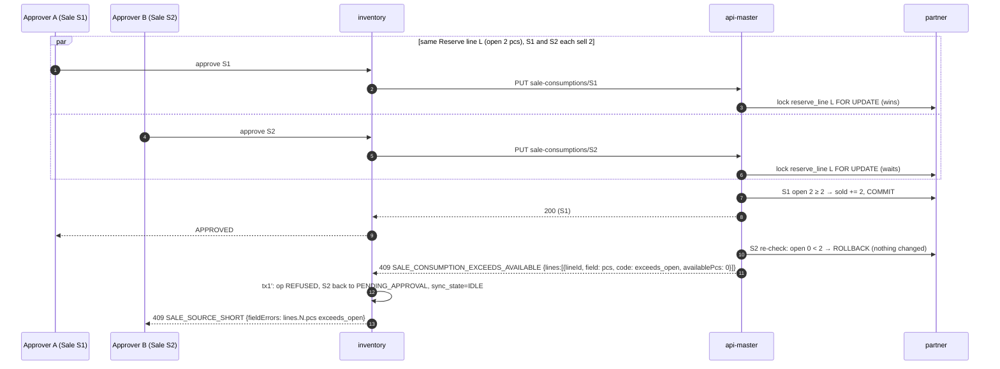
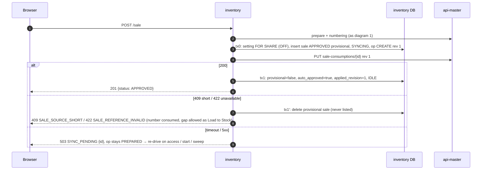
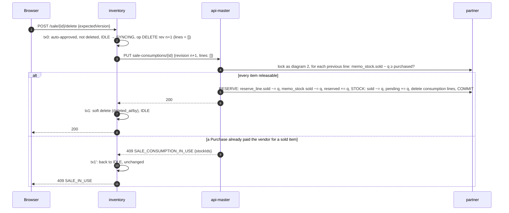
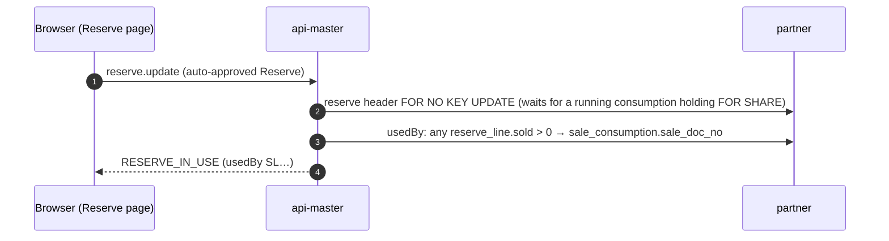
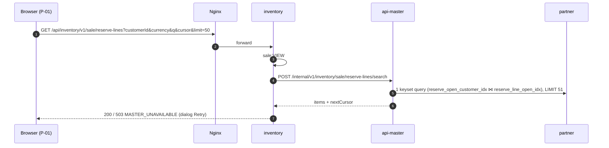

# Sequence diagrams: inventory / sale (SA revision 1, approved 2026-11-18)

Main user flow (not copied here): [diagram/sale-flow.md](../../../../diagram/sale-flow.md). No gateway: Nginx routes `/api/inventory/` to `backend-api-inventory` and `/api/master/` to `api-master`. Internal master calls never pass Nginx.

## 1. Save (approval ON → DRAFT)

## 2. Approve with From Reserve + From Stock lines (saga, success)

## 3. Short at approve (business refusal) and concurrent approvals

A Memo Out holding the same item in `reserved` is never touched: S1/S2 consume only through Reserve line L's open quantity.

## 4. Save with approval OFF (auto-approved, provisional create)

## 5. Edit or delete an auto-approved Sale (release, in-use guard)

Edit uses the same call with the new line set (increases re-checked, decreases released).

## 6. Reserve edit after a sale (master local)

## 7. From Reserve picker

