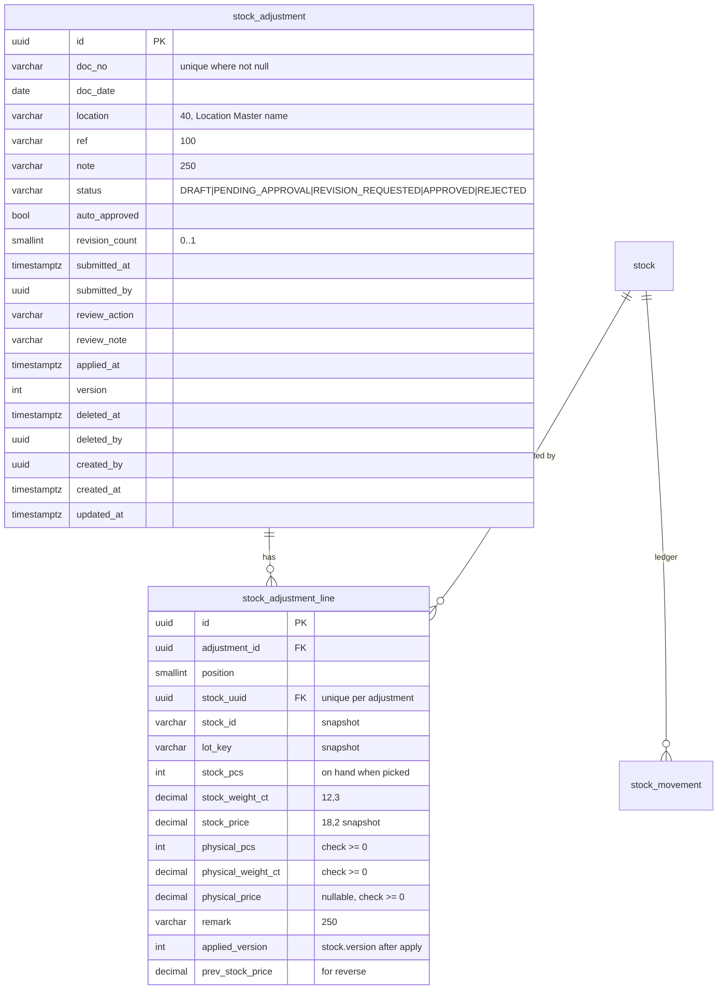

# Database diagram: inventory / stock-adjustment (SA revision 1, approved 2026-11-24)

## Migration (one file, `backend-api-inventory/prisma/migrations/<ts>_stock_adjustment/`)
1. Create both tables with these constraints:
   - FK `stock_adjustment_line.stock_uuid → stock.id` with `ON DELETE RESTRICT`.
   - Unique `(adjustment_id, stock_uuid)` and unique `(adjustment_id, position)`.
   - Checks on the status values, quantities ≥ 0, and `revision_count` between 0 and 1.
2. Indexes:
   - `stock_adjustment (doc_date desc, id desc) WHERE deleted_at IS NULL` for the daybook.
   - `stock_adjustment (status) WHERE status = 'PENDING_APPROVAL'`.
   - `stock_adjustment_line (stock_uuid)`.
3. Replace `stock_movement_kind_check` with the current list plus `'ADJUST', 'ADJUST_REVERSAL'`. Copy the list from `20261123120000_sale_own_stock` and re-check the latest migration first.
4. Widen the `approval_setting` type check with `'stock-adjustment'`.
5. Grants: the same pattern as the sale tables (app role DML; the ledger stays append-only).

`stock` itself gets no new column.
