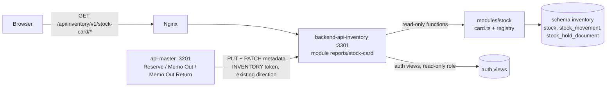

# Service architecture: inventory / stock-card

- Feature ID / SA revision: `stock-card` / **1**
- Source UI revision / TODO: UI rev 1 (pending-review) / [task/todo/stock-card.md](../../../../task/todo/stock-card.md) (BE-SC-*)
- Status: **pending-review** (approval fields `none`)
- ADR / main flow / review bundle: [ADR-0056](../../../../adr/0056-stock-card-report-in-inventory-service.md) (Proposed), [stock-card-flow](../../../../diagram/stock-card-flow.md), [decisions](decisions.md), [api-contract](api-contract.md), [authorization](authorization.md), [database-diagram](database-diagram.md), [sequence-diagram](sequence-diagram.md), [error-handling](error-handling.md), [dependencies](dependencies.md), [testing](testing.md)

## Domain and service boundaries

Reuse: the existing `backend-api-inventory` (Hono, schema `inventory`, ADR-0052 D1), its platform kernel (auth chain, CSRF for mutations, error envelope, db, logging) and the own-stock ledger. Nothing is created that a page needs and a service already has. No gateway, no tRPC (inventory is REST, ADR-0025), no new service.

| Owner | Writes | Reads from others |
|---|---|---|
| `backend-api-inventory` / module `reports/stock-card` | nothing (read-only) | through `modules/stock/card.ts`: `inventory.stock`, `stock_movement`, `stock_hold_document`; auth views for the live grant |
| `backend-api-inventory` / module `stock` | `stock_hold_document.doc_date / party_id / party_name` (new, from the internal PUT/PATCH) | — |
| `api-master` | sends `docDate` / `party` with the hold calls; the backfill script | nothing from inventory |
| `backend-api-auth` | catalog leaves + grant-copy migration | — |

Module rule: `reports/stock-card` has no SQL of its own against another module's private tables; the SQL lives in `modules/stock/card.ts` (the stock component owns `stock` / `stock_movement`) and the report module owns routes, Zod schemas, the concurrency guard and the HTTP mapping. Later reports (Closing Stock, Stock Value) reuse the same component. No cross-schema read, no shared transaction, no call to master at request time.

## Behaviour

### Read paths (one SQL statement per list page, at most two per detail call)

| Path | Statements | Index / bound |
|---|---|---|
| `GET /stock-card/options` | 1: `SELECT DISTINCT location FROM stock ORDER BY 1 LIMIT 500` | seq scan of `stock` (small); ≤ 500 values |
| `GET /stock-card/cards`, no Start and no Due (`CURRENT`) | 1: `stock` (`status = 'ACTIVE'`) grouped by `card_key`, `HAVING` balance ≠ 0 (and `bool_or` of the search match), sort, `LIMIT/OFFSET`, `count(*) OVER ()` | one scan of `stock` (≤ 50,000 rows assumed); page ≤ 50 rows |
| `GET /stock-card/cards`, Start or Due set (`RANGE`) | 1: candidate cards from `stock` (location / search) → their movements (`stock_movement_stock_idx` through `stock_card_key_idx`) → net per (card, document) → dated → per card balance / moved → filter, sort, `LIMIT/OFFSET`, `count(*) OVER ()` | movement rows of the candidate cards; ≤ 200,000 assumed; 5 s timeout |
| `GET /stock-card/cards/{cardKey}` | 1: header and current balance from `stock` by `card_key` | `stock_card_key_idx` |
| `GET /stock-card/cards/{cardKey}/transactions` | 2 in one `REPEATABLE READ READ ONLY` transaction: (A) existence, entry count, opening, totals, total rows; (B) the page rows with the running balance. Both from the same CTE chain | movements of the card's stocks by `stock_movement_stock_idx`; ≤ 50,000 movements / 5,000 entries |

All counts come from the same statement (`count(*) OVER ()`); there is no separate count query and no N+1: the number of statements does not depend on the number of rows. Response ≤ 51 rows (≈ 25 KiB).

### Entry computation (shared by the list `RANGE` mode and the detail)

1. `mv`: movements of the card's stocks whose `kind` is in the registry set (`CARD_KINDS`, fixed fragment built from code, passed as an array parameter).
2. `doc`: group by (document type, document id): `Σ pcs_delta`, `Σ weight_delta`, `min(created_at)` (apply time), the smallest visible Stock ID and the number of visible Stock IDs, the vendor of the stock (Load kinds). Keep groups whose net pcs or net weight is not zero.
3. `dated`: join `stock_hold_document` on (document type, document id) for hold kinds. `doc_date` = `stock.ref_doc_date` for Load kinds, `h.doc_date` for hold kinds, else the Bangkok date of `min(created_at)`. `doc_no` = `stock.ref_doc_no` / `h.document_no`. Account = the stock's vendor snapshot (Load) or `h.party_name`.
4. `ordered`: `doc_date <= Due`, then `Σ(...) OVER (ORDER BY doc_date, first_at, document_id ROWS UNBOUNDED PRECEDING)` gives the running balance (pcs and weight). `opening` = Σ of rows with `doc_date < Start`.
5. Filters after the window: `doc_date >= Start`, then the search. Direction: `GREATEST(net, 0)` is IN and `GREATEST(-net, 0)` is OUT, per dimension. Totals are window sums over the filtered rows; the closing balance is the balance of the last row at or before Due.
6. Sort and page. The running balance is never recomputed for the chosen sort.

Visible Stock ID rule and captions come from the registry (D4): hidden for `memo-out`, `reserve`, `quotation`, `purchase`, `memo-return` (ADR-0055 D9 amended 2026-11-21); a search term matches a Stock ID only on documents where it is visible.

### Write paths (additive, not part of the report itself)

| Action | Effect |
|---|---|
| Master `PUT /internal/v1/master/stock-holds/{type}/{id}` with optional `docDate`, `party` | stores them on `stock_hold_document` in the existing transaction; not part of the request hash, replay unchanged; absent fields leave the stored values alone |
| Master `PATCH /internal/v1/master/stock-holds/{type}/{id}/metadata` | sets `doc_date`, `party_id`, `party_name` of an existing hold document; no revision, no stock change; `404` when the document holds nothing yet; best effort on the master side (a failure is logged, the document save is not undone) |
| Master `stock-card:backfill` script | for every applied Reserve / Memo Out / Memo Out Return that has an inventory hold document, sends the PATCH; idempotent, re-runnable, bounded (200 per minute) |

### Concurrency, timeouts, failure

- At most **2 report queries in flight per process** (a small in-process semaphore); the third waits no longer than 250 ms and then gets `503 STOCK_CARD_BUSY` with `Retry-After: 2`. Document writes keep three of the five pooled connections.
- `SET LOCAL statement_timeout = '5s'`; a timeout is `503 STOCK_CARD_TIMEOUT` ("narrow the date range or search"). A client abort cancels nothing server-side beyond the timeout.
- Master is not needed to read the card; Stock Card stays up when master is down. Stale metadata only affects the displayed date or account of an old hold document.
- Everything is `Cache-Control: no-store`; no server cache. The card always reflects committed ledger rows (snapshot per call).

## Notifications and uploads

Not applicable. The report changes no record, so there is no notification, SSE or reconnect contract. It has no upload, so `@gms/storage` is not used; no `files/stock-card/` prefix, no stored-file metadata, and no retention rule apply.

## Capacity and rollout (4 GB RAM / 2 vCPU host)

| Item | Value |
|---|---|
| Containers | unchanged: 1.75 vCPU / 2880 MiB total, headroom ≈ 0.25 vCPU / 1216 MiB ([ADR-0024](../../../../adr/0024-production-host-4gb-2vcpu.md), [capacity](../../../../infra/capacity.md)) |
| inventory process | 0.20 vCPU / 256 MiB / heap 160 MiB / pids 128; pool 5 + authz 1; report concurrency ≤ 2 |
| PostgreSQL | existing 1024 MiB container; report CTEs aggregate ≤ 200,000 narrow rows (a few MiB of `work_mem`); `statement_timeout` 5 s; no new connection |
| Per request | ≤ 2 statements; ≤ 51 rows returned; no master or auth call beyond the standard authentication chain |
| Data (assumed) | ≤ 50,000 stocks, ≤ 200,000 movements, ≤ 20,000 cards, ≤ 5,000 entries per card |
| Cache / worker / Redis | none |
| Measurement still needed | `RANGE` list p95 ≤ 300 ms at 200,000 movements / 20,000 cards; `CURRENT` list ≤ 100 ms at 50,000 stocks; detail ≤ 150 ms at 5,000 entries; inventory RSS during 2 concurrent `RANGE` calls ≤ 40 MiB above idle (BE-SC-008) |
| Scale-out if missed | a monthly closing-balance table owned by the Closing Stock module (separate ADR); this design only needs `RANGE` to start from a snapshot |

Migration: one additive Prisma migration (generated column + index + three columns). Rollback: drop them (documented in the [database diagram](database-diagram.md)); the report is read-only so a rollback loses no business data. Compatibility: the new internal fields are optional; an older master keeps working (cards fall back to the first-movement date and an empty account).

## Container infrastructure

None. No container, image, network, secret, volume or DB role changes. Compared with [service-index](../../../../infra/service-index.md) row `backend-api-inventory` (bundle `services/backend-api-inventory/1`): unchanged. Nginx routes `/api/inventory/` already; the new routes are GET, JSON, ≤ 256 KiB request cap (no body), `no-store`. **INF-SC: no change.** **DevOps (DO-SC): no build-context, image or variable change**; the existing inventory, master and auth CI targets must run the new tests (no workflow edit expected).
