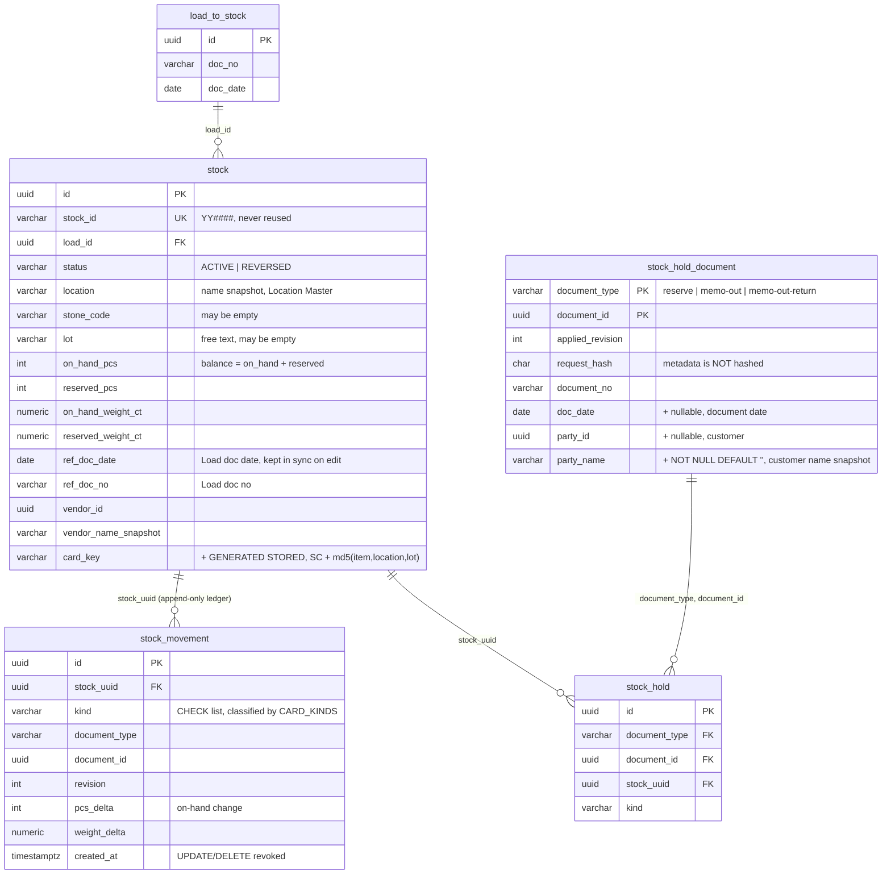

# Database diagram: inventory / stock-card

- Source UI revision / SA revision: UI 1 / **1** (pending-review)
- Owning service / schema: `backend-api-inventory` / `inventory` (the auth change touches `auth.user_permission`, owned by `backend-api-auth`)
- Actual Prisma schema / migration paths: `backend-api-inventory/prisma/schema.prisma` (models `stock`, `stock_movement`, `stock_hold_document`, `load_to_stock`); migrations `20261117100000_inventory_init`, `20261118100000_stock_holds_phase2`, `20261121090000_own_lot_key_per_stock`. Proposed: `backend-api-inventory/prisma/migrations/20261123090000_stock_card/` (+ a rollback script under `prisma/rollback/`).

The report is **read-only**. The change is additive: one generated column and one index on `stock`, three columns on `stock_hold_document`. **No new table.** Entities marked `+` are proposed columns.

Ownership: `stock`, `stock_movement`, `stock_hold*` belong to the inventory `stock` component. The report module owns no table. Master never reads these tables (it uses the internal API); inventory never reads `partner`.

## Definitions

- **`card_key`** (stored generated, `varchar(34)`): `'SC' || md5( item || chr(31) || upper(btrim("location")) || chr(31) || upper(btrim("lot")) )`, with `item = CASE WHEN "stone_code" <> '' THEN "stone_code" ELSE "stone" || chr(31) || "shape" || chr(31) || "size" || chr(31) || "color" || chr(31) || "clarity" || chr(31) || "cutting" || chr(31) || "quality" END`. Plain `||` on `NOT NULL DEFAULT ''` varchars keeps the expression immutable (generated column rule). Written by PostgreSQL only; never set from code. It is separate from `lot_key` (`'OS' || id`, ADR-0055).
- **Card kinds** = `stock_movement.kind` values classified in `CARD_KINDS`: `LOAD_IN`, `LOAD_ADJUST`, `LOAD_REVERSAL`, `MEMO_OUT`, `MEMO_OUT_REVERSAL`, `MEMO_OUT_RETURN`, `MEMO_OUT_RETURN_REVERSAL`; `HOLD_RESERVE` and `RELEASE_RESERVE` are classified as "not a movement". Invariant per stock: `Σ card-kind pcs_delta = on_hand_pcs + reserved_pcs` (same for weight).
- **Document date** = `stock.ref_doc_date` (Load kinds) or `stock_hold_document.doc_date` (hold kinds), else `(min(created_at) AT TIME ZONE 'Asia/Bangkok')::date`.
- **Timestamps:** `timestamptz(3)`; weights `numeric(12,3)`; no money in this report.

## Constraints, indexes and nullability

| Object | Definition | Reason |
|---|---|---|
| `stock.card_key` | `GENERATED ALWAYS AS (…) STORED`, nullable in Prisma (`String?`, like `lot_key`) | card identity |
| `stock_card_key_idx` | `CREATE INDEX ON inventory.stock (card_key)` | detail: stocks of a card; list `RANGE`: candidate cards to movements |
| `stock_movement_stock_idx` (existing) | `(stock_uuid, created_at)` | movements of the card's stocks |
| `stock_hold_document` PK (existing) | `(document_type, document_id)` | metadata join |
| `stock_hold_document.doc_date` | `DATE NULL` | document date; NULL = not yet backfilled |
| `stock_hold_document.party_id` | `UUID NULL` | customer id (no FK across services) |
| `stock_hold_document.party_name` | `VARCHAR(200) NOT NULL DEFAULT ''` | name snapshot; CHECK `char_length(party_name) <= 200` |
| `stock_movement` | **unchanged** (append-only, kind CHECK unchanged) | no write path changes |
| Existing partial index `stock_picker_idx`, `stock_lot_open_idx` | unchanged | pickers |

The `CURRENT` list is one scan of `stock` (bounded by the number of stocks); no partial index is proposed until the measurement in [architecture](architecture.md#capacity-and-rollout-4-gb-ram--2-vcpu-host) shows it is needed.

## Migration, backfill and rollback

1. **Migration `20261123090000_stock_card`** (additive, one transaction, short lock on a small table):
   - `ALTER TABLE inventory.stock ADD COLUMN card_key VARCHAR(34) GENERATED ALWAYS AS (…) STORED;` (rewrites `stock` once, as the `lot_key` migrations did);
   - `CREATE INDEX stock_card_key_idx ON inventory.stock (card_key);`
   - `ALTER TABLE inventory.stock_hold_document ADD COLUMN doc_date DATE, ADD COLUMN party_id UUID, ADD COLUMN party_name VARCHAR(200) NOT NULL DEFAULT '';` + the length CHECK;
   - grants unchanged (the app role already has DML on `stock_hold_document`; `stock_movement` stays append-only).
2. **Backfill of the card key:** none (generated).
3. **Backfill of hold metadata:** the master script `stock-card:backfill` sends `PATCH …/metadata` for every applied Reserve / Memo Out / Memo Out Return with a hold document; re-runnable. Until it runs the card shows the first-movement date and an empty account. Load rows need none.
4. **Auth migration** (`backend-api-auth/prisma/migrations/…_stock_card_grants`): copies grants as described in [authorization](authorization.md#catalog-change-auth-service). Rollback: delete the copied `stock-card` / `stock-value` rows; the old rows were never removed.
5. **Rollback (inventory):** `DROP INDEX stock_card_key_idx; ALTER TABLE stock DROP COLUMN card_key; ALTER TABLE stock_hold_document DROP COLUMN doc_date, DROP COLUMN party_id, DROP COLUMN party_name;` (safe: only this report reads them; disable the route first). Master keeps sending the optional fields; an older inventory would reject unknown keys, so deploy inventory first and roll master back second (strict Zod `docDate` / `party` are added in the same release).
6. **Compatibility:** an old master (without the fields) works against the new inventory; the new master against an old inventory fails the strict body check, so the order is inventory → master.

## Not in this revision (Memo Stock)

`partner.memo_stock` has no ledger. Revision 2 would add `partner.memo_stock_movement` in master (see [decisions](decisions.md#consignment-memo-stock-outline-for-revision-2)); this schema and `card_key` need no change for it because the Memo location is disjoint from own locations.
