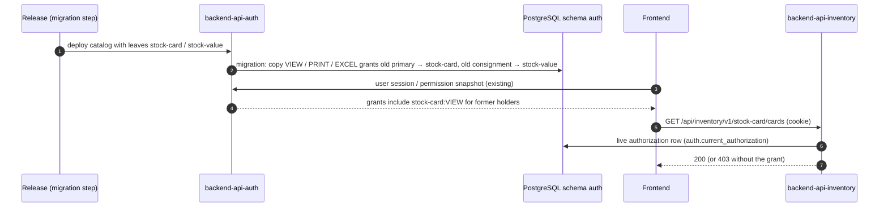

# Sequence diagram: inventory / stock-card

- Source UI revision / SA revision: UI 1 / **1** (pending-review)
- Main user flow: [diagram/stock-card-flow.md](../../../../diagram/stock-card-flow.md) (not copied here)
- Related API operations / TODO IDs: [api-contract](api-contract.md); BE-SC-002/003 (A, B), BE-SC-004/005/006 (C), BE-SC-007 (D)

There is no gateway. The browser calls Nginx on the same origin; Nginx routes `/api/inventory/` to `backend-api-inventory`; the inventory process reads PostgreSQL schema `inventory` only.

## A. Stock Card list (`CURRENT` and `RANGE`)

```mermaid
sequenceDiagram
  autonumber
  actor U as User
  participant FE as Frontend (stock-card list)
  participant N as Nginx
  participant I as backend-api-inventory<br/>reports/stock-card
  participant A as auth views (read-only role)
  participant DB as PostgreSQL schema inventory

  U->>FE: open Stock Card, type a search, pick location / Start / Due
  FE->>N: GET /api/inventory/v1/stock-card/cards?q&location&from&to&sort&dir&page&pageSize
  N->>I: forward (cookie, no body)
  I->>I: verify JWT (JWKS), parse + validate query (Zod strict)
  I->>A: live authorization row + license decision (existing chain)
  alt unauthenticated / license denied / auth unavailable
    I-->>FE: 401 / 403 / 503 (fail closed)
  else no stock-card:VIEW
    I-->>FE: 403 PERMISSION_DENIED
  else invalid query (from > to, page > 200, bad sort)
    I-->>FE: 422 VALIDATION_ERROR field details
  else allowed
    I->>I: concurrency guard (≤ 2 report queries in flight)
    alt guard full for 250 ms
      I-->>FE: 503 STOCK_CARD_BUSY (Retry-After 2)
    else slot acquired
      I->>DB: BEGIN READ ONLY; SET LOCAL statement_timeout = 5s
      alt mode CURRENT (no from, no to)
        I->>DB: ONE statement: stock ACTIVE GROUP BY card_key, HAVING balance <> 0, search match, ORDER, LIMIT/OFFSET, count(*) OVER()
      else mode RANGE
        I->>DB: ONE statement: candidate cards → movements → net per (card, document) → dated → balance at Due / moved → filter, ORDER, LIMIT/OFFSET, count(*) OVER()
      end
      alt statement timeout
        I-->>FE: 503 STOCK_CARD_TIMEOUT (narrow the filters)
      else rows
        DB-->>I: ≤ 25..50 rows + total
        I-->>FE: 200 { items, total, page, pageSize, mode, asOf }
        FE-->>U: table, BALANCE Pcs / Cts, pager
      end
    end
  end
```

## B. Card detail (header + transactions)

```mermaid
sequenceDiagram
  autonumber
  actor U as User
  participant FE as Frontend (stock-card detail)
  participant N as Nginx
  participant I as backend-api-inventory
  participant DB as PostgreSQL schema inventory

  U->>FE: click a list row (cardKey from the list)
  par header
    FE->>N: GET /api/inventory/v1/stock-card/cards/{cardKey}
    N->>I: forward
    I->>I: auth chain + stock-card:VIEW, cardKey ^SC[0-9a-f]{32}$
    I->>DB: ONE statement: attributes of the newest stock, vendor count, current balance (stock by card_key)
    alt no stock has this key (or malformed key)
      I-->>FE: 404 STOCK_CARD_NOT_FOUND
    else found
      I-->>FE: 200 CardHeader
    end
  and rows
    FE->>N: GET /api/inventory/v1/stock-card/cards/{cardKey}/transactions?q&from&to&sort&dir&page&pageSize
    N->>I: forward
    I->>I: auth chain + VIEW + validate + concurrency guard
    I->>DB: BEGIN READ ONLY REPEATABLE READ; SET LOCAL statement_timeout = 5s
    I->>DB: statement A: exists, entry count (≤ 5,000), opening, totals, total rows
    alt card unknown
      I-->>FE: 404 STOCK_CARD_NOT_FOUND
    else entries > 5,000 or movements > 50,000
      I-->>FE: 422 STOCK_CARD_TOO_LARGE
    else ok
      I->>DB: statement B: page rows with the running balance (window computed before q, from, sort)
      DB-->>I: ≤ 50 rows
      I-->>FE: 200 { items, total, opening, totals }
    end
  end
  U->>FE: click DOC NO
  FE->>FE: route push to the document page (type → route map); the document enforces its own VIEW
```

## C. Hold metadata from master (additive path, existing saga direction)

```mermaid
sequenceDiagram
  autonumber
  participant M as api-master (hold saga)
  participant I as backend-api-inventory<br/>internal /master
  participant DB as PostgreSQL schema inventory

  Note over M: Reserve / Memo Out / Memo Out Return applied (create, approve, edit, delete)
  M->>I: PUT /internal/v1/master/stock-holds/{type}/{id} {revision, documentNo, holds, docDate, party}
  I->>I: token check (constant time), strict Zod (docDate, party optional)
  I->>DB: tx: existing applyHolds (lock, deltas, buckets, hold rows, movements)
  I->>DB: same tx: UPDATE stock_hold_document SET doc_date, party_id, party_name (only the fields sent)
  alt replay (same revision, same hash)
    I->>DB: no stock change; metadata still applied (idempotent)
  else stale / exceeds / busy
    I-->>M: existing refusal codes; nothing stored
  end
  I-->>M: 200 existing result

  Note over M: date or customer edited, hold set unchanged
  M->>I: PATCH …/stock-holds/{type}/{id}/metadata {docDate, party}
  alt hold document exists
    I->>DB: UPDATE stock_hold_document metadata
    I-->>M: 200 {updated: true}
  else none (the document holds no own stock)
    I-->>M: 404 NOT_FOUND (master ignores it)
  end
  Note over M: PATCH failure is logged; the document save stands. The next hold call or a backfill run corrects the display.
  Note over M: One-off script stock-card:backfill sends PATCH for every applied document with a hold document (≤ 200 per minute).
```

## D. Permission catalog and grant copy (auth)



## Alternate and error paths covered

| Case | Where | Outcome |
|---|---|---|
| Not signed in / session expired / license denied | A, B | 401 / 403, the app shell handles it |
| Auth views down | A, B | 503 fail closed |
| Invalid query | A, B | 422 with field details |
| Guard full / statement timeout | A, B | 503 `STOCK_CARD_BUSY` / `STOCK_CARD_TIMEOUT`, UI shows Retry |
| Card disappeared | B | 404 `STOCK_CARD_NOT_FOUND`, UI "This stock card no longer exists" |
| Master down | C | unaffected for reading; metadata may lag, no data loss |
| Metadata missing (old hold document) | A, B | first-movement date, empty account |
