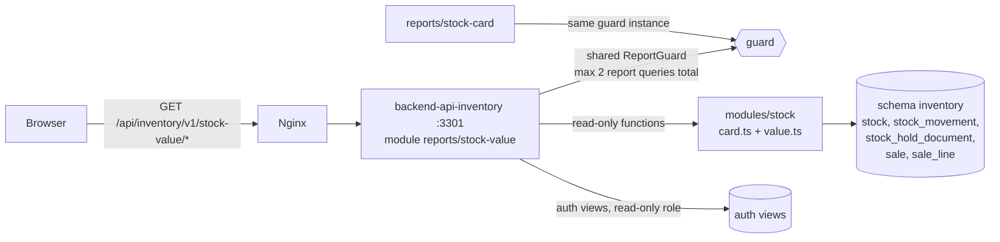

# Service architecture: inventory / stock-value

- Feature ID / SA revision: `stock-value` / **1**
- Source UI revision / TODO: UI rev 1 (ui-spec, concurrent) / [task/todo/stock-value.md](../../../../task/todo/stock-value.md) (BE-SV-*)
- Status: **pending-review** (work authorized by the owner instruction of 2026-11-23; approval fields recorded by the parent)
- ADR / main flow / review bundle: [ADR-0057](../../../../adr/0057-stock-value-report-in-inventory-service.md) (Proposed), [stock-value-flow](../../../../diagram/stock-value-flow.md) (ui-spec), [decisions](decisions.md), [api-contract](api-contract.md), [authorization](authorization.md), [database-diagram](database-diagram.md), [sequence-diagram](sequence-diagram.md), [error-handling](error-handling.md), [dependencies](dependencies.md), [testing](testing.md)

## Domain and service boundaries

Reuse: the existing `backend-api-inventory` (Hono, schema `inventory`), its platform kernel (auth chain, error envelope, db, logging), the **Stock Card read model** ([architecture](../stock-card/architecture.md)) and the own-stock tables. Stock Value is a second report module over the same component. No gateway, no tRPC, no new service.



| Owner | Writes | Reads from others |
|---|---|---|
| `backend-api-inventory` / module `reports/stock-value` | nothing (read-only) | through `modules/stock/value.ts` (and `card.ts`): `stock`, `stock_movement`, `stock_hold_document` (stock component) and `sale`, `sale_line` (Sale module's tables, **read-only SQL inside the stock component's report function, same schema and process**); auth views for the live grant |
| `backend-api-inventory` / Sale module | unchanged (no write path changes) | — |
| `api-master`, `backend-api-auth`, frontend | nothing for this report | no master call at request time, no auth change |

Module rule (as Stock Card): `reports/stock-value` owns routes, Zod schemas and the HTTP mapping; the SQL lives in `src/modules/stock/value.ts`. Reading `sale` / `sale_line` is a same-service, same-schema read behind one function (`lastSaleSql`), and it is the only place that knows the Sale columns; a Sale schema change is caught by its integration test. No cross-schema read, no shared transaction with another service, no `partner` read.

## Behaviour

### Read paths (statement budget independent of the number of rows)

| Path | Statements | Index / bound |
|---|---|---|
| `GET /stock-value/options` | 1: Stock Card's `readOptions` (distinct locations, <= 500) | unchanged |
| `GET /stock-value/cards`, no Start and no Due (`CURRENT`) | 1: Stock Card's grouped cards CTE `g` (balance) + valuation aggregates in the **same GROUP BY pass** + last-sale probe only for cards without a Price list + totals + top-N page | one scan of ACTIVE `stock` (<= 50,000); probes use `sale_line_item_key_idx` |
| `GET /stock-value/cards`, Start or Due set (`RANGE`) | 1: Stock Card's `RANGE` CTE chain (entries, balance at Due) + a valuation pass over the ACTIVE stocks of the cards in `g` (`stock_card_key_idx`) + probes + totals + page | movement rows of candidate cards (<= 200,000 assumed); 5 s timeout |
| `GET /stock-value/cards/{cardKey}` | 1: header + current balance + valuation (+ probe) for one card | `stock_card_key_idx`, `sale_line_item_key_idx` |
| `GET /stock-value/cards/{cardKey}/transactions` | 2 in one `REPEATABLE READ READ ONLY` transaction. (A) existence, entry count, opening, totals, closing balance, **valuation of the card** (exact `price`, `avg_cost`, `unit`, source, ref); (B) the page rows with the running balance, **`amount` / `profitLoss` computed in SQL from the bound exact price and cost of (A)** (sortable by `profitLoss`) | the Stock Card chain for one card; <= 5,000 entries, <= 50,000 movements |

`count(*) OVER ()`, the totals and the valuation come from the same statement; there is no separate count, no per-row call, no N+1. Response <= 51 rows plus one `totals` / `valuation` object (about 30 KiB).

### Valuation rules

Let `S(C)` be the ACTIVE stocks of card `C` (same `card_key`).

1. **Weights.** `bp_i = on_hand_pcs + reserved_pcs`, `bw_i = on_hand_weight_ct + reserved_weight_ct`. If `Σ bp = 0` and `Σ bw = 0` over `S(C)`, the weights are the loaded quantities (`pcs`, `weight_ct`); otherwise the book balance. Call them `wp_i`, `ww_i`.
2. **Unit.** `PCS` iff every stock with `wp_i > 0 or ww_i > 0` has `price_unit = 'PER_PCS'`; else `CT`. `basis_i = ww_i` (CT) or `wp_i` (PCS). `own_i = ww_i` if the stock's own `price_unit` is `PER_CT`, else `wp_i` (a per-piece stock in a `CT` card therefore spreads its value over its own weight; stocks with `basis_i = 0` take no part).
3. **Price list** `P = Σ(sale_price_i x own_i) / Σ basis_i` over stocks with `sale_price_i > 0` and `basis_i > 0`; undefined if the set is empty.
4. **Cost** `K = Σ(unit_cost_base_i x own_i) / Σ basis_i` over stocks with `unit_cost_base_i > 0` and `basis_i > 0`; undefined if empty.
5. **Last sale** `L`, only when `P` is undefined: the latest approved Sale line with equal `item_key` ([decisions](decisions.md#last-sale-lookup-d4)), `u x COALESCE(exchange_rate, 1)`, converted to the card unit with that line's quantities when its `price_unit` differs. `PRICE_LIST` if `P`, else `LAST_SALE` if `L`, else `NONE`.
6. **Value of a balance** `(pcs, weight)`: `basis = weight` (CT) or `pcs` (PCS); `amount = round(price x basis, 2)`; `cost = round(K x basis, 2)`; `profitLoss = amount - cost` when both exist, else null. The list uses the balance of the card (at Due in `RANGE`); the detail uses each row's running balance and the closing balance for the Total.

The pure rules (unit, weighting, conversion, rounding mirror) are also written as TypeScript in `value.ts` with `Decimal` for the unit tests; PostgreSQL `numeric` is the engine of record, and IT-SV-V1 compares both on fixtures.

### SQL shape (list, informative; BE-SV-003 owns the exact text)

```
WITH <Stock Card's g / grouped CTE, extracted as groupedCardsSql(params)>,
v AS (  -- one row per card of g: valuation aggregates (CURRENT: computed inside g's GROUP BY)
  SELECT card_key, unit, pl_value, pl_basis, cost_value, cost_basis, item_key, ...
),
priced AS (
  SELECT g.*, v.*, (v.pl_value / NULLIF(v.pl_basis, 0)) AS pl_price, (v.cost_value / NULLIF(v.cost_basis, 0)) AS avg_cost
  FROM g JOIN v USING (card_key)
),
valued AS (
  SELECT p.*, ls.*,                                  -- LATERAL last-sale probe, only WHERE pl_price IS NULL
         COALESCE(p.pl_price, ls.price) AS price, <source>, <amount>, <cost>, <profit_loss>
  FROM priced p LEFT JOIN LATERAL (<latest approved sale_line by item_key, LIMIT 1>) ls ON p.pl_price IS NULL
),
t AS (SELECT count(*), sum(bal_pcs), sum(bal_w), sum(amount), sum(profit_loss), count(*) FILTER (WHERE price IS NULL), ... FROM valued)
SELECT t.*, page.* FROM t LEFT JOIN LATERAL (SELECT ... FROM valued JOIN stock n ON n.id = newest_id ORDER BY <enumerated keys> LIMIT :pageSize OFFSET :offset) page ON true
```

Sort keys are the Stock Card enumerated fragments plus `price`, `amount`, `profit_loss` (`... NULLS LAST` regardless of `dir`); ties break by `card_key`. No user text enters SQL: `q`, `location`, dates, `cardKey` are bound parameters, `LIKE` metacharacters are escaped (Stock Card's `likePattern`).

### Reuse of Stock Card code (no behaviour change)

| Change | File | Reason |
|---|---|---|
| Extract the `grouped` fragment of `readCards` into an exported `groupedCardsSql(params)` and export `entriesSql`, `likePattern`, `locationFilter`, `stockMatch`, `entryFilter`, `txnOrderBy`, `CARD_COLUMNS`, `mapCard`, the types and constants | `src/modules/stock/card.ts` | one definition of cards, entries and balance for both reports; Stock Card tests must pass unchanged |
| Move the guard to `src/modules/reports/guard.ts`, parameterised by `{ busy, timeout }` error codes; keep `reports/stock-card/guard.ts` as a re-export | guard files | one shared instance; Stock Card keeps `STOCK_CARD_BUSY` / `STOCK_CARD_TIMEOUT`, Stock Value passes `STOCK_VALUE_*` |
| Export the shared Zod pieces (`text`, `date`, `dir`, `page`, `pageSize`, `range`) | `reports/stock-card/schemas.ts` | identical query validation |
| Register the routes and pass **one** `ReportGuard` to both modules | `src/app.ts` (**composition root, parent-serialized**) | total in flight <= 2 |

### Write paths

None. The report changes no record: no transaction with writes, no saga, no notification, no upload. Price and cost change only through Load to Stock edits and Sale applies, which already exist.

### Concurrency, timeouts, failure

- Shared guard: at most **2 report queries in flight per process across Stock Card and Stock Value**; a third waits <= 250 ms, then `503 STOCK_VALUE_BUSY` (`Retry-After: 2`). Document writes keep three of the five pooled connections.
- `SET LOCAL statement_timeout = '5s'` and read-only; a timeout is `503 STOCK_VALUE_TIMEOUT`.
- Master and auth-service availability are not needed beyond the standard authentication chain; the report works while master is down.
- Everything is `Cache-Control: no-store`; no server cache; the detail reads one consistent snapshot (`REPEATABLE READ`), so header values of statement A match the rows of statement B. The list and the header are separate calls; a price change between them can differ, and the UI's refetch resolves it.

## Notifications and uploads

Not applicable: the report changes no record (no notification, SSE or reconnect contract) and has no upload (`@gms/storage` unused; no `files/stock-value/` scope, metadata or retention rule).

## Capacity and rollout (4 GB RAM / 2 vCPU host)

| Item | Value |
|---|---|
| Containers | unchanged: 1.75 vCPU / 2880 MiB total, headroom ≈ 0.25 vCPU / 1216 MiB ([ADR-0024](../../../../adr/0024-production-host-4gb-2vcpu.md), [capacity](../../../../infra/capacity.md)) |
| inventory process | 0.20 vCPU / 256 MiB / heap 160 MiB / pids 128; pool 5 + authz 1; report concurrency <= 2 **across both reports** |
| PostgreSQL | existing 1024 MiB container; the list aggregates <= 50,000 narrow stock rows and probes <= 20,000 stones; a few MiB of `work_mem`; 5 s timeout; no new connection |
| Per request | <= 2 statements; <= 51 rows; no master or auth call beyond the standard chain |
| Data (assumed) | <= 50,000 stocks, <= 20,000 cards, <= 200,000 movements, <= 200,000 sale lines |
| Cache / worker / Redis | none |
| Measurement still needed | PF-SV-01...05 in [testing](testing.md): `CURRENT` list p95 <= 600 ms, `RANGE` list <= 800 ms, detail <= 200 ms, last-sale probe for 20,000 unpriced cards <= 250 ms, inventory RSS <= idle + 40 MiB during 2 concurrent `RANGE` lists |
| If missed | (1) a partial index `stock_active_card_idx` on ACTIVE stocks (additive migration, same ADR); (2) `item_last_sale` maintained by the Sale transaction (BE-SV-101, separate ADR); (3) a monthly closing table owned by Closing Stock (as ADR-0056 D12) |

Migration: one additive Prisma migration `20261123110000_stock_value` (two generated columns, one index). Rollback script drops them ([database diagram](database-diagram.md)); the report is read-only so a rollback loses no business data. Deploy order: migrate job, then the inventory image; nothing else changes. Compatibility: a new frontend against an old backend gets 404 on `/stock-value/*` (the UI keeps its placeholder behind the same permission until BE-SV-004 is deployed).

## Container infrastructure

None. No container, image, network, secret, volume or DB role changes. Compared with [service-index](../../../../infra/service-index.md) row `backend-api-inventory`: unchanged. Nginx already routes `/api/inventory/`; the new routes are GET, JSON, no body, `no-store`. **INF-SV: no change.** **DevOps (DO-SV): no build-context, image or variable change**; the existing inventory CI target must run the new tests (no workflow edit expected).
