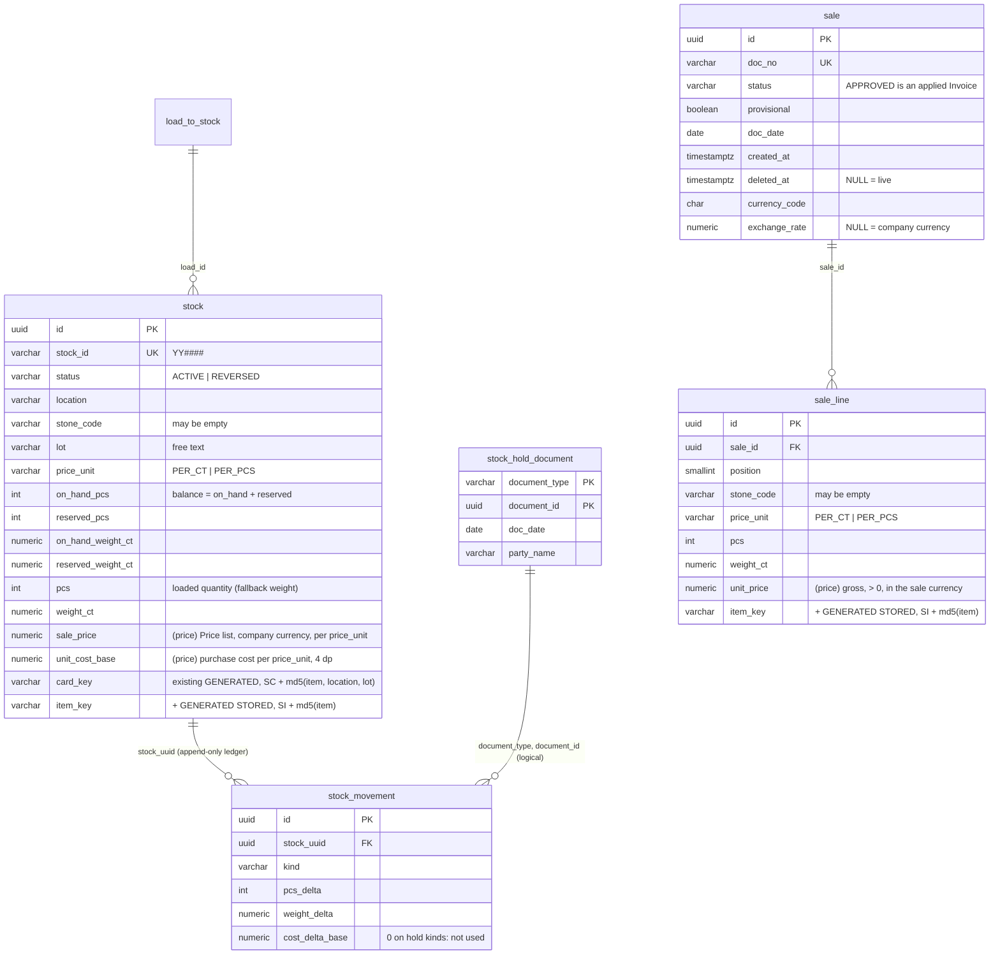

# Database diagram: inventory / stock-value

- Source UI revision / SA revision: UI 1 / **1** (pending-review)
- Owning service / schema: `backend-api-inventory` / `inventory`. No other schema is touched.
- Actual Prisma schema / migration paths: `backend-api-inventory/prisma/schema.prisma` (models `stock`, `stock_movement`, `stock_hold_document`, `sale`, `sale_line`); migrations `20261117100000_inventory_init`, `20261119090000_sale`, `20261123090000_stock_card`. Proposed: `backend-api-inventory/prisma/migrations/20261123110000_stock_value/` and `prisma/rollback/20261123110000_stock_value.down.sql`.

The report is **read-only**. The change is additive: two generated columns and one index. **No new table, no backfill, no data rewrite except the generated column on `stock`.** Entities marked `+` are proposed columns; `(price)` marks the existing price columns the report reads.

Ownership: `stock`, `stock_movement`, `stock_hold*` belong to the inventory `stock` component; `sale*` to the Sale module; the report module owns no table. The stock component's report function reads `sale` / `sale_line` (same schema, read-only). Master never reads these tables; inventory never reads `partner`.

## Definitions

- **`item_key`** (stored generated, `varchar(34)`), identical expression on both tables: `'SI' || md5( upper(btrim( CASE WHEN "stone_code" <> '' THEN "stone_code" ELSE "stone" || chr(31) || "shape" || chr(31) || "size" || chr(31) || "color" || chr(31) || "clarity" || chr(31) || "cutting" || chr(31) || "quality" END )) )`. It is the item part of `card_key` (without location and lot). Plain `||` on `NOT NULL DEFAULT ''` varchars keeps it immutable. Written by PostgreSQL only; never set from code. Test IT-SV-M1 asserts that equal stones get equal keys on `stock` and `sale_line`, and that `card_key` equal implies `item_key` equal.
- **Applied Invoice** = `sale.status = 'APPROVED' AND sale.deleted_at IS NULL AND NOT sale.provisional` (`sale_provisional_check` forces provisional rows to be APPROVED, so `provisional` must be excluded explicitly).
- **Latest** = `ORDER BY sale.doc_date DESC, sale.created_at DESC, sale_line.position DESC`.
- **Company-currency price** = `sale_line.unit_price x COALESCE(sale.exchange_rate, 1)` (Selling Rate: company = foreign x rate, ADR-0054 D10).
- **Money / quantity scales:** `unit_price` 18,2; `unit_cost_base` 18,4; `weight_ct` 12,3. Intermediate results stay `numeric` (no float); the API rounds as in [api-contract](api-contract.md).
- **Card key, card kinds, document date, movement kinds:** unchanged ([stock-card database diagram](../stock-card/database-diagram.md#definitions)).

## Constraints, indexes and nullability

| Object | Definition | Reason |
|---|---|---|
| `stock.item_key` | `VARCHAR(34) GENERATED ALWAYS AS (…) STORED`, nullable in Prisma (`String?`, like `card_key`) | stone identity for the last-sale probe; read from the card's newest stock |
| `sale_line.item_key` | same expression | stone identity of an invoice line |
| `sale_line_item_key_idx` | `CREATE INDEX ON inventory.sale_line (item_key)` | the per-card probe: lines of the stone, then `sale` by primary key |
| `stock_card_key_idx` (existing) | `(card_key)` | detail and `RANGE` valuation pass |
| `stock_movement_stock_idx` (existing) | `(stock_uuid, created_at)` | entries |
| `sale` PK, `sale_list_idx` (existing) | `(id)`; partial `(doc_date desc, created_at desc, id desc) WHERE deleted_at IS NULL AND NOT provisional` | the join by `sale_id` uses the primary key; no new `sale` index needed |
| `stock_active_card_idx` | **contingency, not in the base migration:** `(card_key) WHERE status = 'ACTIVE'` (+ balance columns in `INCLUDE`) | only if PF-SV-02 misses; additive, separate rollback line |
| `stock_movement`, `sale`, `sale_line` data | **unchanged** | no write path change |

The probe reads all lines of a stone, joins `sale`, filters and sorts in memory. At the assumed 200,000 sale lines over 20,000 stones that is ~10 lines per stone; PF-SV-05 measures a stone with 5,000 lines. If it misses, scale-out is the `item_last_sale` table of BE-SV-101 (separate ADR).

## Migration, backfill and rollback

1. **Migration `20261123110000_stock_value`** (additive, one transaction):
   - `ALTER TABLE inventory.stock ADD COLUMN item_key VARCHAR(34) GENERATED ALWAYS AS (…) STORED;` (rewrites `stock` once, as the `lot_key` and `card_key` migrations did);
   - `ALTER TABLE inventory.sale_line ADD COLUMN item_key VARCHAR(34) GENERATED ALWAYS AS (…) STORED;` (rewrites `sale_line`, small today);
   - `CREATE INDEX sale_line_item_key_idx ON inventory.sale_line (item_key);`
   - grants unchanged (the app role already has SELECT on both tables; the migrator owns the DDL).
2. **Prisma:** add `item_key String? @db.VarChar(34)` to `stock` and `sale_line`, `@@index([item_key], map: "sale_line_item_key_idx")`; regenerate the client (`src/generated/prisma` is regenerated by the backend; no manual edit).
3. **Backfill:** none (generated). **Data repair:** none.
4. **Rollback (`prisma/rollback/20261123110000_stock_value.down.sql`):** `DROP INDEX inventory.sale_line_item_key_idx; ALTER TABLE inventory.sale_line DROP COLUMN item_key; ALTER TABLE inventory.stock DROP COLUMN item_key;` Safe: only this report reads them; disable the Stock Value route first (remove the registration), then run the script. No data is lost.
5. **Compatibility:** old code ignores the columns (Prisma selects by name), so the migrate job can run before the image; a new image against an un-migrated database fails the report only (the Stock Value statements reference the columns), not the other modules; the migrate job runs first in the existing release order.
6. **Never edit an applied migration;** the existing `20261123090000_stock_card` stays as is.

## Not in this revision

Memo Stock (`partner.memo_stock`) is not valued (SQ-SV-13). A price-history table, an `item_last_sale` table and a closing-valuation snapshot are scale-out options only (ADR-0057 consequences).
