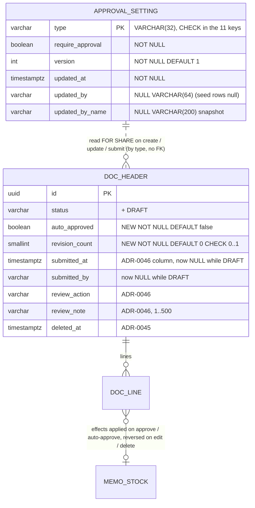

# Database diagram: approval-setup (SA revision 1, 2026-11-10, approved with ADR-0050)

Owner `backend-api-master`, schema `partner`. Applies on top of the approve-center migration `20261107090000_approval_review` ([its diagram](../approve-center/database-diagram.md)), which is not yet applied; both migrations ship in the same release, approve-center first.

`DOC_HEADER` = `quotation`, `reserve`, `memo_receive`, `memo_return`, `memo_out`, `memo_out_return`, `purchase_order`, `purchase`. Quotation also receives the ADR-0046 review/submitted columns (it was outside ADR-0046's seven tables) and keeps `CANCELLED`.

## Constraints per header `<t>` (replacing the ADR-0046 versions)

| Constraint | Definition |
|---|---|
| `<t>_status_check` | `status IN ('DRAFT','PENDING_APPROVAL','APPROVED','REJECTED','REVISION_REQUESTED')` (+ `'CANCELLED'` for quotation) |
| `<t>_submitted_check` | `(status = 'DRAFT') = (submitted_at IS NULL)` for non-deleted rows of the 7 engine tables; `submitted_at`/`submitted_by` paired. Quotation: `status IN ('DRAFT','CANCELLED') OR submitted_at IS NOT NULL OR auto_approved` |
| `<t>_auto_approved_check` | `NOT auto_approved OR (status = 'APPROVED' AND submitted_at IS NULL AND review_action IS NULL)` |
| `<t>_revision_count_check` | `revision_count BETWEEN 0 AND 1 AND (status <> 'REVISION_REQUESTED' OR revision_count = 1)` |
| `<t>_deleted_check` | `deleted_at IS NULL OR status IN ('DRAFT','REVISION_REQUESTED') OR (status = 'APPROVED' AND auto_approved)`, with `deleted_at`/`deleted_by` paired |
| ADR-0046 `review_check`, `review_status_check`, `approved_check` | unchanged |

`approval_setting_type_check`: `type IN ('quotation','reserve','memo-receive','memo-return','memo-out','memo-out-return','purchase-order','purchase','load-to-stock','merge-split','stock-transfer-location')`.

## Indexes

- ADR-0046 partial index `(submitted_at, id) WHERE status = 'PENDING_APPROVAL' AND deleted_at IS NULL` per header (also added on `quotation`).
- New partial index per header `(id) WHERE status = 'REVISION_REQUESTED' AND deleted_at IS NULL` for the turn-OFF guard and Setup counts (rows are few; replaces a scan).
- `isUsed` uses existing FK indexes: `memo_stock(memo_receive_line_id)`, `memo_out_return_line(memo_out_line_id)`, `purchase_line(memo_stock_id)`, `purchase_line(purchase_order_line_id)`, `reserve_line/memo_out_line(memo_stock_id)`. BE-AS-003 verifies each exists and adds the missing one in this migration.

## Migration `20261110090000_approval_setting`

1. Create `approval_setting`; seed 11 rows: quotation `false`, all others `true`, `updated_at = now()`.
2. Per header: add `auto_approved`, `revision_count`; make `submitted_at`/`submitted_by` nullable; replace the constraints above; add the indexes.
3. Backfill: `quotation` rows with `status = 'APPROVED'` → `auto_approved = true` (today's Save-approved Quotation stays editable while Quotation is OFF); every other existing row keeps `auto_approved = false`, `revision_count = 0`.
4. No data is approved by SQL. Existing `PENDING_APPROVAL` documents are handled by the go-live command (ADR-0050 D7), which runs after the migration and before the new frontend is opened.

Auth migration: none (the catalog is code; the new leaf `approval-setup` has no default grants).

## Go-live command (`scripts/approve-pending.ts`)

- `--dry-run` (default) lists what would happen; `--apply` executes.
- Order by dependency: Memo Receive → Memo Return → Memo Out → Memo Out Return → Reserve → Purchase Order → Purchase → Quotation; within a type oldest `submitted_at` first.
- Each document in its own transaction through the normal `approve()` with actor `system:go-live` (`approved_by` = the command's configured actor id, `reviewed_by_name` "System"). A failure (e.g. `*_PENDING_SHORT`) → soft delete with `deleted_by` = the actor and a log line `{docNo, code}`; the command prints a final table (approved / deleted / errors).
- Idempotent: a second run finds no pending documents.

## Rollback

Before any new status is used: drop the new columns, constraints and table. After use: map `DRAFT` → `PENDING_APPROVAL` (setting `submitted_* = created_*`), `revision_count` dropped (REVISION_REQUESTED handled by the ADR-0046 rollback), auto-approved rows stay APPROVED. Documents approved or deleted by the go-live command are not reverted (owner decision); the command output is the record.
