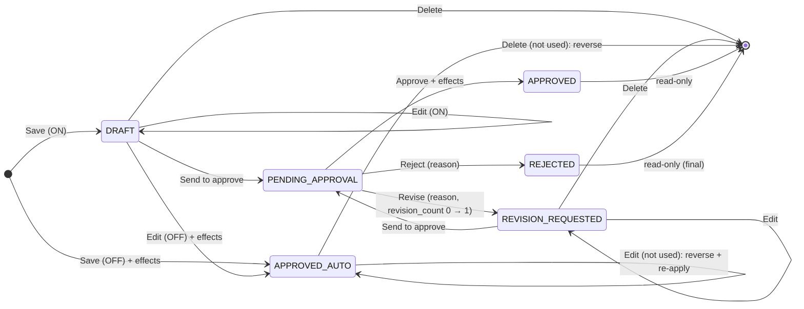

# Sequence diagrams: approval-setup (SA revision 1, 2026-11-10, approved with ADR-0048)

User flow of the setup page: [diagram/approval-setup-flow.md](../../../../diagram/approval-setup-flow.md). Path for every call: Browser → Next same-origin proxy → nginx → `backend-api-master` tRPC → PostgreSQL `partner` (auth authorization read through the existing reader, unchanged).

## Document status (approval ON / OFF)



`APPROVED_AUTO` = `status APPROVED, auto_approved = true`. A second Revise from `PENDING_APPROVAL` with `revision_count = 1` → `<CODE>_REVISE_LIMIT`.

## Save (create / update)

```mermaid
sequenceDiagram
  actor U as User
  participant P as Document page
  participant M as master <doc> router
  participant DB as partner DB
  U->>P: Save
  P->>M: <doc>.create / update (CSRF)
  M->>M: auth: <menu>:ADD / EDIT
  M->>DB: BEGIN; SELECT approval_setting WHERE type FOR SHARE
  alt update
    M->>DB: SELECT header FOR UPDATE (version, status, auto_approved)
    M->>M: assertEditable (DRAFT / REVISION_REQUESTED / auto-approved)
    opt auto-approved
      M->>DB: isUsed EXISTS
      alt used
        M-->>P: <CODE>_IN_USE {usedBy}
      end
      M->>DB: reverseEffects(old) (memo_stock / PO lines FOR UPDATE, id order)
    end
  end
  M->>DB: write header + lines, totals
  alt setting OFF
    M->>DB: applyEffects(new); status APPROVED, auto_approved = true
    alt effect check fails
      M->>DB: ROLLBACK
      M-->>P: approve error (e.g. *_PENDING_SHORT)
    end
  else setting ON
    M->>DB: status stays / becomes DRAFT (REVISION_REQUESTED stays)
  end
  M->>DB: COMMIT
  M-->>P: document + Flow
```

## Send to approve

```mermaid
sequenceDiagram
  actor U as Maker
  participant P as Document page
  participant M as master <doc>.submit
  participant DB as partner DB
  U->>P: Send to approve
  P->>M: submit {id, expectedVersion} (CSRF)
  M->>M: auth: <menu>:ADD or EDIT
  M->>DB: BEGIN; setting FOR SHARE
  alt setting OFF
    M-->>P: <CODE>_APPROVAL_OFF (page refetches setting; Save now approves)
  end
  M->>DB: header FOR UPDATE; status ∈ {DRAFT, REVISION_REQUESTED}, version
  M->>M: full save validation on the stored lines
  M->>DB: status PENDING_APPROVAL, submitted_at/by/name, version+1; COMMIT
  M-->>P: {status: PENDING_APPROVAL} → page read-only
```

## Approve / Revise / Reject (Approve menu)

```mermaid
sequenceDiagram
  actor A as Approver
  participant C as Approve Center
  participant M as master <doc> router
  participant DB as partner DB
  A->>C: Revise… (reason) / Reject… (reason) / Approve
  C->>M: requestRevision / reject / approve (CSRF)
  M->>M: canApprove(actor, type)
  M->>DB: BEGIN; header FOR UPDATE; status = PENDING_APPROVAL, version
  alt Revise and revision_count = 1
    M-->>C: <CODE>_REVISE_LIMIT (button already disabled)
  else Revise
    M->>DB: REVISION_REQUESTED, revision_count = 1, review_* ; COMMIT
  else Reject
    M->>DB: REJECTED, review_* ; COMMIT
  else Approve
    M->>DB: applyEffects; APPROVED, approved_* ; COMMIT
  end
  M-->>C: new status (row leaves the list)
```

## Turn approval OFF / ON (Setup › Approval)

```mermaid
sequenceDiagram
  actor S as Admin
  participant G as Setup › Approval
  participant M as master approvalSetting.update
  participant DB as partner DB
  S->>G: switch Off (after confirm)
  G->>M: update {type, requireApproval: false, expectedVersion} (CSRF)
  M->>M: auth: approval-setup:EDIT
  M->>DB: BEGIN; SELECT approval_setting FOR UPDATE (blocks new Saves of this type)
  M->>DB: count PENDING_APPROVAL, REVISION_REQUESTED (not deleted)
  alt any waiting
    M->>DB: ROLLBACK
    M-->>G: APPROVAL_SETTING_HAS_WAITING {pending, revision} → blocked dialog
  else none
    M->>DB: require_approval = false, version+1, updated_*; COMMIT
    M-->>G: row (drafts stay DRAFT; their next Save approves)
  end
```

Turning ON skips the count.

## Go-live command

```mermaid
sequenceDiagram
  participant O as Operator
  participant C as approve-pending command
  participant S as <doc> service
  participant DB as partner DB
  O->>C: --dry-run, then --apply
  loop types in dependency order, oldest first
    C->>S: approve(system actor, id, version)
    alt ok
      S->>DB: applyEffects; APPROVED
    else approve error
      C->>S: delete (soft) with system actor
    end
  end
  C-->>O: table approved / deleted / errors
```
