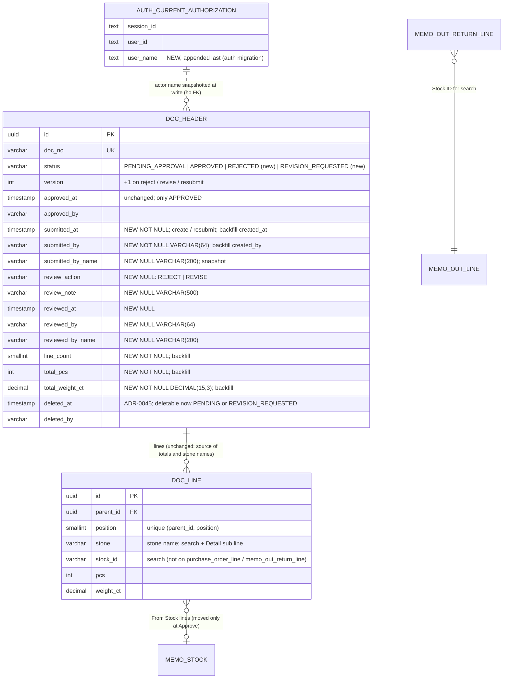

# Database diagram: approve-center (SA revision 1, 2026-11-07, approved 2026-11-07)

Owner: `backend-api-master`, schema `partner` (seven header tables). One auth-owned view column in schema `auth`. Decisions D2–D5, D8, D17, D18, D21 in [decisions.md](decisions.md). Line, charge, photo, `memo_stock`, counter and `stored_files` tables do **not** change.



`DOC_HEADER` = each of `reserve`, `purchase_order`, `purchase`, `memo_receive`, `memo_return`, `memo_out`, `memo_out_return`. `DOC_LINE` = its line table ([scope](decisions.md#scope)).

## Constraints (per header table `<t>`)

| Constraint | Definition |
|---|---|
| `<t>_status_check` (replaced) | `status IN ('PENDING_APPROVAL','APPROVED','REJECTED','REVISION_REQUESTED')` |
| `<t>_approved_check` | unchanged: `(status = 'APPROVED') = (approved_at IS NOT NULL)` and `approved_at`/`approved_by` paired |
| `<t>_review_check` (new) | `(review_action IS NULL AND review_note IS NULL AND reviewed_at IS NULL AND reviewed_by IS NULL AND reviewed_by_name IS NULL) OR (review_action IN ('REJECT','REVISE') AND char_length(btrim(review_note)) BETWEEN 1 AND 500 AND reviewed_at IS NOT NULL AND reviewed_by IS NOT NULL)` |
| `<t>_review_status_check` (new) | `(status <> 'REJECTED' OR review_action = 'REJECT') AND (status <> 'REVISION_REQUESTED' OR review_action = 'REVISE') AND (review_action IS DISTINCT FROM 'REJECT' OR status = 'REJECTED')` |
| `<t>_deleted_check` (replaced) | `(deleted_at IS NULL AND deleted_by IS NULL) OR (deleted_at IS NOT NULL AND deleted_by IS NOT NULL AND status IN ('PENDING_APPROVAL','REVISION_REQUESTED'))` |
| `<t>_totals_qty_check` (new) | `line_count >= 0 AND total_pcs >= 0 AND total_weight_ct >= 0` |

## Indexes

| Index | Definition | Serves |
|---|---|---|
| `<t>_pending_idx` (new, partial) | `(submitted_at ASC, id ASC) WHERE status = 'PENDING_APPROVAL' AND deleted_at IS NULL` | `summary` counts (LIMIT 100), `pending` default sort both directions, the pending set for other sorts/search |
| existing `<t>_status_idx`, `<t>_list_idx`, `<t>_deleted_list_idx`, line `(parent_id, position)` unique | unchanged | document lists; lateral stone subquery and line `EXISTS` |

Prisma: `@@index([submittedAt, id], where: raw("((status)::text = 'PENDING_APPROVAL'::text) AND (deleted_at IS NULL)"), map: "<t>_pending_idx")` (the `partialIndexes` preview is already enabled).

## Migration `20261107090000_approval_review` (master; next free timestamp if newer exists)

Per table, in one migration:

1. `ALTER TABLE` add the 11 columns, all nullable.
2. Backfill:
   ```sql
   UPDATE partner.<t> d SET submitted_at = d.created_at, submitted_by = d.created_by,
          line_count = s.n, total_pcs = s.pcs, total_weight_ct = s.wt
   FROM (SELECT h.id, count(l.id)::smallint AS n, COALESCE(sum(l.pcs), 0)::int AS pcs, COALESCE(sum(l.weight_ct), 0) AS wt
         FROM partner.<t> h LEFT JOIN partner.<line> l ON l.<parent> = h.id GROUP BY h.id) s
   WHERE s.id = d.id;
   ```
   `version` and `updated_at/by` are **not** touched (open pages keep working).
3. `ALTER COLUMN … SET NOT NULL` on `submitted_at`, `submitted_by`, `line_count`, `total_pcs`, `total_weight_ct`.
4. Drop and add `<t>_status_check`, `<t>_deleted_check`; add `<t>_review_check`, `<t>_review_status_check`, `<t>_totals_qty_check` (all existing rows satisfy them: no row is REJECTED/REVISION_REQUESTED and all review columns are null).
5. `CREATE INDEX <t>_pending_idx …` (plain `CREATE INDEX` inside the migration transaction; tables are small — use `CONCURRENTLY` in a separate step only if M-AP-02 shows a table above ~100 000 rows).
6. `ANALYZE partner.<t>`.

Locks: ALTER/CHECK/INDEX take short exclusive locks on small tables; the backfill rewrites each header row once. Run in a low-traffic window; measure row counts first (M-AP-02).

## Auth migration `<ts>_current_authorization_user_name` (auth owner)

`CREATE OR REPLACE VIEW "auth"."current_authorization" WITH (security_barrier = true)` with the identical existing column list and `u."name" AS user_name` appended as the last column. PostgreSQL allows appending columns with `CREATE OR REPLACE VIEW`; existing `SELECT` grants on the view (to `gms_master_authz_reader`) are kept. No table change.

## Rollback

Reverse order (frontend → master code → master migration → auth view):

1. Revert master code (it reads the new columns and statuses).
2. Business decision for rows in new statuses before the old CHECKs can return. Default script: `REVISION_REQUESTED` → `PENDING_APPROVAL`; `REJECTED` → `PENDING_APPROVAL` **and soft-deleted** (`deleted_at = reviewed_at, deleted_by = reviewed_by`) so rejected documents do not reappear as live drafts.
3. Drop `<t>_pending_idx`, the three new CHECKs; restore the previous `<t>_status_check` and `<t>_deleted_check`; drop the 11 columns.
4. Auth: `CREATE OR REPLACE VIEW` cannot drop a column — `DROP VIEW` + recreate the original definition and re-run the reader `GRANT SELECT` (provisioning script) in one transaction; only after the master code no longer selects `user_name`.

No data in lines, stock or files is affected by either direction.
