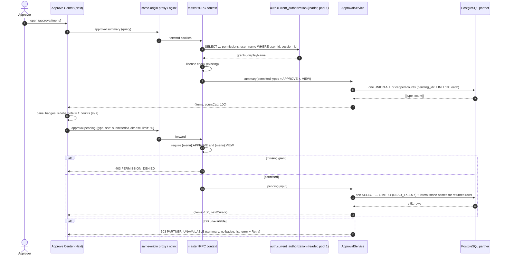
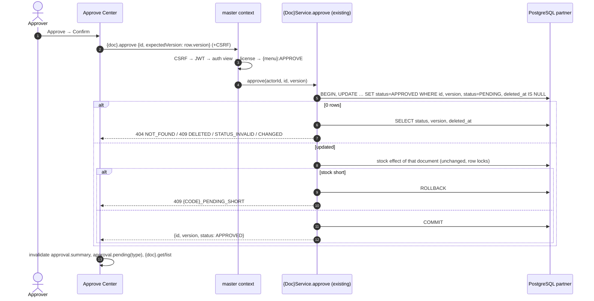
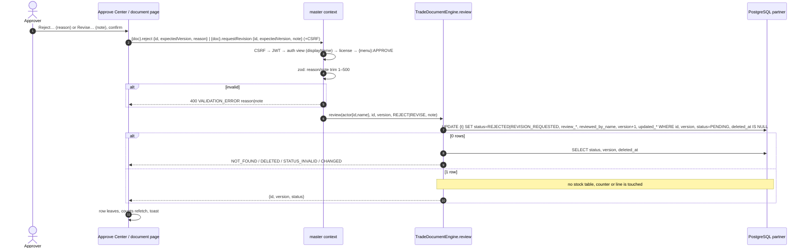
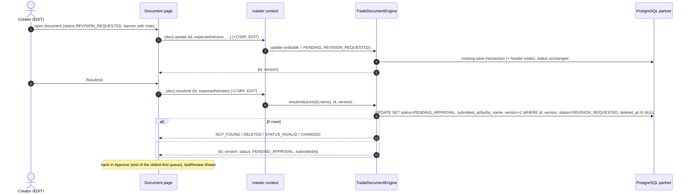

# Sequence diagrams: approve-center (SA revision 1, 2026-11-07, approved 2026-11-07)

Notation: `{doc}`, `{menu}`, `{t}` and `{CODE}` stand for the document router, menu key, header table and error prefix (written with braces because Mermaid strips angle brackets).

Editable Mermaid. Path: browser → Next same-origin proxy (`/api/master/trpc`) → nginx → `api-master:3201` → master tRPC context (CSRF for mutations, JWT, `auth.current_authorization` via the 1-connection reader, license check) → procedure grant → domain service → PostgreSQL `partner`. Status model: [approve-center-review-flow](../../../../diagram/approve-center-review-flow.md). UI flow: [approve-center-flow](../../../../diagram/approve-center-flow.md).

## 1. Open Approve Center: counts and first page

## 2. Approve one row (existing procedure, version from the row)

Bulk "Approve selected" repeats this one document at a time on the client and stops on Cancel (unchanged from phase 1, without the `get` before each approve).

## 3. Reject / Revise (new)

## 4. Creator edits and resubmits (new)

