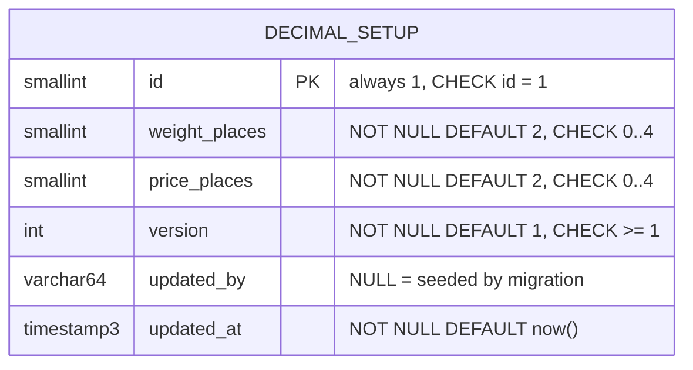

# Database diagram: master / decimal-setup (SA revision 1, pending-review)

Owner: `backend-api-master`, PostgreSQL schema `partner`. Migration `20261103090000_decimal_setup` (expand-only).



No relationships: no table references it and it references none. Same single-row pattern as `partner.company_profile`.

## Prisma model (proposed)

```prisma
/// Decimal Setup (decimal-setup SA rev 1, ADR-0038): one global row; display/entry places for weight and price.
model DecimalSetup {
  id           Int      @id @default(1) @db.SmallInt
  weightPlaces Int      @default(2) @map("weight_places") @db.SmallInt
  pricePlaces  Int      @default(2) @map("price_places") @db.SmallInt
  /// Optimistic version: +1 on every save.
  version      Int      @default(1)
  updatedBy    String?  @map("updated_by") @db.VarChar(64)
  updatedAt    DateTime @default(now()) @map("updated_at") @db.Timestamp(3)

  @@map("decimal_setup")
  @@schema("partner")
}
```

## Migration SQL (proposed)

```sql
CREATE TABLE "partner"."decimal_setup" (
  "id" SMALLINT NOT NULL DEFAULT 1,
  "weight_places" SMALLINT NOT NULL DEFAULT 2,
  "price_places" SMALLINT NOT NULL DEFAULT 2,
  "version" INTEGER NOT NULL DEFAULT 1,
  "updated_by" VARCHAR(64),
  "updated_at" TIMESTAMP(3) NOT NULL DEFAULT CURRENT_TIMESTAMP,
  CONSTRAINT "decimal_setup_pkey" PRIMARY KEY ("id"),
  CONSTRAINT "decimal_setup_single_row" CHECK ("id" = 1),
  CONSTRAINT "decimal_setup_weight_places_range" CHECK ("weight_places" BETWEEN 0 AND 3),
  CONSTRAINT "decimal_setup_price_places_range" CHECK ("price_places" BETWEEN 0 AND 2),
  CONSTRAINT "decimal_setup_version_positive" CHECK ("version" >= 1)
);
INSERT INTO "partner"."decimal_setup" ("id") VALUES (1) ON CONFLICT ("id") DO NOTHING;

-- Owner 2026-11-03 (Q-DEC-08 changed): follow-up migration 20261103120000_decimal_setup_places_max_4 (the one above was
-- already committed and applied, so it is not edited):
ALTER TABLE "partner"."decimal_setup" DROP CONSTRAINT IF EXISTS "decimal_setup_weight_places_range";
ALTER TABLE "partner"."decimal_setup" DROP CONSTRAINT IF EXISTS "decimal_setup_price_places_range";
ALTER TABLE "partner"."decimal_setup" ADD CONSTRAINT "decimal_setup_weight_places_range" CHECK ("weight_places" BETWEEN 0 AND 4);
ALTER TABLE "partner"."decimal_setup" ADD CONSTRAINT "decimal_setup_price_places_range" CHECK ("price_places" BETWEEN 0 AND 4);
```

- Indexes: primary key only.
- Backfill: the seed row (2/2 = today's display). The rev-1 browser `localStorage` values are **not** imported (they were per-page
  demo values); the frontend deletes the key (FE-DEC-101).
- Existing data: no change to any document table; 74 `numeric(18,2)` and 16 `numeric(12,3)` columns keep their scale.
- Rollback: `DROP TABLE "partner"."decimal_setup";` plus reverting the Prisma model; frontend falls back to 2/2.
- Drift check: `prisma migrate diff` shows no drift for this table after apply (BE-DEC-005).
