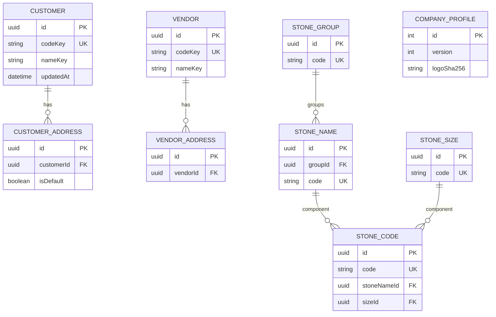

# Database diagram: master / GMS platform migration

- SA revision: 1, approved-design; see central TODO gates; current owner `backend-api-partner` / `partner` and `stone`; target owner `api-master`
- Actual schema: `backend-api-partner/prisma/schema.prisma`, migrations `backend-api-partner/prisma/migrations/`

Current diagram is abbreviated; real Prisma also has stone shape/color/cutting/clarity/quality and shape-size junction. Customer/vendor have unique normalized `codeKey`, partial single-default-address indexes, and indexed name/active lists. `CompanyProfile.id=1`; logo bytes currently live outside DB. **No schema change is required for the first tRPC route cutover.** Strict GMS one-schema-per-service would later migrate `partner` and `stone` to `master` with one writer, additive target tables, bounded checked backfill, row counts/checksum, FK/index parity, swap, rollback-compatible old schema and delayed contract. No cross-schema FK to inventory/auth. A proposed `master.stored_files` table is required only when storage migration is separately approved. Preserve user-generated old UUIDs; UUIDv7 applies to newly created inventory data, not a rewrite of these keys.
