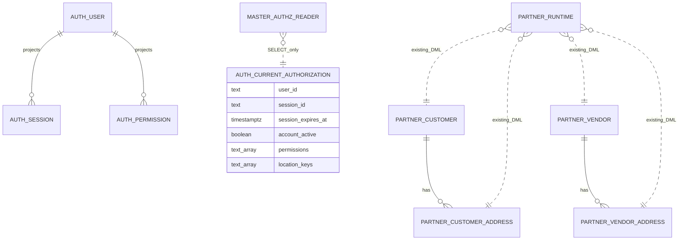

# Database boundary: master authorization reader

- Source / SA revision: `INV-20261021-006-r1` / 1; approved for implementation (2026-10-21)
- Current source: `backend-api-partner/prisma/schema.prisma`; auth view DDL: `backend-api-auth/prisma/migrations/20261021090000_gms_refresh_and_current_authorization/migration.sql`; see auth-side boundary [here](../../../auth/gms-platform/inv006-auth-license-boundary/database-diagram.md).

No relation/table migration is proposed. Add a separate login role only after backend inspects actual object owners and grants. The existing partner process still serves company-profile, stone and other partner-owned procedures. Keep its current `PARTNER_DATABASE_URL`/Prisma client and permissions unchanged. Only auth-view reads use a second `MASTER_AUTHZ_DATABASE_URL` with a dedicated read-only client.

Create a secret-backed non-owner login with password supplied only by the selected DB provisioning mechanism: `CREATE ROLE gms_master_authz_reader LOGIN NOSUPERUSER NOCREATEDB NOCREATEROLE NOINHERIT NOREPLICATION NOBYPASSRLS PASSWORD '<injected-secret>';`. Grant only `CONNECT` on the application database, `USAGE ON SCHEMA auth`, and `SELECT ON TABLE auth.current_authorization`. Grant nothing else: no `partner`/`stone` schema access, no auth base tables (`User`, `Session`, permissions, `LicenseCache`, `LicenseCurrentDecision`, refresh tables), sequences/functions, DML, `CREATE`, ownership or migration access. Keep auth schema-owner and migration principals separate. Verify no membership/inheritance from any owner or privileged role.

The auth-view query uses a separate Prisma client configured with `MASTER_AUTHZ_DATABASE_URL`, auth search path, max pool size 1 and bounded acquire timeout. When mounted master auth is enabled, missing/invalid URL or connection must fail startup/request closed; never fall back to `PARTNER_DATABASE_URL`. The partner URL remains unchanged for the existing domain client and old internal routes. Do not switch the existing partner client to the reader identity: that would break its currently-live domain procedures. Do not claim the existing partner login has least-privilege auth-view access.

Before relying on this boundary, inspect effective privileges from the actual auth-reader login, including `PUBLIC` grants and memberships. If `PUBLIC` already exposes auth base tables, do not broaden or globally revoke grants blindly; pause and prepare a separate reviewed revocation/provisioning decision after identifying affected consumers. Acceptance tests prove reader SELECT on the view succeeds, SELECT on auth base tables and any partner/stone object fails, and legacy partner features still use their unchanged DB connection. Rollback disables/revokes only the reader login/grant/URL; retain all schemas and rows.
