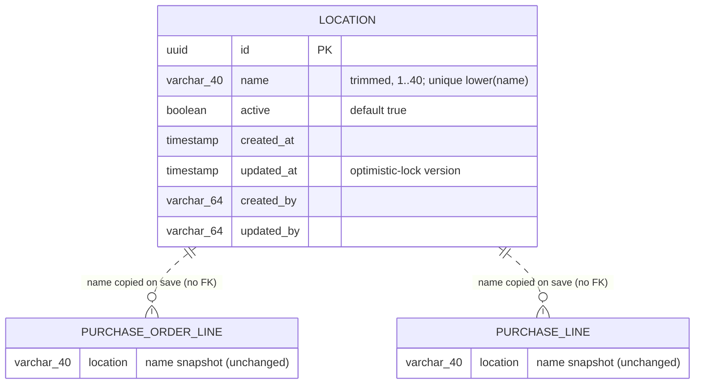

# Location Master — database (SA revision 1, approved 2026-11-16)

- Schema `partner`, table `location`. Indexes: PK `id`; unique `location_name_lower_key ON (lower(name))`; keyset `(lower(name), id)` is served by the unique index plus id.
- CHECKs: `char_length(name) BETWEEN 1 AND 40`, `name = btrim(name)`.
- Migration `20261116090000_location_master` (SA-LM-07): create table + indexes; `INSERT … SELECT DISTINCT ON (lower(btrim(location))) btrim(location) FROM (purchase_order_line UNION ALL purchase_line) WHERE btrim(location) <> '' AND char_length(btrim(location)) <= 40` with `created_by = 'migration'`. Grants follow the existing partner role script (same as `currency`).
- Rollback: `DROP TABLE partner.location` — no other table changes.
