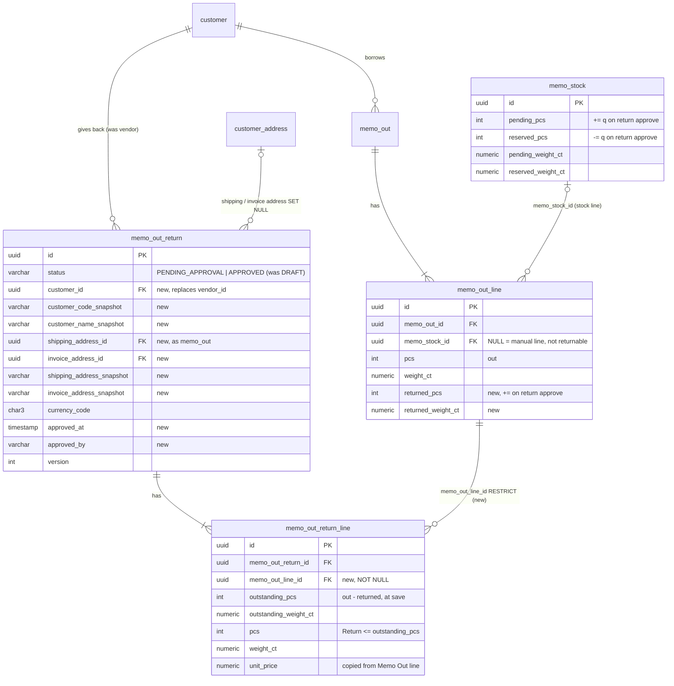

# Database diagram: memo-out-return (SA revision 2, approved 2026-10-31)

Schema `partner`, owned by `backend-api-master`. Decisions: [decisions.md](decisions.md) SA-MOR-11…20. Memo Out tables: [memo-out database diagram](../memo-out/database-diagram.md).

## Migration `20261101090000_memo_out_return_customer`

1. Guard: `DO $$ BEGIN IF EXISTS (SELECT 1 FROM partner.memo_out_return) THEN RAISE EXCEPTION 'memo_out_return has rows: answer Q-MOR-17 first'; END IF; END $$;`
2. `memo_out_return`:
   - Drop `vendor_id`, `vendor_code_snapshot`, `vendor_name_snapshot`, `address_id`, `address_snapshot`, their FKs and indexes.
   - Add `customer_id UUID NOT NULL` (FK `customer` RESTRICT), `customer_code_snapshot VARCHAR(120)`, `customer_name_snapshot VARCHAR(200)`, `shipping_address_id` / `invoice_address_id` (FK `customer_address` SET NULL, indexed), `shipping_address_snapshot` / `invoice_address_snapshot VARCHAR(1000)`, and index `(customer_id, doc_date DESC)`.
   - Add `approved_at` / `approved_by`. Status CHECK becomes `PENDING_APPROVAL | APPROVED`, plus the approved CHECK and index `(status, doc_date DESC, created_at DESC, id DESC)`.
3. `memo_out_return_line`:
   - Add `memo_out_line_id UUID NOT NULL` (FK `memo_out_line` RESTRICT).
   - Add unique `(memo_out_return_id, memo_out_line_id)` and index `(memo_out_line_id)`.
   - The existing CHECK pcs ≤ outstanding stays.
4. `memo_out_line`:
   - Add `returned_pcs INT NOT NULL DEFAULT 0` and `returned_weight_ct DECIMAL(12,3) NOT NULL DEFAULT 0`.
   - CHECK `returned_pcs BETWEEN 0 AND pcs AND returned_weight_ct BETWEEN 0 AND weight_ct`.
   - Partial index `memo_out_line_open_idx (memo_out_id) WHERE memo_stock_id IS NOT NULL AND (returned_pcs < pcs OR returned_weight_ct < weight_ct)`.

## Who writes what

| Event | memo_out_return | memo_out_line | memo_stock |
|---|---|---|---|
| Save | row + lines, PENDING_APPROVAL | read | — |
| Delete (pending) | removed, lines cascade | — | — |
| Approve | APPROVED, approved_at/by | locked, `returned_* += q` | locked, `reserved_* −= q`, `pending_* += q` |
