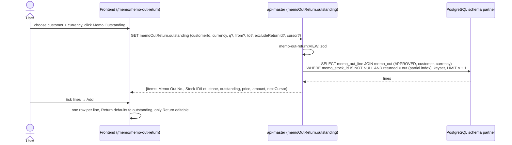

# Sequence diagrams: memo-out-return (SA revision 2, approved 2026-10-31)

- Main flow: [memo-out-return-flow.md](../../../../diagram/memo-out-return-flow.md). Contract: [api-contract.md](api-contract.md). Tables: [database-diagram.md](database-diagram.md).

Every call goes through nginx `:8080` to `api-master` with the session cookie. Mutations carry the CSRF token. Authorization is read live from the auth view (ADR-0031). Not shown each time: `UNAUTHORIZED`, `PERMISSION_DENIED`, `AUTHORIZATION_UNAVAILABLE`.

## 1. Memo Outstanding dialog



## 2. Save

```mermaid
sequenceDiagram
  actor U as User
  participant FE as Frontend
  participant M as api-master (memoOutReturn.create / update)
  participant DB as PostgreSQL

  U->>FE: Save
  FE->>M: POST memoOutReturn.create {customerId, shippingAddressId, invoiceAddressId, currency, lines[{memoOutLineId, pcs, weightCt, itemNote}]}
  M->>M: ADD (update: EDIT) + CSRF, strict zod
  M->>DB: BEGIN; customer + shipping / invoice address, currency
  M->>DB: SELECT memo_out_line JOIN memo_out WHERE id IN lines
  alt missing / not approved / manual line / other customer or currency
    M-->>FE: 422 MEMO_OUT_RETURN_REFERENCE_INVALID lines.N.memoOutLineId
  else twice / above outstanding / both zero
    M-->>FE: 400 VALIDATION_ERROR duplicate / exceeds_outstanding / required
  end
  M->>M: copy item fields + Memo Out price, Outstanding = out − returned
  M->>DB: Doc No. (Document Setup memo-out-return); INSERT rows, status PENDING_APPROVAL; COMMIT
  M-->>FE: {id, docNo, version}
  Note over M,DB: Memo Out lines and Memo Stock unchanged by saving.
```

## 3. Approve

```mermaid
sequenceDiagram
  actor U as User
  participant FE as Frontend
  participant M as api-master (memoOutReturn.approve)
  participant DB as PostgreSQL

  U->>FE: Approve → confirm
  FE->>M: POST memoOutReturn.approve {id, expectedVersion}
  M->>M: memo-out-return:APPROVE + CSRF
  M->>DB: BEGIN; UPDATE memo_out_return SET APPROVED … WHERE id, version, PENDING_APPROVAL
  alt 0 rows
    M-->>FE: 404 / 409 STATUS_INVALID / 409 CHANGED
  end
  M->>DB: SELECT memo_out_line WHERE id = ANY(ids) ORDER BY id FOR UPDATE
  alt a line > outstanding now
    M->>DB: ROLLBACK
    M-->>FE: 409 MEMO_OUT_RETURN_OUTSTANDING_SHORT
  end
  M->>DB: UPDATE memo_out_line SET returned_* += q (VALUES list)
  M->>DB: SELECT memo_stock WHERE id = ANY(stock ids) ORDER BY id FOR UPDATE
  M->>DB: UPDATE memo_stock SET reserved_* −= q, pending_* += q, version + 1
  Note over DB: CHECKs returned ≤ out and memo_stock_balance hold
  M->>DB: COMMIT
  M-->>FE: {id, version, status: APPROVED}
  FE-->>U: read-only; items are back in Memo Stock (From Stock / Memo Return)
```
