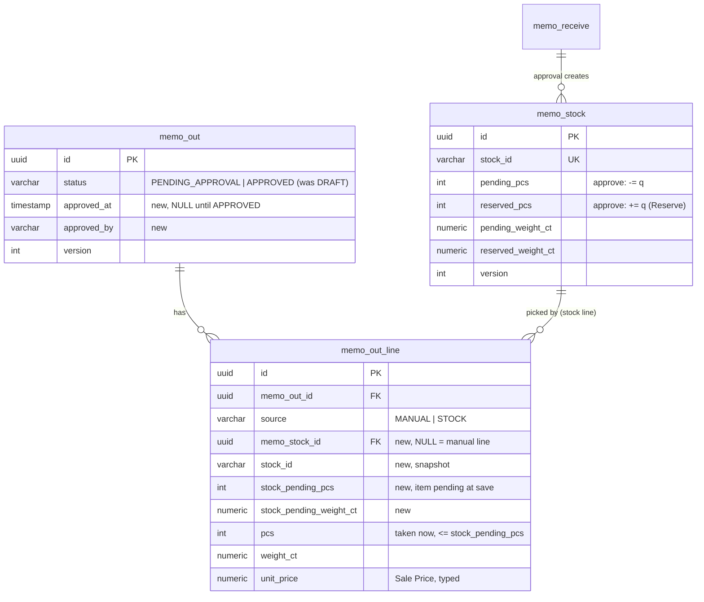

# Database diagram: memo-out (SA revision 2, approved 2026-10-31)

Schema `partner`, owned by `backend-api-master`. Revision 2 changes `memo_out`, `memo_out_line` and one index on `memo_stock`. All other memo tables are unchanged. Memo Stock and its buckets: [memo-receive database diagram](../memo-receive/database-diagram.md) and [ADR-0035](../../../../adr/0035-memo-outstanding-vendor-report.md).

## Migration `20261031090000_memo_out_from_stock` (additive)

1. `memo_out`:
   - Add `approved_at TIMESTAMP(3)` and `approved_by VARCHAR(64)`.
   - Replace `memo_out_status_check` with `status IN ('PENDING_APPROVAL','APPROVED')`.
   - Add `memo_out_approved_check`: approved_at is set exactly when the status is APPROVED, and approved_at / approved_by are set together.
   - Backfill `UPDATE memo_out SET status = 'PENDING_APPROVAL' WHERE status = 'DRAFT'`, before the new CHECK.
2. `memo_out_line`:
   - Add `memo_stock_id UUID NULL` (FK → `memo_stock(id)` ON DELETE RESTRICT), `stock_id VARCHAR(10) NULL`, `stock_pending_pcs INT NULL` and `stock_pending_weight_ct DECIMAL(12,3) NULL`.
   - CHECK `memo_out_line_stock_check`:
     - Either all four new columns are NULL and source = MANUAL,
     - or all are set, source = STOCK, pcs ≤ stock_pending_pcs and weight_ct ≤ stock_pending_weight_ct.
   - Index `memo_out_line_memo_stock_idx (memo_stock_id)`.
   - Unique `(memo_out_id, memo_stock_id)`: an item at most once per document (NULLs don't collide).
3. `memo_stock`: `CREATE INDEX memo_stock_pending_all_idx ON memo_stock (received_doc_date DESC, stock_id DESC) WHERE pending_pcs > 0 OR pending_weight_ct > 0` (From Stock across vendors).

No backfill of stock: existing memo out lines are manual. Rollback (only while no memo out is APPROVED):
- Drop the new index, constraints and columns.
- Set status back to DRAFT.
- Restore `memo_out_status_check` to `('DRAFT')`.
