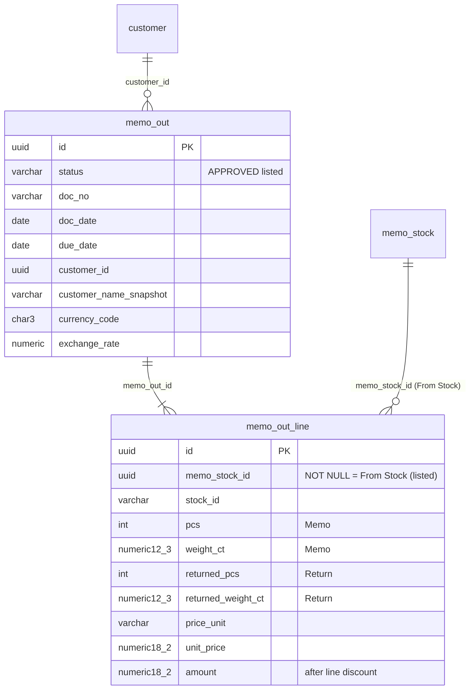

# Database diagram: memo-outstanding-customer (SA revision 1, approved 2026-11-03)

There is no schema change. The report reads these existing tables (`partner` schema):

- Outstanding = `pcs − returned_pcs` / `weight_ct − returned_weight_ct`. Sold is 0 until Sale exists.
- Index used: `memo_out_line_open_idx (memo_out_id) WHERE memo_stock_id IS NOT NULL AND (returned_pcs < pcs OR returned_weight_ct < weight_ct)`, which already exists. `memo_out_status_idx (status, doc_date desc, …)` serves the status and date filters.
