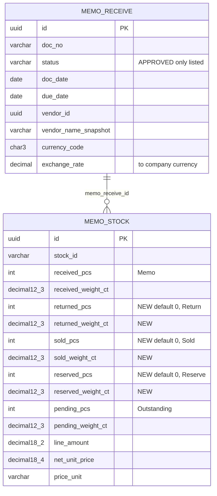

# Database diagram: memo-outstanding-vendor (SA revision 1, 2026-10-29, approved 2026-10-29)

Owner: `backend-api-master`, schema `partner`. The report reads `memo_receive` and `memo_stock` ([memo-receive database diagram](../memo-receive/database-diagram.md)). There is one additive migration, `20261030090000_memo_stock_buckets`.

## Constraints and indexes

- New CHECKs (both named):
  - `memo_stock_buckets_nonneg`: every bucket ≥ 0.
  - `memo_stock_balance`: `pending_pcs = received_pcs − returned_pcs − sold_pcs − reserved_pcs` AND the same for `_weight_ct`.
- The existing CHECKs `0 ≤ pending ≤ received` stay.
- New partial index `memo_stock_open_idx (memo_receive_id) WHERE pending_pcs > 0 OR pending_weight_ct > 0 OR reserved_pcs > 0 OR reserved_weight_ct > 0`, so the report reads only open items.
- `memo_receive` already has `(status, doc_date desc, created_at desc, id desc)` and `(vendor_id, doc_date desc)`.

## Migration, backfill, rollback

- `ADD COLUMN … NOT NULL DEFAULT 0` for 6 columns. This is fast, and the table is small.
- Then add the CHECKs, which validate immediately because every existing row has pending = received (no writer has reduced it yet), and the partial index.
- Rollback: drop the index, the CHECKs and the columns. That is safe while no writer uses them; revision 1 has none.
