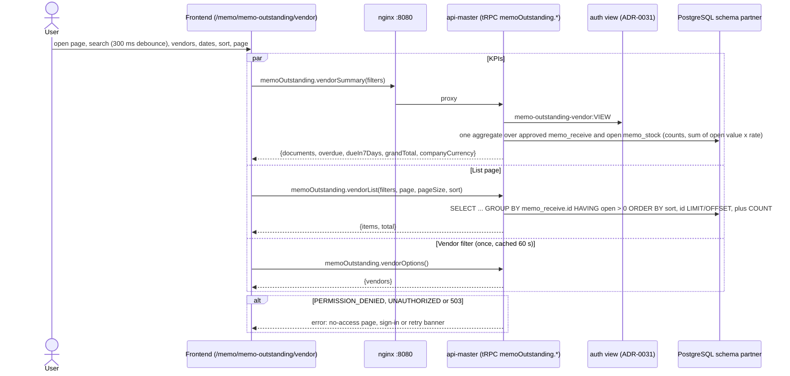
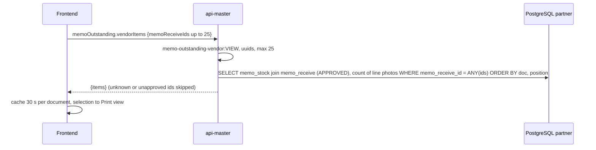

# Sequence diagrams: memo-outstanding-vendor (SA revision 1, 2026-10-29, approved 2026-10-29)

- Source UI revision / SA revision: 1 / 1
- Main flow: [memo-outstanding-vendor-flow](../../../../diagram/memo-outstanding-vendor-flow.md)
- Operations: [api-contract](api-contract.md); TODO BE-MOV-001…003, FE-MOV-001…004

## 1. Open the page / change filters

## 2. Expand documents (one, or the whole page in Expanded mode)

No step writes. Print is client-side (`window.print`).
