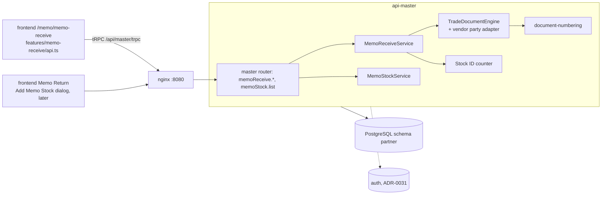

# Architecture: memo-receive (SA revision 1, 2026-10-29, approved 2026-10-29)

Decisions: [decisions.md](decisions.md) · ADR: [ADR-0034](../../../../adr/0034-memo-receive-approval-and-memo-stock.md) · TODO: [memo-receive.md](../../../../task/todo/memo-receive.md)

## Placement

| Concern | Decision |
|---|---|
| Owning service | `backend-api-master`. There is no new service and no change to the gateway or nginx. |
| Code | `src/trade-document/memo-receive.service.ts` (party adapter, Stock ID assignment, approve), `src/trade-document/memo-stock.service.ts` (list) and `memo-schemas.ts` (input schemas). In the engine, status is set per document (SA-MR-02) and an `onLines` hook keeps line ids and Stock IDs. |
| Transactions | `WRITE_TX` as in Memo Out. Lock order: Document Setup row or advisory lock → `memo_stock_id_counter` row → document row. This order is always the same, so no deadlock. |
| Timeouts / retry | The existing Prisma transaction timeout applies. The client never retries a mutation automatically. A read retries only on transient errors (`retryTransient`). |
| Bounds | ≤ 200 lines per document. Lists return ≤ 50 rows plus a count, and `memoStock.list` has no count. Options return ≤ 1,000 rows per list. Search text ≤ 100 chars. |
| Logs | `memo_receive.created/updated/deleted/approved` with id, docNo, line count and actor. No prices or vendor names. |
| Frontend | `api.ts` replaces the mock store with tRPC calls. Location and photo upload are removed from the row panel, the Approve button and confirm are added, and the page is read-only when APPROVED. `localStorage` `gms.memo-receive.v1` is removed on load. |

## Capacity (4 GB / 2 vCPU host)

- No new process, cache or container. The pool budget of ADR-0027 is unchanged: requests use the existing `api-master` pool.
- Save makes ≤ 8 round trips, approve ≤ 5, and `memoStock.list` 1 query (LIMIT 51) on a partial index.
- Expected size: a few thousand `memo_stock` rows a year at about 0.5 KB each, so well under 10 MB a year.
- Still to measure after build: p95 of an approve with 200 lines (target < 500 ms) and `memoStock.list` with 50k rows (target < 100 ms).

## Not covered

Memo Return document, Approve page, reject/unapprove, line photos, "From Stock" over Memo Stock, inventory service. See SA-MR-13.
