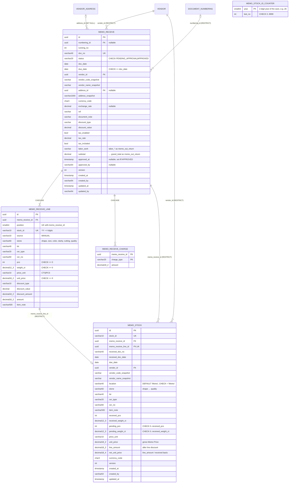
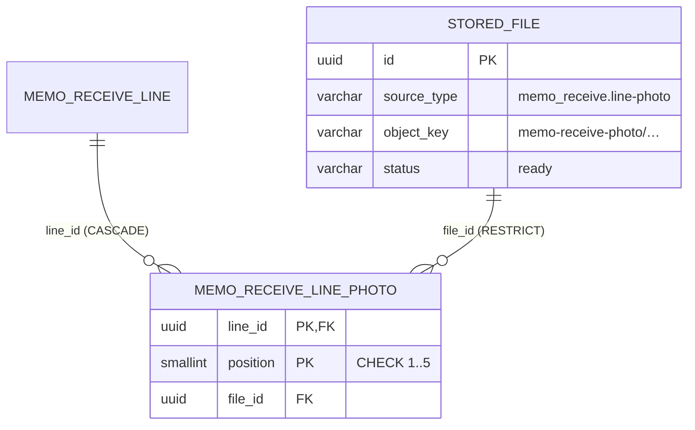

# Database diagram: memo-receive (SA revision 1, 2026-10-29, approved 2026-10-29)

Owner: `backend-api-master`, schema `partner` (interim until the inventory service, ADR-0034 D5). Migration `20261029090000_memo_receive`, additive only.

## Constraints and indexes

| Table | Constraint / index |
|---|---|
| memo_receive | `UNIQUE (numbering_id, running_no)`; partial `UNIQUE (running_no) WHERE numbering_id IS NULL`; list `(doc_date desc, created_at desc, id desc)`; `(vendor_id, doc_date desc)`; `(status, doc_date desc, created_at desc, id desc)` for the future Approve page; `CHECK ((status = 'APPROVED') = (approved_at IS NOT NULL))` |
| memo_receive_line | `UNIQUE (memo_receive_id, position)`; `UNIQUE (stock_id)`; `CHECK stock_id ~ '^[0-9]{6}$'` |
| memo_stock | `UNIQUE (stock_id)`; `UNIQUE (memo_receive_line_id)`; partial `(vendor_id, received_doc_date desc, stock_id desc) WHERE pending_pcs > 0 OR pending_weight_ct > 0` for the dialog; `(memo_receive_id)` |

`memo_stock.stock_id` matches its line. The line FK uses `RESTRICT`, and an approved document cannot be deleted (SA-MR-03), so a stock item always keeps its source line.

## Migration, backfill, rollback

- Expand only: create 5 tables, the indexes and the CHECKs. Existing tables are not changed, and the Document Setup `used` check changes only in code.
- No backfill. Mock documents in the browser are not imported (ADR-0034).
- Rollback: before any approved Memo Receive exists, drop the 5 tables in reverse order. After that, roll forward with a fix migration. Approved Memo Stock is never deleted by a schema rollback.
- Move to inventory later: copy `memo_stock` with the same `id` and `stock_id`, check counts and checksums, switch reads, then write from the new owner only (ADR-0027 D1 pattern).

## SA revision 2 (2026-10-29, approved): line photos

Index `memo_receive_line_photo_file_idx (file_id)`. Migration `20261029150000_memo_receive_line_photo` is additive. Rollback: drop the table. Stored files stay (ADR-0030).
