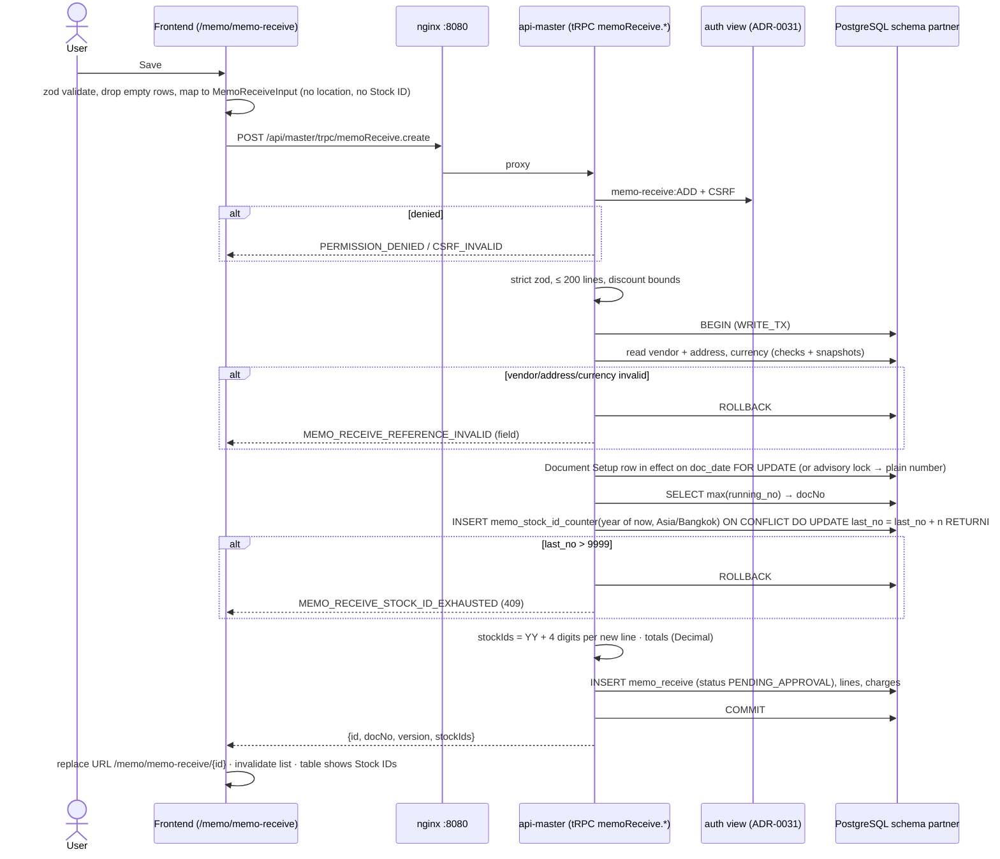
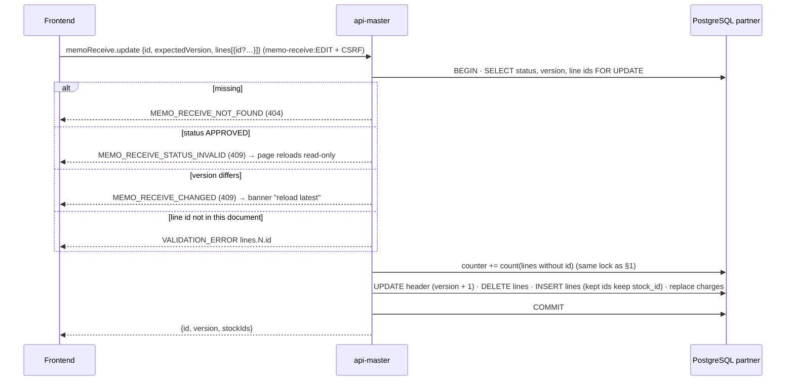
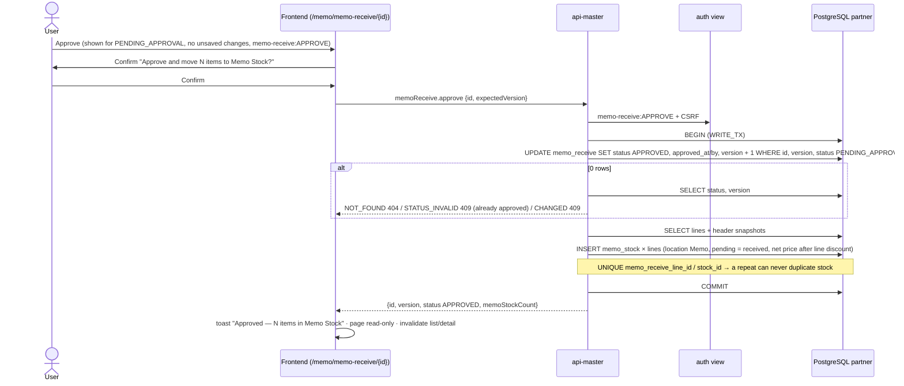
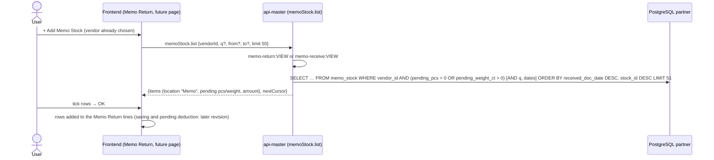
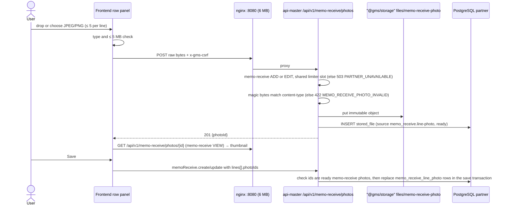

# Sequence diagrams: memo-receive (SA revision 1, 2026-10-29, approved 2026-10-29)

- Source UI revision / SA revision: memo-receive UI 3 / SA 1
- Main user flow: [memo-receive-flow.md](../../../../diagram/memo-receive-flow.md)
- Operations: [api-contract.md](api-contract.md); TODO FE-MR-007…010, BE-MR-001…006 in [memo-receive.md](../../../../task/todo/memo-receive.md)

Every call goes through nginx `:8080` to `api-master` with the session cookie. Mutations carry the CSRF token. Authorization is read live from the auth view (ADR-0031). Not shown each time: `UNAUTHORIZED` → sign-in, `PERMISSION_DENIED` → no-access message, `AUTHORIZATION_UNAVAILABLE` (503) → "try again", no retry of mutations.

## 1. Save a new Memo Receive (number and Stock IDs issued)

## 2. Edit a pending Memo Receive

Delete is the same guard (`DELETE … WHERE id AND version AND status = 'PENDING_APPROVAL'`, 0 rows → re-read for 404/409). Stock IDs of deleted lines are not reused.

## 3. Approve (temporary button on the Memo Receive page)

## 4. Memo Return › Add Memo Stock dialog (read only in this revision)

## 5. Add a line photo (SA revision 2, approved 2026-10-29)

