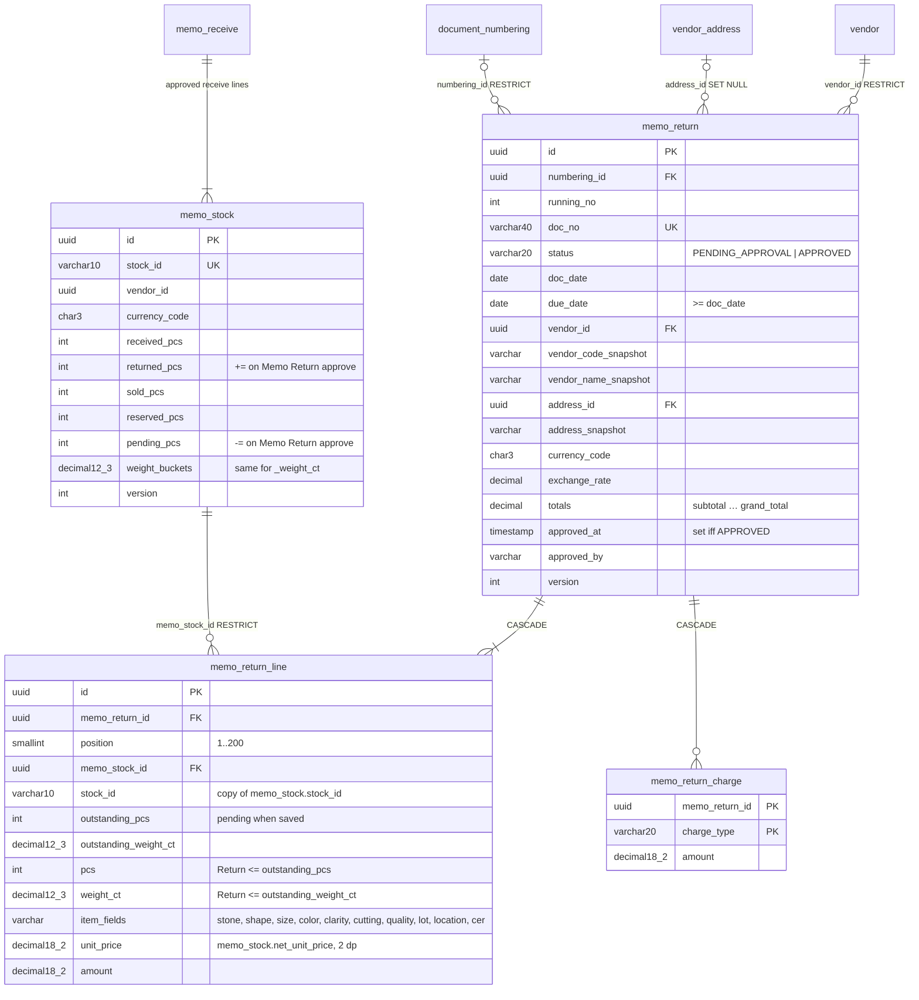

# Database diagram: memo-return (SA revision 2, as built 2026-10-30)

Schema `partner`, service `backend-api-master`. Migration `20261029160000_memo_return`. The Return bucket columns on `memo_stock` come from `20261030090000_memo_stock_buckets` (ADR-0035). Flow: [memo-return-flow.md](../../../../diagram/memo-return-flow.md). Sequences: [sequence-diagram.md](sequence-diagram.md).

## Constraints and indexes

| Table | Constraints / indexes |
|---|---|
| memo_return | `UNIQUE doc_no`; `UNIQUE (numbering_id, running_no)`; partial `UNIQUE (running_no) WHERE numbering_id IS NULL`; list `(doc_date desc, created_at desc, id desc)`; `(vendor_id, doc_date desc)`; `(status, doc_date desc, created_at desc, id desc)`; `(address_id)`. CHECKs: status, approved fields set iff APPROVED, due ≥ doc date, running_no ≥ 1, discount, tax rate, exchange rate, version |
| memo_return_line | `UNIQUE (memo_return_id, position)`; `UNIQUE (memo_return_id, memo_stock_id)` (one line per item); `(memo_stock_id)`. CHECK values and `pcs <= outstanding_pcs AND weight_ct <= outstanding_weight_ct` |
| memo_return_charge | PK `(memo_return_id, charge_type)`; charge type in SHIPPING / HANDLING / INSURANCE / CERTIFICATE, amount ≥ 0 |
| memo_stock | `memo_stock_balance`: pending = received − returned − sold − reserved (pcs and weight); buckets ≥ 0 |

## Who writes what

| Event | memo_return | memo_stock |
|---|---|---|
| Save (create / update) | row + lines, status PENDING_APPROVAL | read only |
| Delete (pending only) | row removed, lines cascade | — |
| Approve | status APPROVED, approved_at/by | rows locked `FOR UPDATE` (id order); `pending_* −= return`, `returned_* += return`, version + 1 |

`memo_stock` rows can't be deleted while a return line points at them (RESTRICT).
