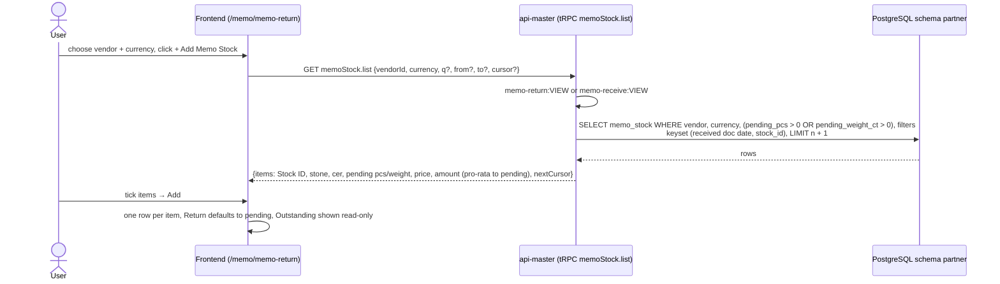
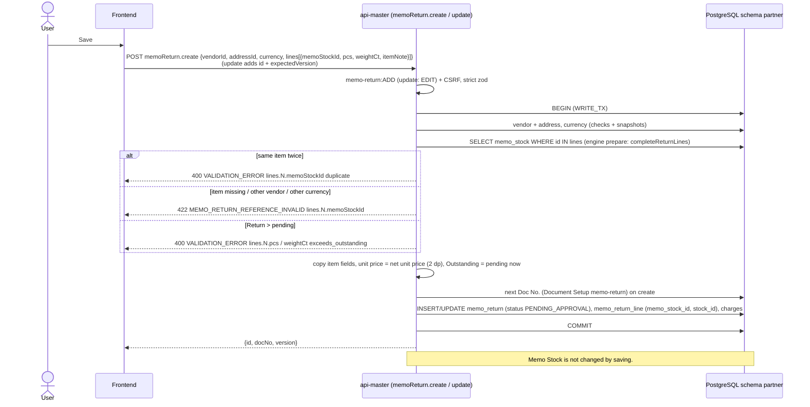

# Sequence diagrams: memo-return (SA revision 2, as built 2026-10-30)

- Main user flow: [memo-return-flow.md](../../../../diagram/memo-return-flow.md)
- Tables: [database-diagram.md](database-diagram.md)
- Code: `backend-api-master/src/trade-document/memo-return.service.ts`, `memo-stock.service.ts`, router `memoReturn.*` / `memoStock.list` in `src/master/router.ts`; frontend `frontend/src/features/memo-return/`.
- Contract and decisions: [api-contract.md](api-contract.md), [decisions.md](decisions.md) (SA-MRT-01…09).

Every call goes through nginx `:8080` to `api-master` with the session cookie. Mutations carry the CSRF token. Authorization is read live from the auth view (ADR-0031). Not shown each time: `UNAUTHORIZED` → sign-in, `PERMISSION_DENIED` → no-access message, `AUTHORIZATION_UNAVAILABLE` (503) → "try again", no retry of mutations.

## 1. Add Memo Stock dialog



## 2. Save (create / update)



Update and delete use the version guard: only `PENDING_APPROVAL` → else `MEMO_RETURN_STATUS_INVALID` (409); stale version → `MEMO_RETURN_CHANGED` (409).

## 3. Approve

```mermaid
sequenceDiagram
  actor U as User
  participant FE as Frontend
  participant M as api-master (memoReturn.approve)
  participant DB as PostgreSQL schema partner

  U->>FE: Approve → confirm
  FE->>M: POST memoReturn.approve {id, expectedVersion}
  M->>M: memo-return:APPROVE + CSRF
  M->>DB: BEGIN (WRITE_TX)
  M->>DB: UPDATE memo_return SET status APPROVED, approved_at/by, version + 1<br/>WHERE id, version, status = PENDING_APPROVAL
  alt 0 rows
    M-->>FE: 404 NOT_FOUND / 409 STATUS_INVALID / 409 CHANGED
  end
  M->>DB: SELECT lines (memo_stock_id, pcs, weight_ct)
  M->>DB: SELECT memo_stock WHERE id = ANY(ids) ORDER BY id FOR UPDATE
  alt a line > pending now
    M->>DB: ROLLBACK
    M-->>FE: 409 MEMO_RETURN_PENDING_SHORT lines.N.pcs / weightCt exceeds_pending
    FE-->>U: "Some items no longer have enough pending…"
  end
  M->>DB: UPDATE memo_stock SET pending −= r, returned += r, version + 1 (one statement, VALUES list)
  Note over DB: CHECK memo_stock_balance and pending ≥ 0 hold
  M->>DB: COMMIT
  M-->>FE: {id, version, status: APPROVED}
  FE-->>U: read-only document; Memo Outstanding › Vendor shows the Return
```
