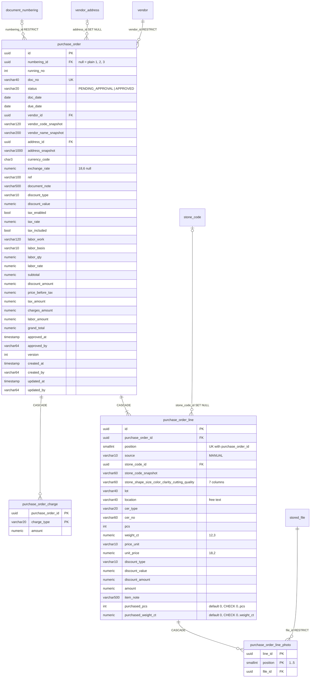

# Database diagram: purchase-order (SA revision 1, approved 2026-11-04)

Schema `partner`, migration `20261104090000_purchase_order` (additive; rollback = drop the four tables).

Constraints and indexes:

- `purchase_order_numbering_running_no_key (numbering_id, running_no)`; partial unique `(running_no) WHERE numbering_id IS NULL`; `purchase_order_doc_no_key`.
- `purchase_order_list_idx (doc_date desc, created_at desc, id desc)`, `purchase_order_status_idx (status, doc_date desc, …)`, `purchase_order_vendor_idx (vendor_id, doc_date desc)`, `purchase_order_address_idx`.
- `purchase_order_line_position_key (purchase_order_id, position)`; `purchase_order_line_stone_code_idx`.
- CHECK `purchase_order_status_check` (two values), `purchase_order_line_source_check` (`MANUAL`), `purchase_order_line_purchased_check` (`purchased_pcs BETWEEN 0 AND pcs AND purchased_weight_ct BETWEEN 0 AND weight_ct`), `purchase_order_line_photo_position_check` (1..5).
