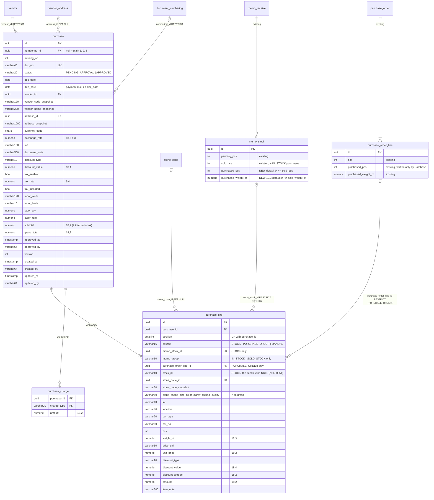

# Database diagram: purchase (SA revision 1, approved 2026-11-04)

Schema `partner`, owned by `backend-api-master` (ADR-0027). Migration `20261104150000_purchase` (additive, one file). Decisions: [SA-PU-01/05/06/10](decisions.md).



The header columns are exactly those of `purchase_order` (subtotal, discount_amount, price_before_tax, tax_amount, charges_amount, labor_amount and grand_total, all numeric(18,2)).

## Constraints

| Table | Constraint |
|---|---|
| purchase | The `purchase_order` CHECK set (migration `20261104090000_purchase_order`), renamed `purchase_*`: `purchase_status_check` (`PENDING_APPROVAL`, `APPROVED`), `purchase_approved_check`, `purchase_due_date_check` (due_date ≥ doc_date), `purchase_running_no_check`, `purchase_discount_check`, `purchase_tax_rate_check`, `purchase_exchange_rate_check`, `purchase_totals_check`, `purchase_version_check` |
| purchase | `purchase_numbering_running_no_key (numbering_id, running_no)`; partial unique `purchase_plain_running_no_key (running_no) WHERE numbering_id IS NULL`; `purchase_doc_no_key` |
| purchase_line | `purchase_line_source_check`: `source IN ('STOCK','PURCHASE_ORDER','MANUAL')` and the shape rule `(source = 'STOCK') = (memo_stock_id IS NOT NULL AND memo_group IS NOT NULL)`, `(source = 'PURCHASE_ORDER') = (purchase_order_line_id IS NOT NULL)`, `(source = 'STOCK') OR memo_group IS NULL` |
| purchase_line | `purchase_line_memo_group_check` (`memo_group IN ('IN_STOCK','SOLD')` or null); `purchase_line_qty_check` (pcs ≥ 0, weight_ct ≥ 0, pcs > 0 OR weight_ct > 0, unit_price > 0); `purchase_line_values_check` as `purchase_order_line_values_check` (position 1..200, price unit, discount enums) |
| purchase_line | `purchase_line_position_key (purchase_id, position)`; `purchase_line_memo_stock_key (purchase_id, memo_stock_id, memo_group)` (NULLs distinct, so it applies to STOCK only); `purchase_line_po_line_key (purchase_id, purchase_order_line_id)` |
| purchase_line | `purchase_line_stock_id_source_check`: `(source = 'STOCK') = (stock_id IS NOT NULL)` (ADR-0051, migration `20261113110000_purchase_line_stock_id_nullable`; `stock_id` nullable). The rev 1 partial unique `purchase_line_issued_stock_id_key` was dropped by that migration; STOCK lines repeat their item's id across purchases |
| memo_stock | **NEW** `memo_stock_purchased_check`: `purchased_pcs >= 0 AND purchased_weight_ct >= 0 AND purchased_pcs <= sold_pcs AND purchased_weight_ct <= sold_weight_ct`. Unchanged: `memo_stock_balance`, `memo_stock_buckets_nonneg`, 0 ≤ pending ≤ received |
| purchase_order_line | unchanged: `purchase_order_line_purchased_check` (0 ≤ purchased ≤ ordered) |

## Indexes

- `purchase_list_idx (doc_date desc, created_at desc, id desc)`, `purchase_status_idx (status, doc_date desc, created_at desc, id desc)`, `purchase_vendor_idx (vendor_id, doc_date desc)`, `purchase_address_idx (address_id)`: the daybook and the filters, as `purchase_order`.
- `purchase_line_memo_stock_idx (memo_stock_id)`, `purchase_line_po_line_idx (purchase_order_line_id)`, `purchase_line_stone_code_idx (stone_code_id)`: FK checks, and a future inventory backfill.
- **NEW** `memo_stock_sold_open_idx (vendor_id, received_doc_date desc, stock_id desc) WHERE sold_pcs > purchased_pcs OR sold_weight_ct > purchased_weight_ct`: the SOLD group. It stays empty until Sale exists. The IN_STOCK group uses the existing `memo_stock_pending_idx`.
- **NEW** `purchase_order_line_open_idx (purchase_order_id) WHERE purchased_pcs < pcs OR purchased_weight_ct < weight_ct`: the PO picker, joined to `purchase_order` through `purchase_order_vendor_idx` with status = APPROVED.

## Prisma

- New models `Purchase`, `PurchaseLine` and `PurchaseCharge` (`@@schema("partner")`). The partial uniques and indexes are written in the migration SQL with `@@index` / `@@unique(... where: raw(...))`, as the memo_stock indexes are.
- Back-relations: `DocumentNumbering.purchases`, `Vendor.purchases`, `VendorAddress.purchases`, `StoneCode.purchaseLines`, `MemoStock.purchaseLines` and `PurchaseOrderLine.purchaseLines`.
- `MemoStock` gains `purchasedPcs Int @default(0) @map("purchased_pcs")` and `purchasedWeightCt Decimal @default(0) @map("purchased_weight_ct") @db.Decimal(12, 3)`.

## Migration, backfill, rollback

1. `ALTER TABLE memo_stock ADD COLUMN purchased_pcs INTEGER NOT NULL DEFAULT 0, ADD COLUMN purchased_weight_ct DECIMAL(12,3) NOT NULL DEFAULT 0`. This is a fast metadata-only default on a small table.
2. Add `memo_stock_purchased_check`. It validates immediately: no writer of `sold_*` exists yet, so every row has sold = 0 and purchased = 0.
3. Create `purchase`, `purchase_line` and `purchase_charge`, with their FKs, CHECKs and indexes. Then create the two new partial indexes. Both are tiny or empty today, so plain `CREATE INDEX` is fine.
4. No data backfill. No auth migration (the catalog leaf `purchase` exists).

Rollback, documented in the migration header:

- **While no purchase exists:** drop the three tables, the two new indexes, the CHECK and the two `memo_stock` columns.
- **While only pending purchases exist:** the same as above, because pending purchases cut nothing (D2).
- **Once approved purchases exist,** first reverse their stock in one transaction, then drop:

```sql
UPDATE memo_stock s SET pending_pcs = s.pending_pcs + h.p, pending_weight_ct = s.pending_weight_ct + h.w,
  sold_pcs = s.sold_pcs - h.p, sold_weight_ct = s.sold_weight_ct - h.w
FROM (SELECT l.memo_stock_id, sum(l.pcs) p, sum(l.weight_ct) w FROM purchase_line l JOIN purchase d ON d.id = l.purchase_id
      WHERE d.status = 'APPROVED' AND l.memo_group = 'IN_STOCK' GROUP BY 1) h
WHERE s.id = h.memo_stock_id;

UPDATE purchase_order_line o SET purchased_pcs = o.purchased_pcs - h.p, purchased_weight_ct = o.purchased_weight_ct - h.w
FROM (SELECT l.purchase_order_line_id, sum(l.pcs) p, sum(l.weight_ct) w FROM purchase_line l JOIN purchase d ON d.id = l.purchase_id
      WHERE d.status = 'APPROVED' AND l.purchase_order_line_id IS NOT NULL GROUP BY 1) h
WHERE o.id = h.purchase_order_line_id;
```

SOLD-group purchases disappear with the dropped `purchased_*` columns, and every purchase is lost with the tables. A rollback with approved data is therefore a business decision.

Data size: thousands of purchases a year, ≤ 200 lines each. The tables stay in the low MB range, and every query is keyset ≤ 50 or a primary-key read.

## SA revision 2 (proposed 2026-11-05): merged lines

Migration `20261106090000_purchase_merged_line` (additive) on `purchase_line`:

- `sold_part_pcs` int NULL, `sold_part_weight_ct` numeric(12,3) NULL: the Sold part taken first, written at Approve for `MERGED` lines (SA-PU-23/25).
- CHECK `purchase_line_memo_group_check`: `memo_group IS NULL OR memo_group IN ('IN_STOCK', 'SOLD', 'MERGED')`.
- CHECK `purchase_line_sold_part_check`: both NULL unless `memo_group = 'MERGED'`; when set, `0 ≤ sold_part_pcs ≤ pcs` and `0 ≤ sold_part_weight_ct ≤ weight_ct`.
- `memo_stock` is unchanged; a MERGED approval writes the same columns as a SOLD line plus an IN_STOCK line.
