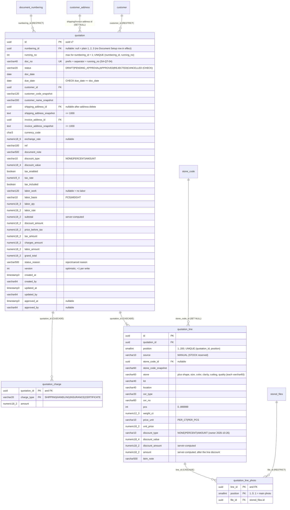

# Database diagram: quotation (SA revision 1, approved 2026-10-26)

Owner: `backend-api-master`, PostgreSQL schema `partner` ([SA-QT-01](decisions.md)). New tables have
the prefix `quotation`; existing tables are referenced only.

## Indexes

- `quotation (running_no) WHERE numbering_id IS NULL` UNIQUE — plain numbers (owner 2026-10-26).
- `quotation (numbering_id, running_no)` UNIQUE — next number = `max(running_no) + 1` read under the
  numbering-row lock (SA-QT-04); also the "used" check for Document Setup (SA-QT-05).
- `quotation (doc_date desc, created_at desc, id desc)` — list/daybook keyset (SA-QT-11).
- `quotation (status, doc_date desc, created_at desc, id desc)` — status filter / excluding cancelled.
- `quotation (customer_id, doc_date desc)` — customer filter and RESTRICT checks.
- `quotation_line (stone_code_id)` — FK checks when a stone code is deleted.
- `quotation_line_photo (file_id)` — FK checks.
- Search on `doc_no`, `customer_name_snapshot`, `ref` uses `ILIKE '%q%'` over the date-ordered keyset
  (bounded to 50 rows per page; add a trigram index only if measured slow).

## Existing tables touched

- `document_numbering`: no column change; locked `FOR UPDATE` while a number is issued. A row is "used"
  when a quotation references it; Document Setup save keeps used rows unchanged (SA-QT-05), and the
  `numbering_id` FK is RESTRICT, so a used row can't be deleted.
- `stored_files`: new rows with `kind = 'image'`, `source_type = 'quotation.line-photo'`,
  `source_id = <the photo id>` (the table allows one ready row per source; the uploader is `created_by`); never deleted (ADR-0030).
- `customer`: delete of a customer that has quotations returns the existing in-use error (RESTRICT).

## Migration, backfill, rollback

- One additive migration `…_quotation`: create the 4 tables, CHECK constraints, indexes. No backfill
  (there is no stored quotation data; the browser mock is not migrated).
- Rollback: drop the 4 tables in reverse FK order; photo bytes stay in storage as permanent files.
- Prisma models use `@@schema("partner")`. Later documents (reserve, memo, …) reuse the same
  "lock numbering row, max + 1" rule with their own `numbering_id` / `running_no` columns.
