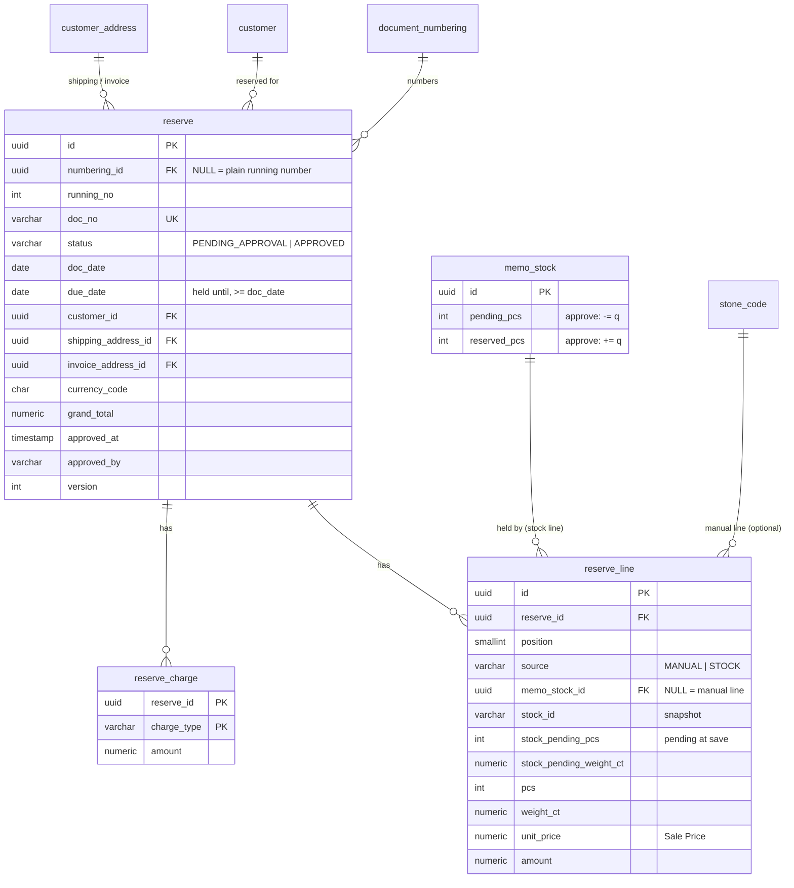

# Database diagram: reserve (SA revision 1, approved 2026-11-02)

Schema `partner`, owned by `backend-api-master`. New tables `reserve`, `reserve_line` and `reserve_charge`. `memo_stock` is unchanged: an approved Reserve fills its existing `reserved_*` bucket ([ADR-0035](../../../../adr/0035-memo-outstanding-vendor-report.md)).

## Migration `20261102090000_reserve` (additive)

- The three tables have the columns of `memo_out` / `memo_out_line` / `memo_out_charge` after `20261031090000_memo_out_from_stock`.
- Keys: unique `doc_no`; unique `(numbering_id, running_no)`; partial unique `running_no WHERE numbering_id IS NULL`.
- Indexes: list `(doc_date DESC, created_at DESC, id DESC)`, `(customer_id, doc_date DESC)`, `(status, doc_date DESC, created_at DESC, id DESC)`, the address ids, and `reserve_line (memo_stock_id)`.
- Line keys: unique `(reserve_id, position)` and `(reserve_id, memo_stock_id)`.
- FKs:
  - numbering, customer, memo_stock: RESTRICT;
  - addresses: SET NULL;
  - stone_code: SET NULL;
  - lines and charges: CASCADE from `reserve`.
- CHECKs:
  - status, approved, due date, running no, discount, tax rate, exchange rate, version;
  - line values (source MANUAL / STOCK) and the stock-line CHECK of SA-MO-12;
  - charge values.

No backfill. Rollback (only while no Reserve is APPROVED): drop the three tables.
