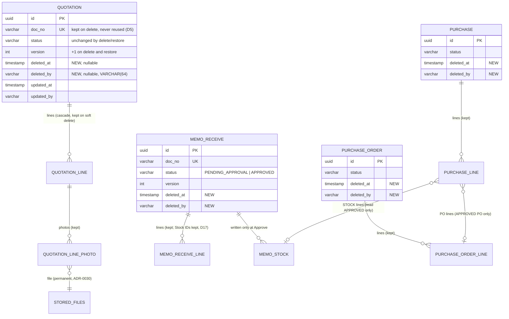

# Database diagram: transaction soft delete (SA revision 1, 2026-11-06, approved 2026-11-06)

Owner: `backend-api-master`, PostgreSQL schema `partner` (existing). Decisions D3, D5, D12, D17, D18 in [decisions.md](decisions.md). These are header tables only; line, charge and photo tables and `stored_files` do not change.



`reserve`, `memo_out`, `memo_out_return` and `memo_return` get the same two columns as `memo_receive`; they are left out of the diagram to keep it readable.

## Changes per table

The same change applies to each of `quotation`, `reserve`, `memo_receive`, `memo_return`, `memo_out`, `memo_out_return`, `purchase_order` and `purchase`.

| Object | Definition |
|---|---|
| Column | `deleted_at TIMESTAMP(3) NULL` (Prisma `deletedAt DateTime? @map("deleted_at") @db.Timestamp(3)`) |
| Column | `deleted_by VARCHAR(64) NULL` (Prisma `deletedBy String? @map("deleted_by") @db.VarChar(64)`) |
| CHECK `<table>_deleted_check` (engine tables) | `(deleted_at IS NULL AND deleted_by IS NULL) OR (deleted_at IS NOT NULL AND deleted_by IS NOT NULL AND status = 'PENDING_APPROVAL')` |
| CHECK `quotation_deleted_check` | `(deleted_at IS NULL AND deleted_by IS NULL) OR (deleted_at IS NOT NULL AND deleted_by IS NOT NULL AND status IN ('DRAFT','PENDING_APPROVAL'))` (D2, owner OQ-1) |
| Partial index `<table>_deleted_list_idx` | `ON "partner"."<table>" (doc_date DESC, created_at DESC, id DESC) WHERE deleted_at IS NOT NULL` (Prisma `@@index([...], where: raw("(deleted_at IS NOT NULL)"), map: …)`, preview `partialIndexes` already enabled) |
| Existing indexes | unchanged: `*_list_idx`, `*_status_idx`, party, address and numbering uniques (D12) |

Constraint and index names stay under 63 bytes; the longest is `memo_out_return_deleted_list_idx`.

## Migration `20261106090000_transaction_soft_delete` (D18)

- Expand only. `ALTER TABLE … ADD COLUMN` ×2, `ADD CONSTRAINT … CHECK` and `CREATE INDEX` per table, in one migration. No backfill: every existing row is `NULL/NULL`, so each CHECK validates at once.
- Locks: `ADD COLUMN` (nullable, no default) is metadata-only. `ADD CONSTRAINT CHECK` scans the table (small today). `CREATE INDEX` is not `CONCURRENTLY`, because Prisma runs a migration in a transaction; the index builds over zero matching rows. Run during the normal deploy window.
- The header comment records the owner request, ADR-0045 and the rollback text below. Existing migrations are not edited.

### Rollback

```sql
-- Optional first (business decision): remove deleted drafts so they don't reappear as live drafts.
-- DELETE FROM "partner"."<table>" WHERE deleted_at IS NOT NULL;   -- lines/charges/photo links cascade; stored_files stay
DROP INDEX "partner"."<table>_deleted_list_idx";
ALTER TABLE "partner"."<table>" DROP CONSTRAINT "<table>_deleted_check",
  DROP COLUMN "deleted_at", DROP COLUMN "deleted_by";
```

Code must be rolled back before the columns are dropped (the new code selects them).

## Data size

Only drafts can be deleted. The expected deleted share is a few percent of each table, and the partial indexes stay a few KB to a few MB. Measurement M-SD-01 ([testing](testing.md)) checks the share and the list p95 after one month of use.
