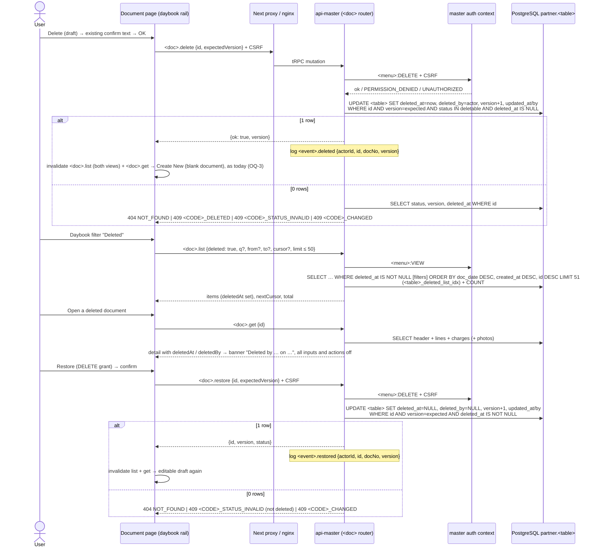

# Sequence diagram: transaction soft delete (SA revision 1, 2026-11-06, approved 2026-11-06)

Main user flow: [diagram/transaction-soft-delete-flow.md](../../../../diagram/transaction-soft-delete-flow.md) (not copied here). Decisions: [D4, D6, D8, D9](decisions.md). Every call goes UI → Next same-origin `/api/master/trpc` → nginx → `api-master`. The master auth context checks the JWT, current authorization and license, then the menu grant (and CSRF on mutations), before any domain code runs. `<doc>` / `<menu>` / `<CODE>` are as in the [api-contract](api-contract.md).

## Delete, Deleted filter, open read-only, Restore



## Writes on a deleted document (stale tab)

```mermaid
sequenceDiagram
  participant FE as Stale tab (document open before delete)
  participant API as api-master
  participant DB as PostgreSQL partner

  FE->>API: <doc>.update / approve / submit / reject / cancel {id, expectedVersion, …}
  API->>DB: BEGIN; SELECT status, version, deleted_at (update) | guarded UPDATE … AND deleted_at IS NULL (approve / transitions)
  alt deleted_at IS NOT NULL
    API->>DB: ROLLBACK (nothing written, no stock moved)
    API-->>FE: 409 <CODE>_DELETED
    FE->>FE: reload → read-only view
  else not deleted
    Note over API,DB: existing flow unchanged
  end
```

## Unchanged readers (D11)

Pickers and reports keep their existing queries. Each one reads `status = 'APPROVED'` documents, or `memo_stock` rows that approval wrote, and `<table>_deleted_check` forbids a deleted APPROVED row. See [architecture.md](architecture.md#readers-of-transaction-documents).
