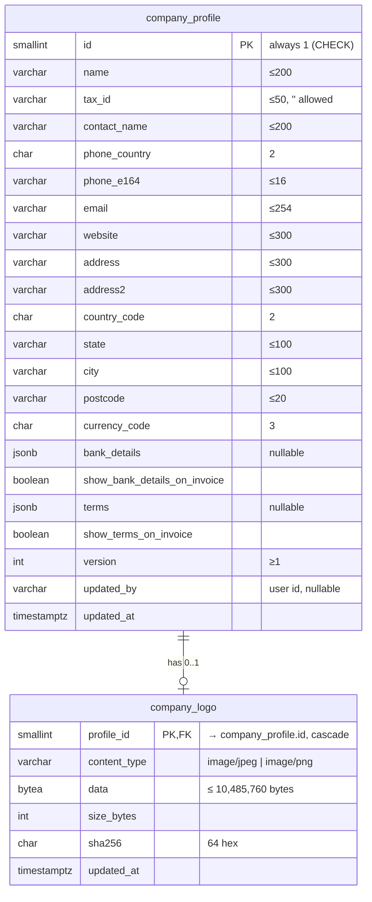

# Database: company-profile (SA 2, approved)

> **Revision 2:** the `company_logo` table below is **superseded**. The logo bytes are a file (`storage/company-profile/logo`); `company_profile` gains nullable metadata columns `logo_content_type varchar(16)`, `logo_size_bytes int`, `logo_sha256 char(64)`, `logo_updated_at timestamptz` (all null = no logo; CHECK: all null or all set, type in jpeg/png, size 1..10,485,760). The rest of this file is unchanged.

Schema `partner` (ADR-0018), new migration `<timestamp>_company_profile`. No change to existing tables.



## Prisma proposal

```prisma
model CompanyProfile {
  id                        Int          @id @default(1) @db.SmallInt
  name                      String       @db.VarChar(200)
  taxId                     String       @default("") @map("tax_id") @db.VarChar(50)
  contactName               String       @map("contact_name") @db.VarChar(200)
  phoneCountry              String       @map("phone_country") @db.Char(2)
  phoneE164                 String       @map("phone_e164") @db.VarChar(16)
  email                     String       @db.VarChar(254)
  website                   String       @default("") @db.VarChar(300)
  address                   String       @db.VarChar(300)
  address2                  String       @default("") @db.VarChar(300)
  countryCode               String       @map("country_code") @db.Char(2)
  state                     String       @db.VarChar(100)
  city                      String       @db.VarChar(100)
  postcode                  String       @db.VarChar(20)
  currencyCode              String       @map("currency_code") @db.Char(3)
  bankDetails               Json?        @map("bank_details")
  showBankDetailsOnInvoice  Boolean      @default(false) @map("show_bank_details_on_invoice")
  terms                     Json?
  showTermsOnInvoice        Boolean      @default(false) @map("show_terms_on_invoice")
  version                   Int          @default(1)
  updatedBy                 String?      @map("updated_by") @db.VarChar(64)
  updatedAt                 DateTime     @updatedAt @map("updated_at") @db.Timestamptz(3)
  logo                      CompanyLogo?

  @@map("company_profile")
  @@schema("partner")
}

model CompanyLogo {
  profileId   Int            @id @map("profile_id") @db.SmallInt
  contentType String         @map("content_type") @db.VarChar(16)
  data        Bytes
  sizeBytes   Int            @map("size_bytes")
  sha256      String         @db.Char(64)
  updatedAt   DateTime       @updatedAt @map("updated_at") @db.Timestamptz(3)
  profile     CompanyProfile @relation(fields: [profileId], references: [id], onDelete: Cascade)

  @@map("company_logo")
  @@schema("partner")
}
```

### Raw SQL CHECKs appended to the migration

```sql
ALTER TABLE partner.company_profile ADD CONSTRAINT company_profile_singleton CHECK (id = 1);
ALTER TABLE partner.company_profile ADD CONSTRAINT company_profile_version_positive CHECK (version >= 1);
ALTER TABLE partner.company_logo ADD CONSTRAINT company_logo_type CHECK (content_type IN ('image/jpeg', 'image/png'));
ALTER TABLE partner.company_logo ADD CONSTRAINT company_logo_size CHECK (size_bytes BETWEEN 1 AND 10485760 AND size_bytes = octet_length(data));
```

## Bounds, migration, rollback

- At most one profile row and one logo row (≤ 10 MB). Reads of the profile never select `data`.
- Version increments in the same transaction as the update (`UPDATE … WHERE id = 1 AND version = $expected`; 0 rows → `CONFLICT`). First save: `INSERT` with conflict on the primary key → `CONFLICT`.
- Forward-only additive migration; rollback = drop both tables (no other table references them). No backfill.
