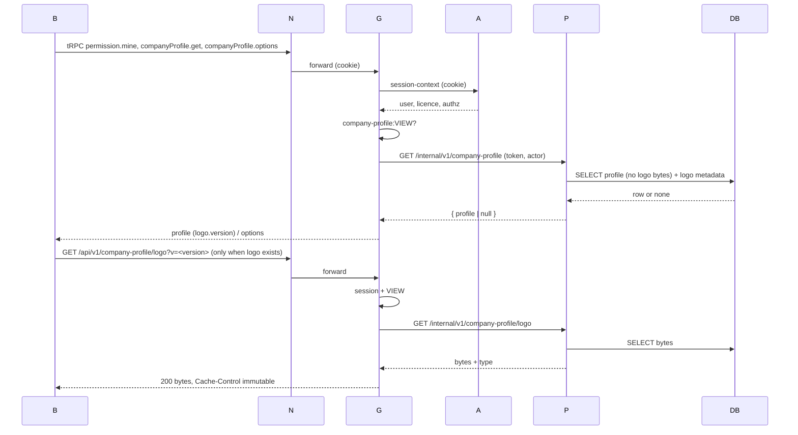

# Sequences: company-profile (SA 1, pending-review)

User flow: [company-profile-flow.md](../../../../diagram/company-profile-flow.md). B = browser, N = Next proxy, G = gateway, A = auth (session context), P = partner, DB = PostgreSQL.

## 1. Page load



## 2. Save with a new logo

```mermaid
sequenceDiagram
  participant B
  participant G
  participant P
  participant DB
  B->>G: companyProfile.save(fields, expectedVersion)
  G->>G: EDIT? + Zod (strict, rich-text schema)
  G->>P: PUT /internal/v1/company-profile
  P->>P: validate again (country/currency membership, rich-text limits)
  P->>DB: INSERT (expected null) or UPDATE … WHERE version = expected
  alt 0 rows / duplicate key
    P-->>G: 409 CONFLICT
    G-->>B: CONFLICT → reload dialog
  else ok
    P-->>G: { profile, version = v+1 }
    G-->>B: profile
    B->>G: PUT /api/v1/company-profile/logo?expectedVersion=v+1 (raw image)
    G->>G: session, EDIT, Origin, Content-Type, stream ≤ 10 MB
    G->>P: PUT /internal/v1/company-profile/logo (raw)
    P->>P: signature matches type, sha256
    P->>DB: UPSERT company_logo; version + 1 (same transaction, WHERE version = expected)
    P-->>G: { profile }
    G-->>B: profile → View mode, toast saved
  end
```

If the logo step fails (413, 415, timeout, conflict), the fields are already saved: the page shows "Details saved, but the logo couldn't be updated", keeps the picked image and stays in Edit so the user can retry Save (fields unchanged → only the logo step runs).

## 3. Remove the logo

`companyProfile.removeLogo({expectedVersion})` → partner `DELETE … /logo` → delete row and version + 1 in one transaction → profile.

## 4. Partner unavailable or token mismatch

Gateway maps timeouts, connection errors and partner 401 to `PARTNER_UNAVAILABLE` (existing `callPartner`), and the page shows its load error with Retry, or a save toast with the data kept.
